# Informe técnico — Backend Django (MovilCare)

Este documento recoge el desarrollo por unidades del backend del proyecto MovilCare, desde la creación del entorno virtual hasta la exposición del catálogo mediante la API REST. Cada unidad describe el objetivo, las acciones realizadas, el código resultante y las evidencias asociadas.

---

# Unidad ISS-00 — Creación del entorno virtual

En esta primera unidad se prepara el terreno de trabajo: se crea el entorno virtual aislado donde se instalarán las dependencias del proyecto, se instala el framework Django, se genera la plantilla inicial del proyecto y se protege el repositorio para que no se suban ficheros sensibles o generados.

## 1. Entorno

El primer paso es aislar las dependencias del proyecto del Python del sistema. Para ello se usa un entorno virtual (`.venv`), que es un directorio autónomo con su propio intérprete y su propio conjunto de paquetes. De esta forma, el proyecto no depende de qué versiones estén instaladas globalmente y se puede reproducir en otra máquina instalando exactamente los mismos paquetes.

### Scripts de creación

```bash
python3 -m venv .venv
```

### Scripts de activación

```bash
source .venv/bin/activate
```

### Evidencia

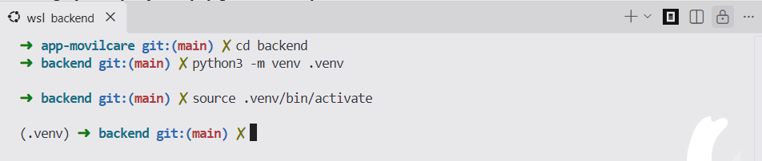

## 2. Instalación del framework

El framework seleccionado para la construcción del backend es Django, un framework de Python que trae consigo un ORM, un sistema de plantillas, un panel de administración y un servidor de desarrollo. Para gestionar los paquetes de Python se utiliza `pip`, que es el gestor de paquetes que acompaña a la lengua.

### Scripts

```bash
python -m pip install "Django==5.2.17"
python -m pip freeze > requirements.txt
```

El comando `freeze` vuelca la lista exacta de paquetes instalados con sus versiones en `requirements.txt`, de modo que en cualquier otra máquina se puedan reproducir con `pip install -r requirements.txt`.

### Evidencias

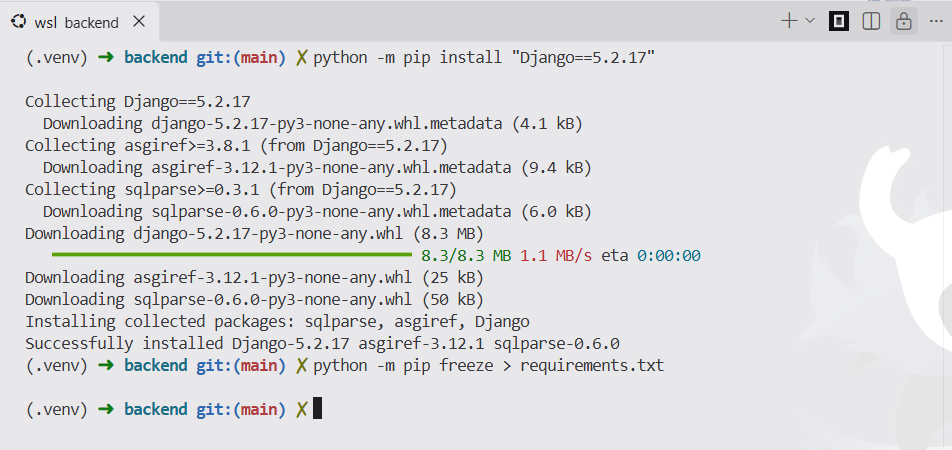
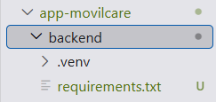

## 3. Creación del proyecto

Con el framework instalado, Django permite generar una plantilla inicial de proyecto mediante `django-admin`. Esta plantilla deja una estructura de archivos concreta —un paquete de configuración, el fichero `manage.py` y varios ficheros de arranque— sobre la cual se construye el resto del trabajo.

### Script

```bash
(.venv) django-admin startproject config .
```

El punto final indica que el proyecto se genera en el directorio actual, y `config` es el nombre del paquete de configuración que contendrá `settings`, `urls`, `wsgi` y `asgi`.

### Evidencias

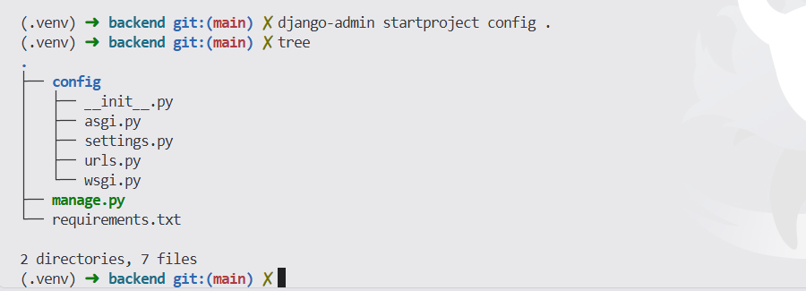
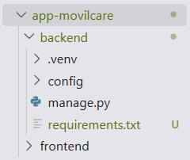

## 4. Protección del repositorio

Al trabajar con repositorios de GitHub hay ficheros que no deben subirse. De un lado, los que contienen información sensible como `.env`, que guarda credenciales y claves; de otro, los que son redundantes o reproducibles, como el propio `.venv` o `db.sqlite3`. Para evitar filtraciones y ruido en el historial se crea un `.gitignore` en la raíz del proyecto que indica qué ficheros y patrones quedan excluidos del control de versiones.

### Contenido del `.gitignore`

```gitignore
.venv/
__pycache__/
*.py[cod]
.env
db.sqlite3
*.log
.idea/
.vscode/
staticfiles/
media/
.pytest_cache/
htmlcov/
.coverage
```

### Evidencia

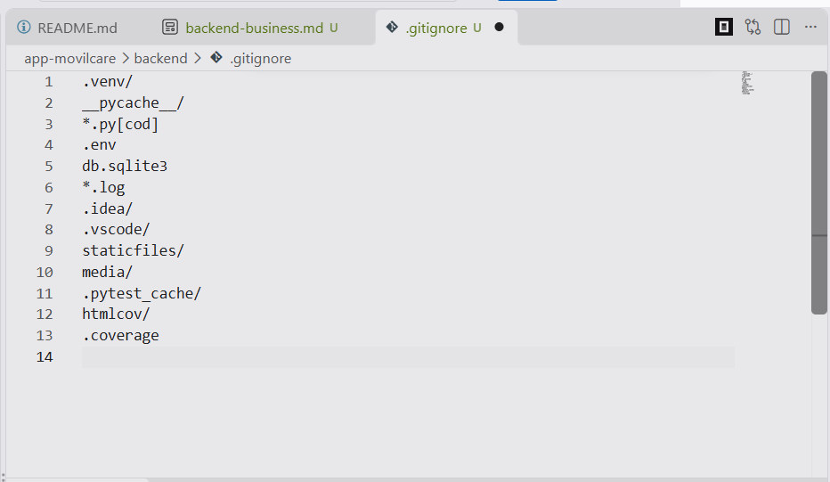

## 5. Verificación

Por último se comprueba que todo queda coherentemente instalado: se verifica la versión de Django activa, se ejecuta el chequeo de integridad del proyecto y se revisa el árbol de archivos resultante.

### Scripts

```bash
python -m django --version
```

```bash
python manage.py check
```

```bash
tree
```

### Evidencia

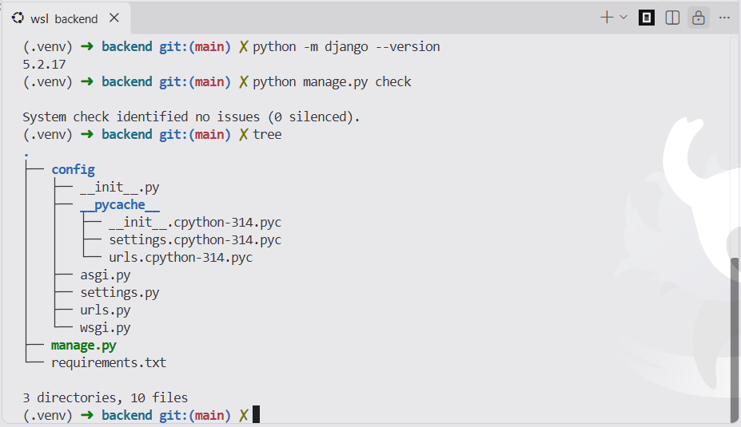

---

# Unidad ISS-01 — Settings y selección de motor

En esta unidad se configura el corazón del proyecto: la selección dinámica del motor de base de datos y el paquete de configuración de Django. Se instalan los controladores de los cuatro motores soportados, se reorganiza la configuración en un paquete y se definen las variables de entorno que permiten cambiar de motor sin tocar código.

## Instalación de paquetes

Cada motor de base de datos necesita su propio controlador, y Django no los incluye de serie. En esta unidad se instalan las librerías que permiten conectar Django con PostgreSQL, MySQL, SQL Server y Oracle, además de `python-dotenv`, que se encarga de leer el fichero `.env`. Una vez instaladas, se vuelcan en el `requirements.txt`.

### Scripts

```bash
source .venv/bin/activate
which python
python -m pip install "python-dotenv==1.2.3"
python -m pip install "psycopg[binary]==3.3.6"
python -m pip install "mysqlclient==2.3.0"
python -m pip install "mssql-django==2.0.0"
python -m pip install "oracledb==26.0.1"
python -m pip freeze > requirements.txt
```

El comando `which python` se ejecuta antes de instalar para confirmar de forma explícita que los paquetes entran en el intérprete del entorno virtual y no en el del sistema.

### Evidencias

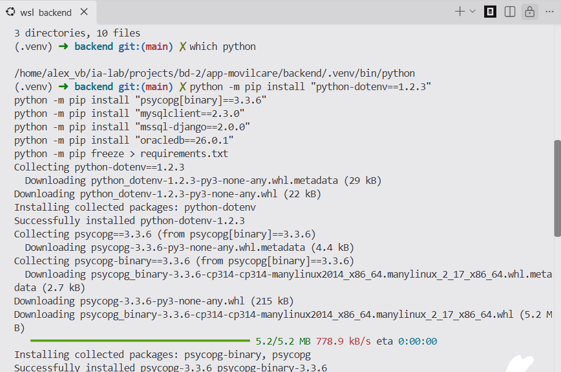
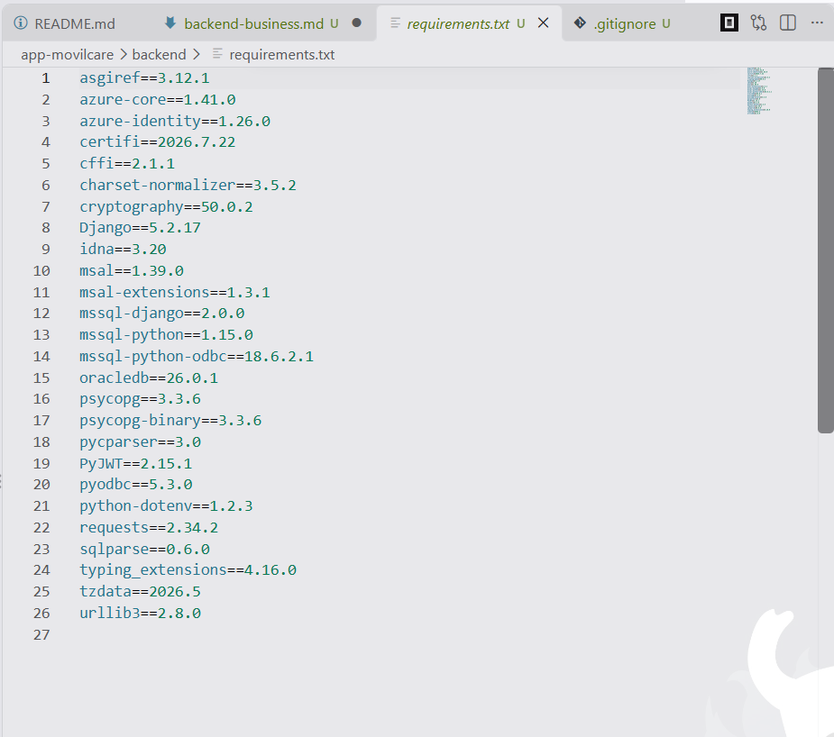

## Transformación de la estructura de archivos

Por defecto Django genera un único fichero `settings.py`. Para un proyecto que debe soportar varios motores de base datos y una configuración sensible externa, ese fichero único resulta poco manejable. Por ello se elimina `settings.py` y se crea un paquete `settings/` con su `__init__.py`, de modo que la configuración se puede organizar en secciones.

Adicionalmente se crean tres ficheros de apoyo: `.env.example`, que documenta la plantilla de variables de entorno sin valores reales; `.env`, que guarda los valores reales y queda fuera del repositorio; `database.py`, que implementa la lógica de selección del motor; y `project_python.py`, que garantiza la ejecución dentro del entorno virtual.

### Evidencia

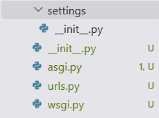

## Definición de las variables de entorno

La configuración sensible —credenciales, claves, orígenes de CORS— no debe ir incrustada en el código. Para ello se separan en dos ficheros: `.env.example` contiene los nombres de las variables como plantilla documental y sí se versiona, mientras que `.env` contiene los valores reales y queda excluido del repositorio mediante el `.gitignore` configurado en la unidad anterior.

### Contenido del `.env.example`

```env
# Laboratorio académico. En producción liste orígenes explícitos.
CORS_ALLOW_ALL_ORIGINS=True
```

### Evidencia

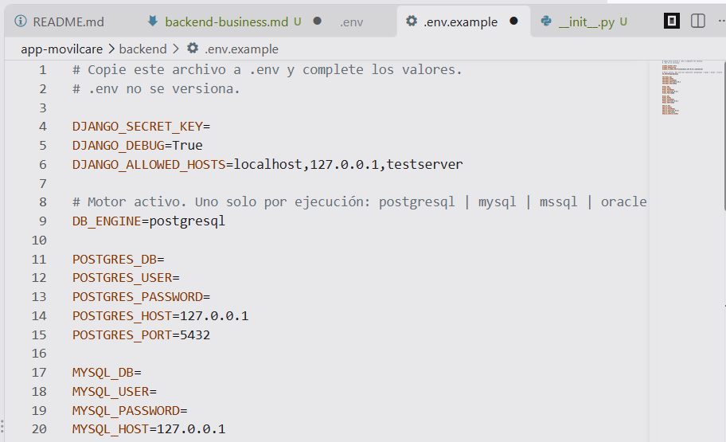

## Módulo de selección de base de datos

El módulo `config/database.py` es el que traduce las variables de entorno en la configuración que Django espera en `DATABASES`. Recibe el diccionario de entorno, valida que el motor solicitado esté entre los soportados y delega en el constructor específico de cada motor. Si el motor no es válido, o si falta alguna variable requerida, lanza `ImproperlyConfigured` con un mensaje que indica exactamente qué corregir.

Este diseño permite que un único alias, `default`, quede activo en cada ejecución, y que cambiar de motor se reduzca a modificar una línea del `.env` sin tocar el código.

### Código

```python
"""Selección del motor de base de datos a partir del entorno.

Un solo alias, default, queda activo en cada ejecución.
"""

from django.core.exceptions import ImproperlyConfigured

ALLOWED_ENGINES = ("postgresql", "mysql", "mssql", "oracle")


def database_from_environ(env):
    engine = str(env.get("DB_ENGINE", "postgresql")).strip().lower()
    if engine not in ALLOWED_ENGINES:
        allowed = ", ".join(ALLOWED_ENGINES)
        raise ImproperlyConfigured(
            f"DB_ENGINE='{engine}' no es válido. Valores permitidos: {allowed}."
        )
    builders = {
        "postgresql": _postgresql,
        "mysql": _mysql,
        "mssql": _mssql,
        "oracle": _oracle,
    }
    return {"default": builders[engine](env)}


def _required(env, key):
    value = env.get(key)
    if value is None or str(value).strip() == "":
        raise ImproperlyConfigured(
            f"Falta la variable de entorno {key} para DB_ENGINE={env.get('DB_ENGINE')}."
        )
    return str(value).strip()


def _postgresql(env):
    return {
        "ENGINE": "django.db.backends.postgresql",
        "NAME": _required(env, "POSTGRES_DB"),
        "USER": _required(env, "POSTGRES_USER"),
        "PASSWORD": _required(env, "POSTGRES_PASSWORD"),
        "HOST": _required(env, "POSTGRES_HOST"),
        "PORT": _required(env, "POSTGRES_PORT"),
    }


def _mysql(env):
    return {
        "ENGINE": "django.db.backends.mysql",
        "NAME": _required(env, "MYSQL_DB"),
        "USER": _required(env, "MYSQL_USER"),
        "PASSWORD": _required(env, "MYSQL_PASSWORD"),
        "HOST": _required(env, "MYSQL_HOST"),
        "PORT": _required(env, "MYSQL_PORT"),
        "OPTIONS": {"charset": "utf8mb4"},
    }


def _mssql(env):
    return {
        "ENGINE": "mssql",
        "NAME": _required(env, "MSSQL_DB"),
        "USER": _required(env, "MSSQL_USER"),
        "PASSWORD": _required(env, "MSSQL_PASSWORD"),
        "HOST": _required(env, "MSSQL_HOST"),
        "PORT": _required(env, "MSSQL_PORT"),
        "OPTIONS": {
            "driver": "ODBC Driver 18 for SQL Server",
            "extra_params": "TrustServerCertificate=yes",
        },
    }


def _oracle(env):
    host = _required(env, "ORACLE_HOST")
    port = _required(env, "ORACLE_PORT")
    service = _required(env, "ORACLE_SERVICE_NAME")
    dsn = (
        f"(DESCRIPTION=(ADDRESS=(PROTOCOL=TCP)(HOST={host})(PORT={port}))"
        f"(CONNECT_DATA=(SERVICE_NAME={service})))"
    )
    return {
        "ENGINE": "django.db.backends.oracle",
        "NAME": dsn,
        "USER": _required(env, "ORACLE_USER"),
        "PASSWORD": _required(env, "ORACLE_PASSWORD"),
        "HOST": host,
        "PORT": "",
    }
```

### Evidencias

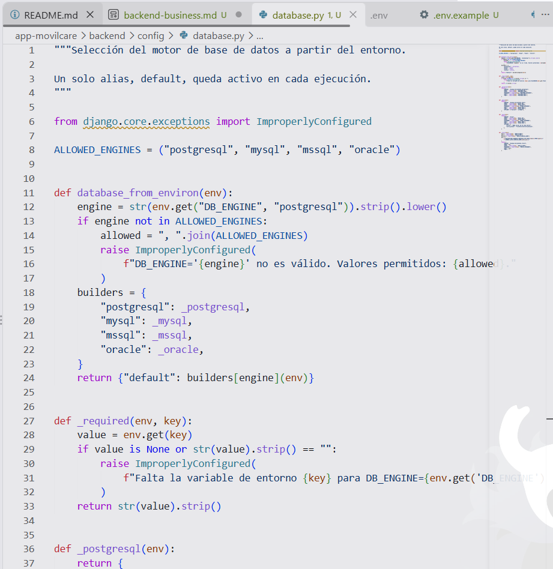

## Paquete de configuración

El fichero `config/settings/__init__.py` reúne la configuración del proyecto. Su particularidad es que carga las variables de entorno con `python-dotenv` antes de leer `SECRET_KEY` y antes de construir `DATABASES`, de modo que ambas dependen de valores externos al código. Si `SECRET_KEY` no está definida, el proyecto no arranca: se levanta `ImproperlyConfigured` en lugar de continuar con una clave insegura.

### Contenido del fichero

```python
import os
from pathlib import Path

# python-dotenv, instalado en este ISS. Lee .env antes de SECRET_KEY y DATABASES.
from dotenv import load_dotenv

from config.database import database_from_environ

BASE_DIR = Path(__file__).resolve().parent.parent.parent
load_dotenv(BASE_DIR / ".env")

SECRET_KEY = os.environ.get("DJANGO_SECRET_KEY", "").strip()
if not SECRET_KEY:
    from django.core.exceptions import ImproperlyConfigured

    raise ImproperlyConfigured("Defina DJANGO_SECRET_KEY en el archivo .env.")

DEBUG = os.environ.get("DJANGO_DEBUG", "False").strip().lower() in {"1", "true", "yes", "on"}

ALLOWED_HOSTS = [
    host.strip()
    for host in os.environ.get("DJANGO_ALLOWED_HOSTS", "localhost,127.0.0.1").split(",")
    if host.strip()
]

INSTALLED_APPS = [
    "django.contrib.admin",
    "django.contrib.auth",
    "django.contrib.contenttypes",
    "django.contrib.sessions",
    "django.contrib.messages",
    "django.contrib.staticfiles",
]

MIDDLEWARE = [
    "django.middleware.security.SecurityMiddleware",
    "django.contrib.sessions.middleware.SessionMiddleware",
    "django.middleware.common.CommonMiddleware",
    "django.middleware.csrf.CsrfViewMiddleware",
    "django.contrib.auth.middleware.AuthenticationMiddleware",
    "django.contrib.messages.middleware.MessageMiddleware",
    "django.middleware.clickjacking.XFrameOptionsMiddleware",
]

ROOT_URLCONF = "config.urls"

TEMPLATES = [
    {
        "BACKEND": "django.template.backends.django.DjangoTemplates",
        "DIRS": [],
        "APP_DIRS": True,
        "OPTIONS": {
            "context_processors": [
                "django.template.context_processors.request",
                "django.contrib.auth.context_processors.auth",
                "django.contrib.messages.context_processors.messages",
            ],
        },
    },
]

WSGI_APPLICATION = "config.wsgi.application"
ASGI_APPLICATION = "config.asgi.application"

DATABASES = database_from_environ(os.environ)

AUTH_PASSWORD_VALIDATORS = [
    {"NAME": "django.contrib.auth.password_validation.UserAttributeSimilarityValidator"},
    {"NAME": "django.contrib.auth.password_validation.MinimumLengthValidator"},
    {"NAME": "django.contrib.auth.password_validation.CommonPasswordValidator"},
    {"NAME": "django.contrib.auth.password_validation.NumericPasswordValidator"},
]

LANGUAGE_CODE = "es"
TIME_ZONE = "America/Bogota"
USE_I18N = True
USE_TZ = True

STATIC_URL = "static/"
DEFAULT_AUTO_FIELD = "django.db.models.BigAutoField"
```

### Evidencia

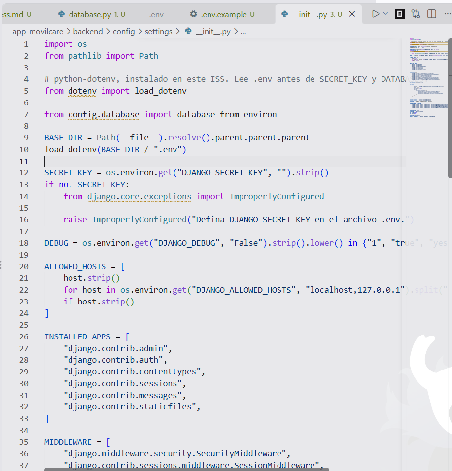

## Reejecución del intérprete

Un problema frecuente en desarrollo es ejecutar `manage.py` con el Python del sistema en lugar del del entorno virtual. Como los paquetes se instalan dentro de `.venv`, el intérprete del sistema no los ve y la ejecución falla con un `ModuleNotFoundError` que puede resultar confuso. Para prevenirlo, el fichero `config/project_python.py` detecta si el proceso corre con el intérprete correcto y, si no es así, vuelve a lanzar el mismo comando apuntando a `.venv/bin/python`.

### Contenido del fichero

```python
"""Intérprete del proyecto.

Los paquetes se instalan dentro de .venv. El comando python3 manage.py
usa el Python del sistema y no ve esos paquetes.
use_project_python() vuelve a lanzar el mismo comando con .venv/bin/python.
"""
import os
import sys
from pathlib import Path

PROJECT_ROOT = Path(__file__).resolve().parent.parent


def use_project_python():
    """Reejecuta el proceso con el Python de .venv si aún no es ese intérprete."""
    venv_root = PROJECT_ROOT / ".venv"
    venv_python = venv_root / "bin" / "python"
    if not venv_python.is_file():
        return
    try:
        if Path(sys.prefix).resolve() == venv_root.resolve():
            return
    except OSError:
        return
    os.execv(venv_python, [str(venv_python), *sys.argv])
```

### Evidencia

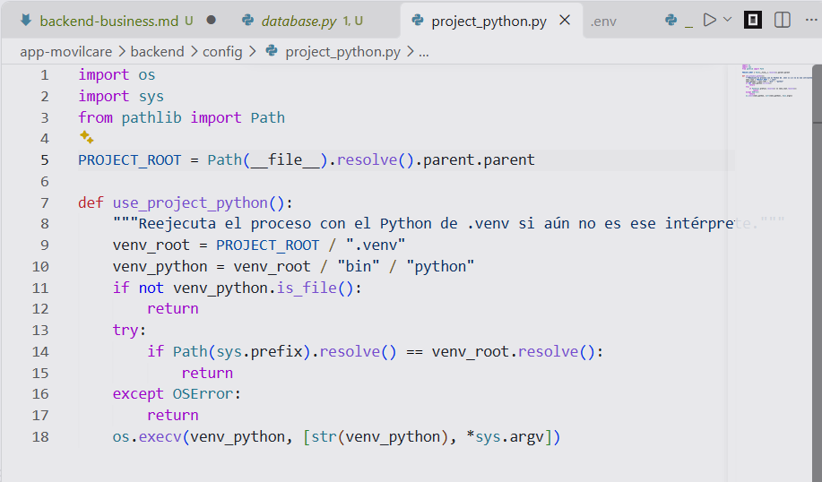

## Parches en los puntos de entrada del sistema

Una vez creado `project_python.py` se invoca desde los puntos de entrada del proyecto —`manage.py` y los ficheros de arranque `wsgi.py` y `asgi.py`— para que todos ellos pasen por la misma salvaguarda.

### Evidencias

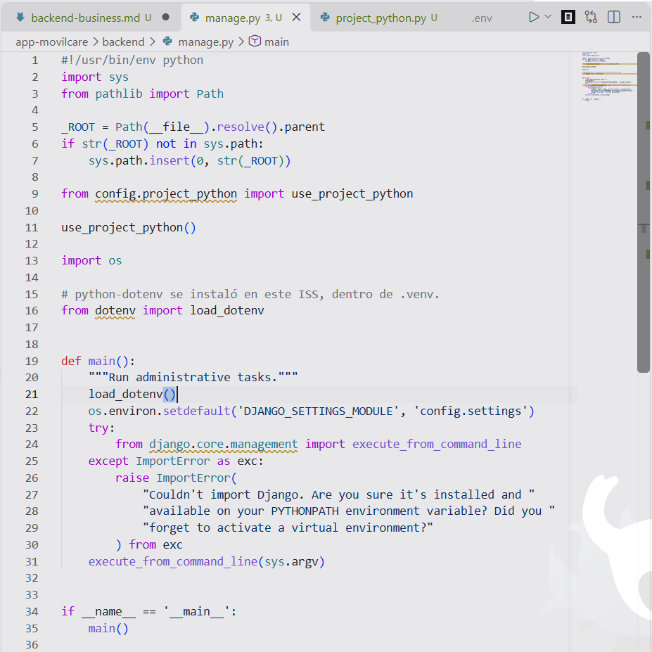
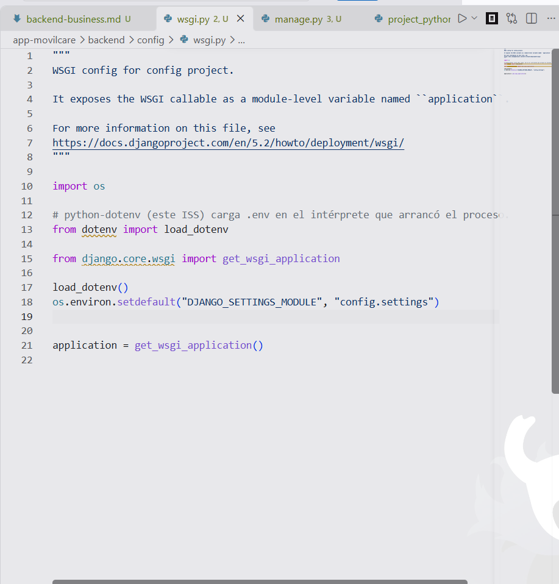
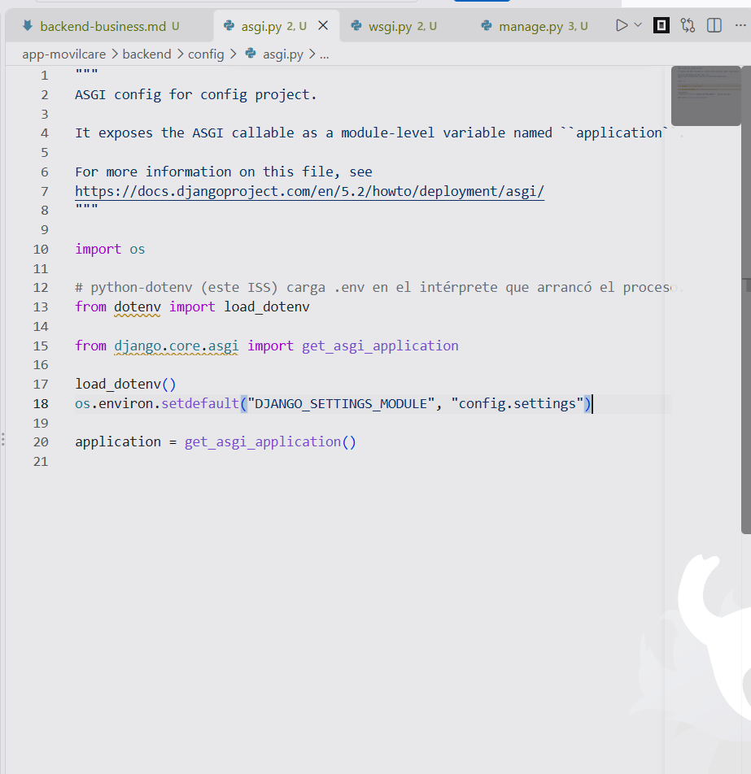
---
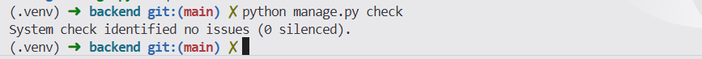

---

# Unidad ISS-02 — Apps customer, product y sale

En esta unidad se crean los paquetes de negocio del proyecto. Django distingue entre el proyecto —la configuración y el arranque— y las aplicaciones, que son los módulos que encapsulan un dominio concreto con sus modelos, vistas y pruebas. Aquí se crean las tres aplicaciones de negocio dentro de la carpeta `apps`, se corrige su nombre para alinearlos con la base de datos de MovilCare y se dan de alta en la configuración.

## Construcción de las apps

Se crea la carpeta `apps` y dentro de ella las aplicaciones `customer`, `product` y `sale` mediante `startapp`, que genera en cada una la estructura estándar: `models.py`, `views.py`, `admin.py`, `tests.py` y `apps.py`.

### Scripts

```bash
mkdir -p apps/client apps/product apps/sale
python manage.py startapp client apps/client
python manage.py startapp product apps/product
python manage.py startapp sale apps/sale
```

### Evidencias

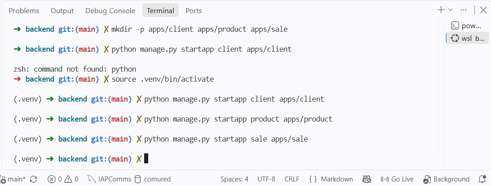
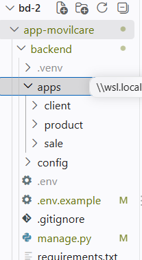

## Creación de `apps/__init__.py`

Para que Python trate `apps` como un paquete —y no como una simple carpeta de directorio— es necesario incluir su fichero `__init__.py`, aunque esté vacío.

### Script

```bash
mkdir -p apps
cat > apps/__init__.py <<'EOF'
EOF
```

### Evidencias

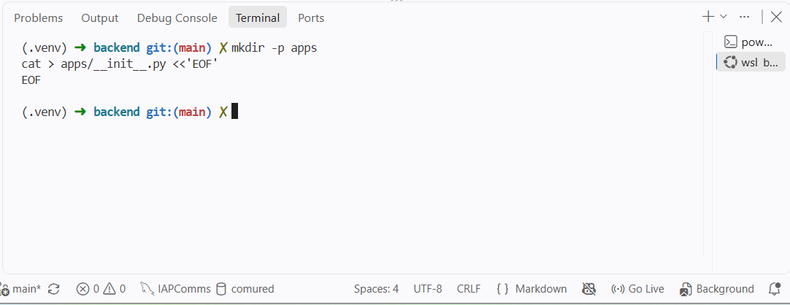
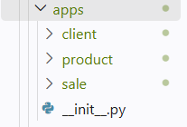

## Corrección del nombre de la aplicación de clientes

> **Corrección:** en la base de datos de MovilCare a los clientes se les referencia como `customers` y no `clients`, por lo que se creó una aplicación `customer` y se eliminó `client`.

Esta discrepancia de nombres se detectó al contrastar el esquema propuesto con el modelo real de datos de MovilCare. Alinear el nombre de la aplicación desde el principio evita confusiones posteriores entre el nombre técnico del módulo y el nombre de la tabla en base de datos.

### Evidencias

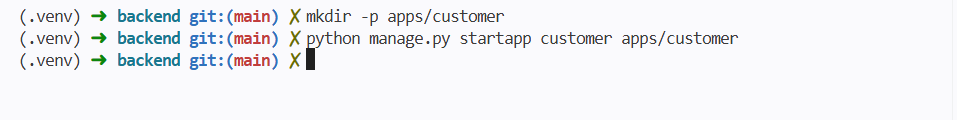
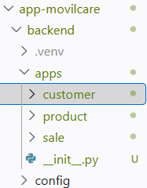

## Parche del atributo `name` en las apps

`startapp` deja en el `apps.py` de cada aplicación un atributo `name` que apunta solo al nombre corto. Como las aplicaciones viven anidadas dentro de la carpeta `apps`, hay que ampliarlo a la ruta completa y declarar además un `label`, que es el identificador corto que Django usará internamente.

### Parche en `customer`

```text
ARCHIVO: apps/customer/apps.py

UBICAR:
    name = "customer"

REEMPLAZAR POR:
    name = "apps.customer"
    label = "customer"
```

### Evidencia

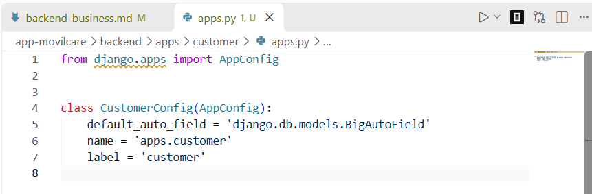

### Parche en `product`

```text
ARCHIVO: apps/product/apps.py

UBICAR:
    name = "product"

REEMPLAZAR POR:
    name = "apps.product"
    label = "product"
```

### Evidencia

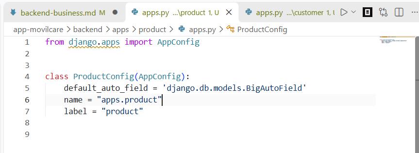

### Parche en `sale`

```text
ARCHIVO: apps/sale/apps.py

UBICAR:
    name = "sale"

REEMPLAZAR POR:
    name = "apps.sale"
    label = "sale"
```

### Evidencia

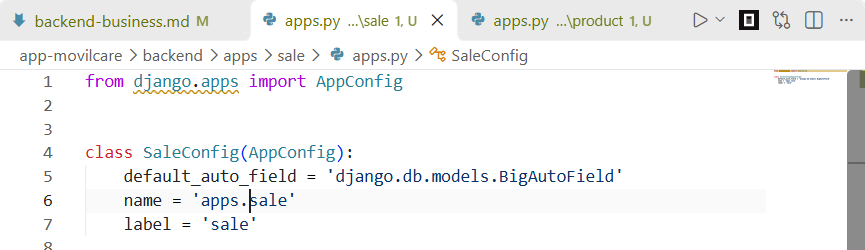

## Agregación de las apps a `settings/__init__.py`

Declarar las aplicaciones en `INSTALLED_APPS` es lo que activa sus modelos, sus migraciones y su registro en el panel de administración. Las rutas se escriben con la forma completa `apps.<nombre>.<ClaseConfig>` para que Django localice tanto el módulo como la clase de configuración.

### Instrucción

```text
ARCHIVO: config/settings/__init__.py

DEBAJO DE:
    "django.contrib.staticfiles",

AGREGAR:
    "apps.customer.apps.CustomerConfig",
    "apps.product.apps.ProductConfig",
    "apps.sale.apps.SaleConfig",
```

### Evidencia

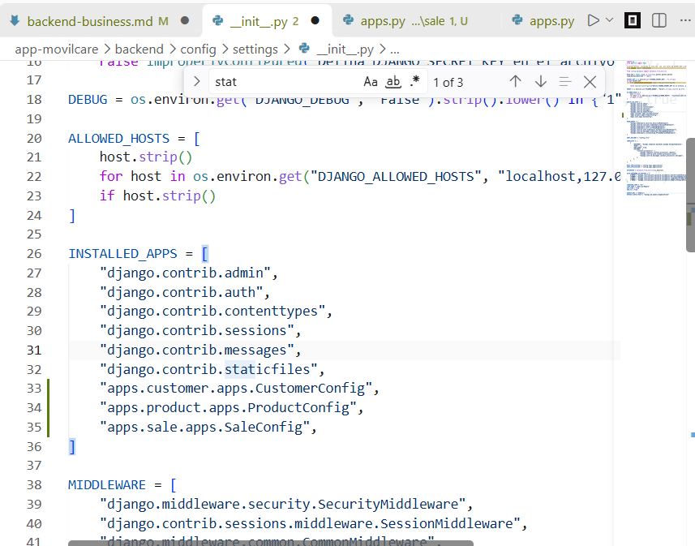

## Prueba de aceptación

Se ejecuta el chequeo de integridad de Django para confirmar que la configuración, las rutas y las referencias entre aplicaciones son coherentes antes de avanzar.

### Script

```bash
python manage.py check
```

### Evidencia

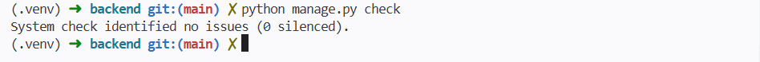

---

# Unidad ISS-03 — Custom User antes de la primera migración

Esta unidad aborda uno de los momentos más delicados del proyecto: definir el modelo de usuario antes de ejecutar la primera migración. Una vez que existen migraciones aplicadas, cambiar la clave primaria del modelo de usuario exige migraciones complejas y con riesgo de pérdida de datos. Por eso se decide modelar el usuario personalizado —con estado y correo electrónico únicos— desde el principio y fijarlo con `AUTH_USER_MODEL`.

## Creación de las carpetas `common` y `security`

Se crean dos nuevas carpetas. `apps/common` alojará elementos compartidos por todas las aplicaciones, como la enumeración de estados de registro. `apps/security` alojará el modelo de usuario personalizado del proyecto.

### Evidencias

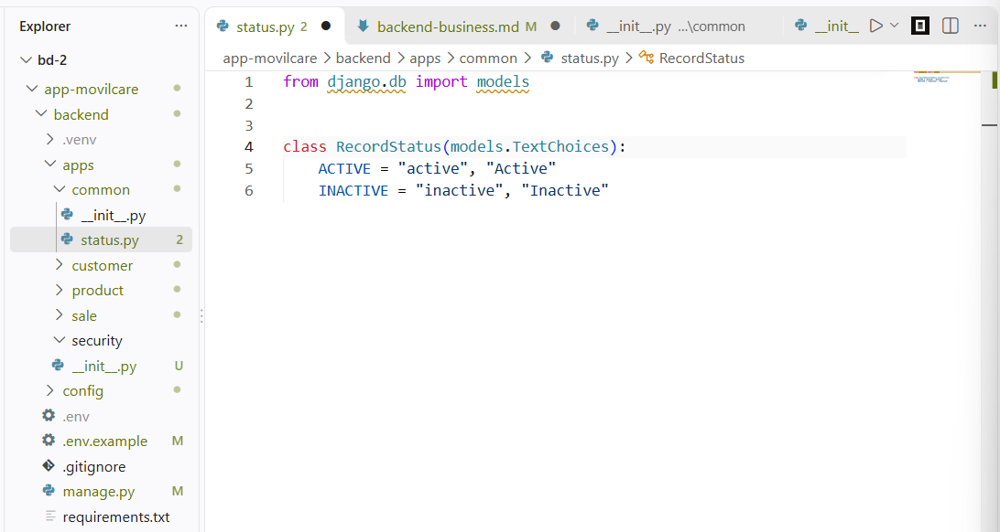
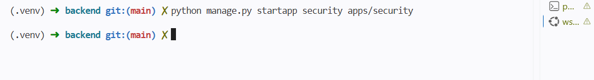

### Parche en el `name` de `security`

Al igual que en las aplicaciones anteriores, hay que ajustar el atributo `name` del `AppConfig` para que apunte a la ruta completa dentro del paquete `apps`.

### Evidencia

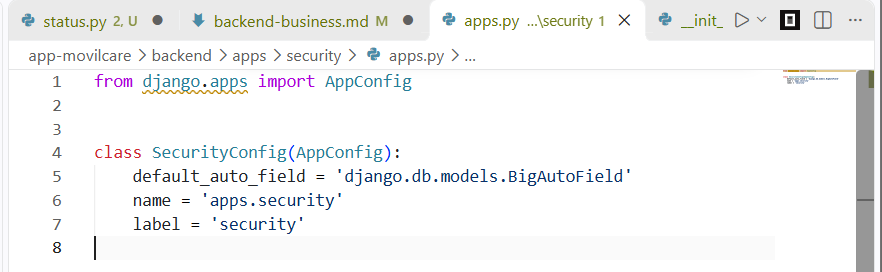

### Contenido de `security/models.py`

El modelo extiende `AbstractUser` para heredar todo el comportamiento de autenticación de Django y le añade tres cosas: un campo `email` con unicidad, un campo `status` que indica si el registro está activo, y marcas de auditoría `created_at` y `updated_at`.

El manager personalizado `StoreUserManager` fija el estado por defecto según el tipo de usuario que se crea: los usuarios normales nacen inactivos y requieren una habilitación previa, mientras que los superusuarios nacen activos para que el acceso al panel de administración funcione de inmediato.

```python
from django.contrib.auth.models import AbstractUser, UserManager
from django.db import models

from apps.common.status import RecordStatus


class StoreUserManager(UserManager):
    def create_user(self, username, email=None, password=None, **extra_fields):
        extra_fields.setdefault("status", RecordStatus.INACTIVE)
        return super().create_user(username, email, password, **extra_fields)

    def create_superuser(self, username, email=None, password=None, **extra_fields):
        extra_fields.setdefault("status", RecordStatus.ACTIVE)
        extra_fields.setdefault("is_staff", True)
        extra_fields.setdefault("is_superuser", True)
        return super().create_superuser(username, email, password, **extra_fields)


class User(AbstractUser):
    email = models.EmailField("correo electrónico", max_length=150, unique=True)
    status = models.CharField(
        max_length=8,
        choices=RecordStatus.choices,
        default=RecordStatus.INACTIVE,
    )
    created_at = models.DateTimeField(auto_now_add=True)
    updated_at = models.DateTimeField(auto_now=True)

    objects = StoreUserManager()

    class Meta:
        db_table = "users"
        verbose_name = "usuario"
        verbose_name_plural = "usuarios"
        constraints = [
            models.CheckConstraint(
                condition=models.Q(status__in=RecordStatus.values),
                name="users_status_valid",
            )
        ]

    def save(self, *args, **kwargs):
        if self.email:
            self.email = self.email.strip().lower()
        self.is_active = self.status == RecordStatus.ACTIVE
        super().save(*args, **kwargs)
```

La particularidad de este modelo es el sobrescrito de `save`: deriva `is_active` a partir de `status` en cada escritura. De esta forma se garantiza que ambos campos nunca queden en contradicción, sin depender de que cada punto del código recuerde mantenerlos sincronizados.

### Evidencia

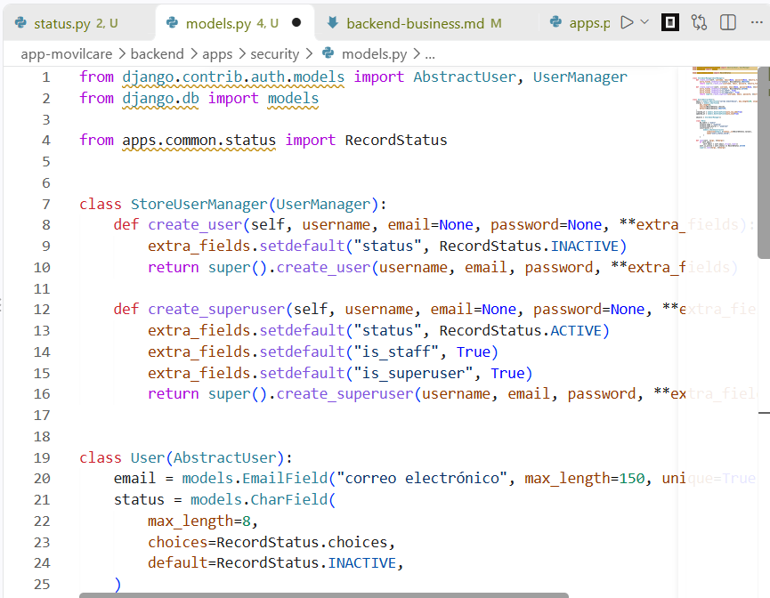

## Parche en `settings/__init__.py`

Para que Django utilice el modelo de usuario personalizado en lugar del incorporado, hay que declararlo con `AUTH_USER_MODEL`. Además se da de alta la aplicación `security` en `INSTALLED_APPS`, colocándola por delante de las demás aplicaciones del proyecto porque el resto dependerá de su modelo de usuario.

### Indicación

```text
ARCHIVO: config/settings/__init__.py

ENCIMA DE:
    "apps.customer.apps.CustomerConfig",

AGREGAR:
    "apps.security.apps.SecurityConfig",

DEBAJO DE:
DATABASES = database_from_environ(os.environ)

AGREGAR:

AUTH_USER_MODEL = "security.User"
```

### Evidencia

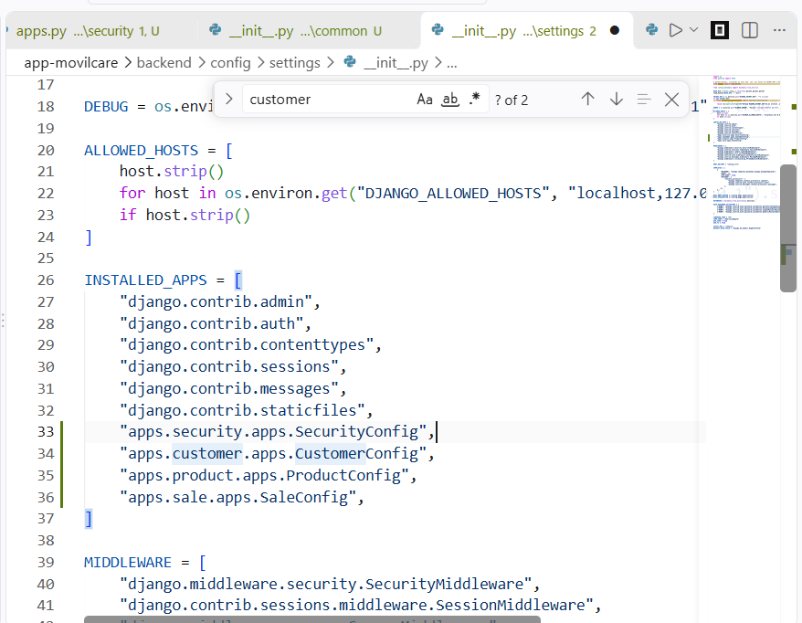

## Test del motor de selección

Antes de migrar, se cubre con pruebas el módulo de selección de base de datos desarrollado en la unidad ISS-01. Las pruebas construyen diccionarios de entorno simulados para cada motor y comprueban que la configuración resultante apunta al backend correcto, que Oracle recibe el nombre de servicio en el DSN y que los casos de error —motor no admitido o variable faltante— levantan la excepción esperada.

### Contenido de prueba en `security/tests.py`

```python
from django.core.exceptions import ImproperlyConfigured
from django.test import SimpleTestCase

from config.database import database_from_environ


class DatabaseSelectionTests(SimpleTestCase):
    def _env(self, engine):
        return {
            "DB_ENGINE": engine,
            "POSTGRES_DB": "storelab",
            "POSTGRES_USER": "storelab",
            "POSTGRES_PASSWORD": "storelab",
            "POSTGRES_HOST": "127.0.0.1",
            "POSTGRES_PORT": "5432",
            "MYSQL_DB": "storelab",
            "MYSQL_USER": "storelab",
            "MYSQL_PASSWORD": "storelab",
            "MYSQL_HOST": "127.0.0.1",
            "MYSQL_PORT": "3306",
            "MSSQL_DB": "storelab",
            "MSSQL_USER": "storelab",
            "MSSQL_PASSWORD": "storelab",
            "MSSQL_HOST": "127.0.0.1",
            "MSSQL_PORT": "1433",
            "ORACLE_DB": "storelab",
            "ORACLE_USER": "storelab",
            "ORACLE_PASSWORD": "storelab",
            "ORACLE_HOST": "127.0.0.1",
            "ORACLE_PORT": "1521",
            "ORACLE_SERVICE_NAME": "FREEPDB1",
        }

    def test_postgresql_engine(self):
        config = database_from_environ(self._env("postgresql"))
        self.assertEqual(config["default"]["ENGINE"], "django.db.backends.postgresql")

    def test_mysql_engine(self):
        config = database_from_environ(self._env("mysql"))
        self.assertEqual(config["default"]["ENGINE"], "django.db.backends.mysql")
        self.assertEqual(config["default"]["OPTIONS"]["charset"], "utf8mb4")

    def test_mssql_engine(self):
        config = database_from_environ(self._env("mssql"))
        self.assertEqual(config["default"]["ENGINE"], "mssql")

    def test_oracle_uses_service_name(self):
        config = database_from_environ(self._env("oracle"))
        self.assertIn("SERVICE_NAME=FREEPDB1", config["default"]["NAME"])
        self.assertEqual(config["default"]["PORT"], "")

    def test_invalid_engine(self):
        with self.assertRaises(ImproperlyConfigured):
            database_from_environ({"DB_ENGINE": "sqlite"})

    def test_missing_variable(self):
        env = self._env("postgresql")
        env["POSTGRES_DB"] = ""
        with self.assertRaises(ImproperlyConfigured):
            database_from_environ(env)
```

### Evidencia

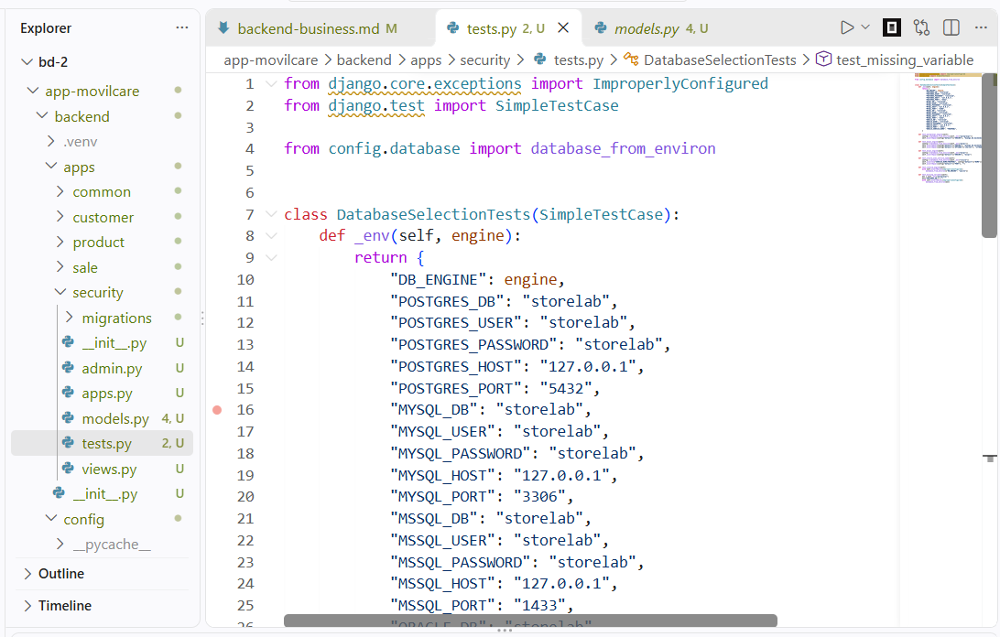

## Migración

Con el modelo de usuario definido y las pruebas en verde, se generan las migraciones de la aplicación `security`, se aplican al motor activo y se vuelve a ejecutar la suite de pruebas para confirmar que nada se ha roto.

### Scripts

```bash
python manage.py makemigrations security
python manage.py migrate
python manage.py test apps.security.tests.DatabaseSelectionTests
```

### Evidencias

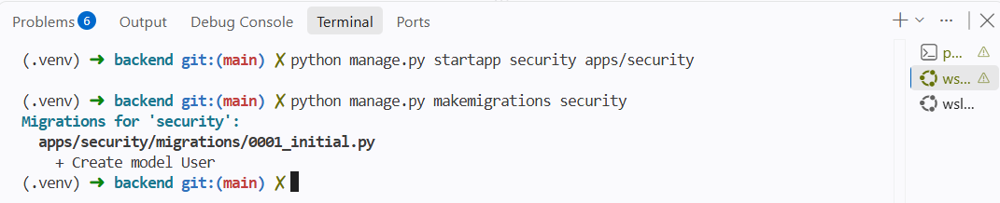
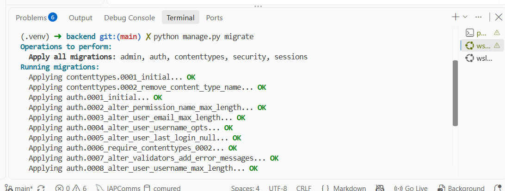
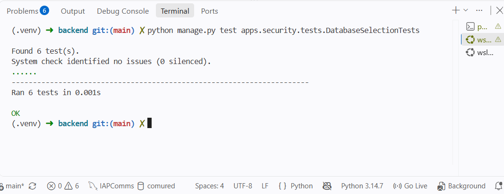

---

# Unidad ISS-04 — Modelo Customer

En esta unidad se modela la entidad de cliente. Antes de escribir el modelo se definen en `apps/common` las clases abstractas que van a compartir todas las entidades del proyecto: las marcas de auditoría y el estado de registro. Sobre esa base se construye el modelo `Customer` con las columnas reales de la base de datos de MovilCare.

## Creación de los modelos comunes

`apps/common/models.py` define dos clases abstractas. `TimeStampedModel` aporta `created_at` y `updated_at` como campos de auditoría automáticos. `StoreLabModel` hereda de ella y añade el campo `status`, que permite marcar un registro como activo o inactivo sin borrarlo físicamente.

Ambas clases declaran `abstract = True`, por lo que no generan tabla propia ni aparecen como secciones independientes en el panel de administración: se limitan a aportar campos a quien las herede.

El método de clase `status_constraint` centraliza la creación de la restricción a nivel de base de datos que impide que un registro guarde un estado fuera del enumerado, evitando repetir esa comprobación en cada modelo.

### Contenido del fichero en `common`

```python
from django.db import models

from apps.common.status import RecordStatus


class TimeStampedModel(models.Model):
    created_at = models.DateTimeField(auto_now_add=True)
    updated_at = models.DateTimeField(auto_now=True)

    class Meta:
        abstract = True


class StoreLabModel(TimeStampedModel):
    status = models.CharField(
        max_length=8,
        choices=RecordStatus.choices,
        default=RecordStatus.INACTIVE,
    )

    class Meta:
        abstract = True

    @classmethod
    def status_constraint(cls, name):
        return models.CheckConstraint(
            condition=models.Q(status__in=RecordStatus.values),
            name=name,
        )
```

### Evidencia

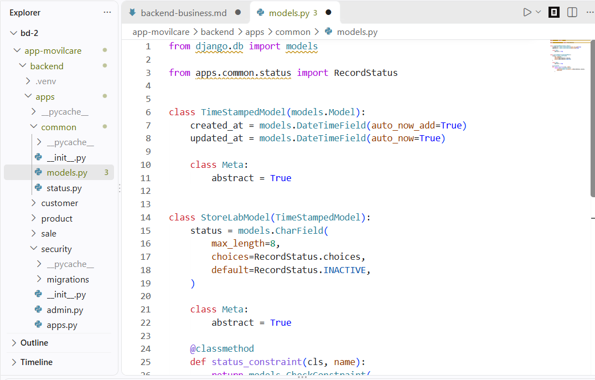

## Creación del modelo de cliente

El modelo `Customer` se adapta para contener las columnas correctas de la tabla `customers` de MovilCare: tipo y número de documento, nombre, correo electrónico y teléfono. El correo se declara como único porque sirve de identificador alternativo del cliente, y el método `save` lo normaliza a minúsculas antes de persistirlo para que la unicidad no dependa de la capitalización con la que se introduzca.

### Contenido del fichero `models` en `customer`

Se adaptó el modelo de `customer` para contener las columnas correctas de la tabla `customer`.

```python
from django.core.validators import MinLengthValidator
from django.db import models

from apps.common.models import StoreLabModel


class Customer(StoreLabModel):
    document_type = models.CharField(max_length=30, null=False, blank=True)
    document_number = models.CharField(max_length=11, null=False, blank=True)
    name = models.CharField(max_length=150, validators=[MinLengthValidator(2)])
    email = models.EmailField(max_length=150, null=True, blank=True, unique=True)
    phone = models.CharField(max_length=30, null=True, blank=True)

    class Meta:
        db_table = "customers"
        verbose_name = "cliente"
        verbose_name_plural = "clientes"
        ordering = ["name", "id"]
        constraints = [StoreLabModel.status_constraint("customers_status_valid")]

    def __str__(self):
        return self.name

    def save(self, *args, **kwargs):
        if self.email:
            self.email = self.email.strip().lower()
        super().save(*args, **kwargs)
```

Posteriormente se hizo la migración ya con el modelo guardado.

### Migración

```bash
python manage.py makemigrations customer
python manage.py migrate
```

### Evidencias

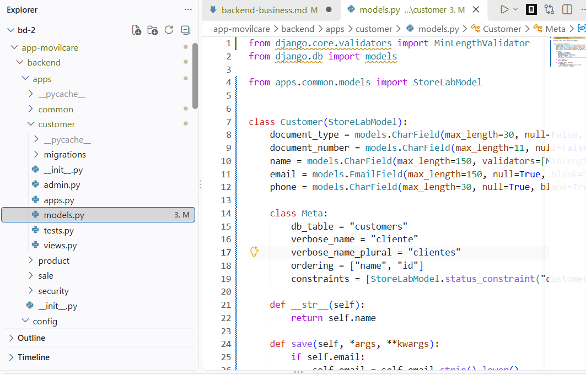
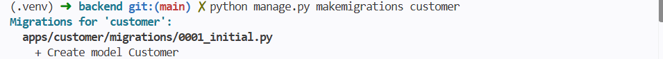
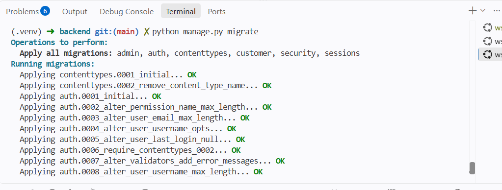
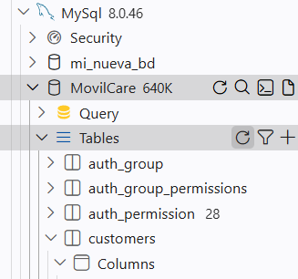
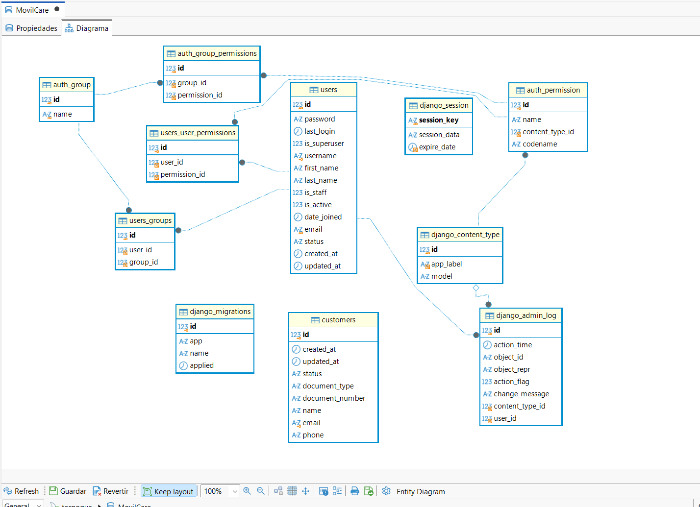

---

# Unidad ISS-05 — Product y Serialized Unit

Esta unidad modela el catálogo de productos y las unidades serializadas. Su particularidad es que MovilCare no sigue la estructura genérica propuesta en la guía académica, sino que presenta una relación 1:N directa entre producto y unidad serializada, sin tabla intermedia de tipos de producto y sin columna de stock en el producto.

## Definición de los modelos de producto

El proyecto de MovilCare, a diferencia de otros proyectos, no posee una tabla `product_types` y en cambio contiene las tablas `product` y `serialized_units`. La relación entre producto y unidades serializadas es de 1:N, por lo que `serialized_units` debe contener como clave foránea el identificador del producto al que referencia; a su vez, el producto no tiene una columna de stock.

Se ajustó la plantilla de modelo propuesta en la guía académica para encajar con esta estructura, y se realizó una segunda migración de corrección.

El modelo `Product` identifica cada artículo por un `sku` único y un `name` igualmente único, y su precio se almacena como decimal con dos cifras y una restricción que impide valores negativos. El modelo `SerializedUnit` representa una unidad física concreta de un producto: su clave foránea usa `on_delete=RESTRICT`, de modo que no se puede eliminar un producto que todavía tenga unidades serializadas asociadas, protegiendo así la integridad referencial del catálogo.

### Contenido de `apps/product/models.py`

```python
from decimal import Decimal

from django.core.validators import MinLengthValidator, MinValueValidator
from django.db import models

from apps.common.models import StoreLabModel

class Product(StoreLabModel):
    sku = models.CharField(max_length=100, unique=True, validators=[MinLengthValidator(2)])
    name = models.CharField(max_length=150, unique=True, validators=[MinLengthValidator(1)])
    description = models.CharField(max_length=255, null=True, blank=True)
    price = models.DecimalField(
        max_digits=15,
        decimal_places=2,
        validators=[MinValueValidator(Decimal("0"))],
    )

    class Meta:
        db_table = "products"
        verbose_name = "producto"
        verbose_name_plural = "productos"
        ordering = ["name", "id"]
        constraints = [
            StoreLabModel.status_constraint("products_status_valid"),
            models.CheckConstraint(
                condition=models.Q(price__gte=0),
                name="product_price_non_neg",
            ),
        ]

    def __str__(self):
        return self.name


class SerializedUnit(StoreLabModel):
    product = models.ForeignKey(
        Product,
        on_delete=models.RESTRICT,
        related_name="serialized_units",
        db_column="product_id",
    )
    name = models.CharField(max_length=150, unique=True, validators=[MinLengthValidator(2)])
    description = models.CharField(max_length=255, null=True, blank=True)

    class Meta: 
        db_table = "serialized_units"
        verbose_name = "Unidad serializada"
        verbose_name_plural = "Unidades serializadas"
        ordering = ["name", "id"]
        constraints = [StoreLabModel.status_constraint("serialized_units_status_valid")]

    def __str__(self):
        return self.name
```

### Migración

```bash
python manage.py makemigrations product
python manage.py migrate
```

### Evidencias

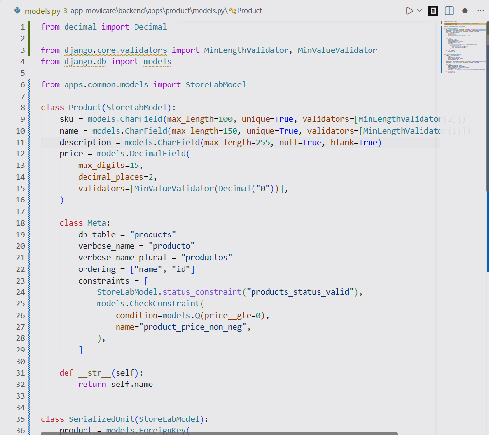
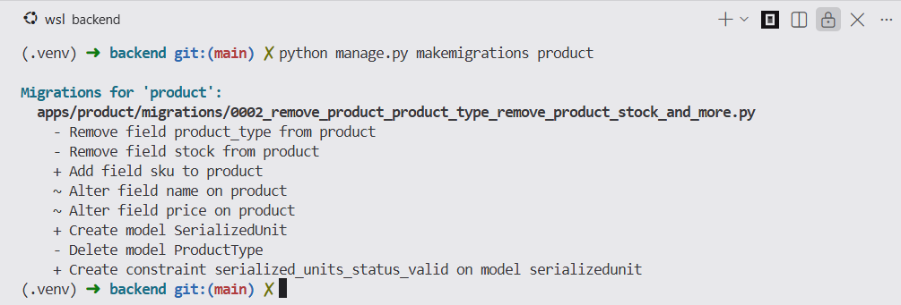
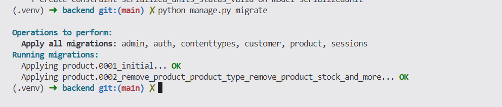

---

# Unidad ISS-06 — Sale y Sale Detail

En esta unidad se modela el dominio de ventas, que es el que conecta clientes y productos. Una venta encabeza una operación con sus importes y sus datos de cabecera, y sus líneas detallan qué productos se vendieron, en qué cantidad y a qué precio. Se crea además un gestor personalizado que deja preparado el terreno para futuras consultas de negocio.

## Creación de `sale/managers.py`

Antes de definir los modelos se crea el módulo de gestores. `SaleQuerySet` es un conjunto de consultas que hoy está vacío pero que servirá de punto de extensión para encapsular métodos de filtrado propios del negocio, y `SaleManager` se construye a partir de él para que esos métodos estén disponibles también desde `Sale.objects`.

```python
from django.db import models


class SaleQuerySet(models.QuerySet):
    pass


class SaleManager(models.Manager.from_queryset(SaleQuerySet)):
    pass
```

### Evidencia

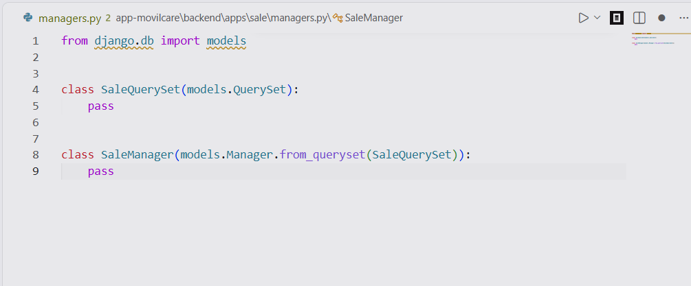

## Definición de los modelos de Sale

El modelo `Sale` representa la cabecera de una operación de venta: referencia al cliente, registra la fecha y acumula los importes de subtotal, impuestos, descuentos y total. Todas las claves foráneas usan `on_delete=RESTRICT`, de modo que no se puede eliminar un cliente que tenga ventas registradas ni un producto que figure en alguna venta, protegiendo así la integridad histórica de la información comercial.

El método `void()` implementa el borrado lógico de una venta. En lugar de eliminar el registro, que arrastraría sus líneas y rompería el histórico, marca la venta como inactiva. La operación se ejecuta dentro de una transacción y con `select_for_update()`, que bloquea la fila en la base de datos para que dos peticiones simultáneas no puedan anular la misma venta a la vez.

El modelo `SaleDetail` representa cada línea de la venta. Su método `save` recalcula el total de línea a partir del precio unitario y la cantidad, de forma que ese importe nunca dependa de lo que el cliente del API haya enviado, sino del producto de sus dos componentes.

### Contenido de `apps/sale/models.py`

```python
from decimal import Decimal

from django.core.validators import MinValueValidator
from django.db import models, transaction

from apps.customer.models import Customer
from apps.common.models import StoreLabModel
from apps.common.status import RecordStatus
from apps.product.models import Product
from apps.sale.managers import SaleManager

class Sale(StoreLabModel):
    customer = models.ForeignKey(
        Customer,
        on_delete=models.RESTRICT,
        related_name="sales",
        db_column="customer_id",
    )
    sale_date = models.DateTimeField()
    subtotal = models.DecimalField(max_digits=12, decimal_places=2, default=Decimal("0.00"))
    tax = models.DecimalField(max_digits=12, decimal_places=2, default=Decimal("0.00"))
    discounts = models.DecimalField(max_digits=12, decimal_places=2, default=Decimal("0.00"))
    total = models.DecimalField(max_digits=12, decimal_places=2, default=Decimal("0.00"))

    objects = SaleManager()

    class Meta:
        db_table = "sales"
        verbose_name = "venta"
        verbose_name_plural = "ventas"
        ordering = ["-sale_date", "-id"]
        constraints = [
            StoreLabModel.status_constraint("sales_status_valid"),
            models.CheckConstraint(
                condition=models.Q(subtotal__gte=0)
                & models.Q(tax__gte=0)
                & models.Q(discounts__gte=0)
                & models.Q(total__gte=0),
                name="sales_amounts_non_neg",
            ),
        ]

    def __str__(self):
        return f"Venta {self.pk}"

    def void(self):
        with transaction.atomic():
            sale = Sale.objects.select_for_update().get(pk=self.pk)
            if sale.status == RecordStatus.INACTIVE:
                return sale
            sale.status = RecordStatus.INACTIVE
            sale.save(update_fields=["status", "updated_at"])
            return sale


class SaleDetail(StoreLabModel):
    sale = models.ForeignKey(
        Sale,
        on_delete=models.RESTRICT,
        related_name="lines",
        db_column="sale_id",
    )
    product = models.ForeignKey(
        Product,
        on_delete=models.RESTRICT,
        related_name="sale_lines",
        db_column="product_id",
    )
    quantity = models.PositiveIntegerField(validators=[MinValueValidator(1)])
    unit_price = models.DecimalField(max_digits=12, decimal_places=2)
    line_total = models.DecimalField(max_digits=12, decimal_places=2)
    observations = models.CharField(max_length=255, null=True, blank=True)

    class Meta:
        db_table = "sale_details"
        verbose_name = "detalle de venta"
        verbose_name_plural = "detalles de venta"
        ordering = ["id"]
        constraints = [
            StoreLabModel.status_constraint("sale_details_status_valid"),
            models.CheckConstraint(
                condition=models.Q(quantity__gte=1)
                & models.Q(unit_price__gte=0)
                & models.Q(line_total__gte=0),
                name="psale_amounts_valid",
            ),
        ]

    def __str__(self):
        return f"{self.product} x {self.quantity}"

    def save(self, *args, **kwargs):
        self.line_total = (self.unit_price * self.quantity).quantize(Decimal("0.01"))
        super().save(*args, **kwargs)
```

### Migración

```bash
python manage.py makemigrations sale
python manage.py migrate
```

### Evidencias

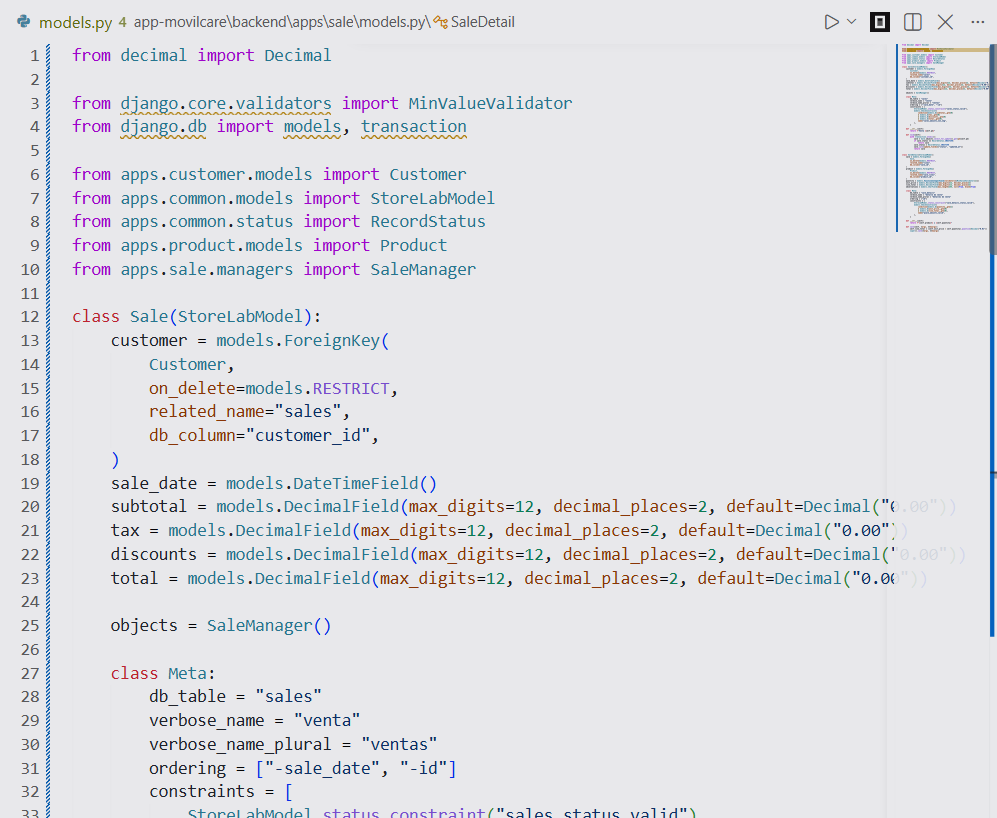
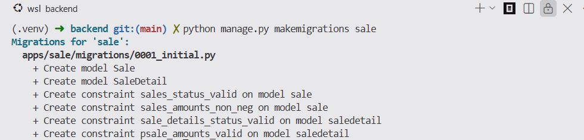


---

# Unidad ISS-07 — Serializers y JSON camelCase

En esta unidad se expone el modelo a través de la API REST. Se instalan Django REST Framework y los paquetes de conversión de nomenclatura y CORS, se configuran para que la API entregue JSON en formato camelCase —propio de JavaScript— y se definen los serializers que traducen cada modelo a JSON y validan los datos entrantes.

## Instalación de los paquetes de REST y JSON

Se instalan tres paquetes. `djangorestframework` aporta el conjunto de herramientas para construir la API. `djangorestframework-camel-case` convierte automáticamente las claves del JSON entre snake_case, que es la convención de Python, y camelCase, que es la convención habitual de JavaScript. `django-cors-headers` gestiona las cabeceras que permiten al frontend consumir la API desde otro origen.

### Comandos

```bash
python -m pip install "djangorestframework==3.17.2" "djangorestframework-camel-case==1.4.2" "django-cors-headers==4.9.0"
python -m pip freeze > requirements.txt
```

### Evidencias


## Ajustes en `config/settings/__init__.py`

Los tres paquetes recién instalados requieren su declaración en la configuración. Se añaden `rest_framework` y `corsheaders` a `INSTALLED_APPS`, y el middleware de CORS se coloca por delante del de seguridad para que las cabeceras se resuelvan antes de cualquier respuesta.

Se configura además `REST_FRAMEWORK` con renderers y parsers camelCase, de modo que la conversión sea automática en ambos sentidos: la API recibe `productId` y responde con `productId`, mientras que por dentro el código sigue trabajando con `product_id`. También se fija `DEFAULT_PAGINATION_CLASS` a `None` para que las listas respondan sin paginar.

### Indicaciones

**Archivo:** `config/settings/__init__.py`

**Encima de:**

```python
    "apps.security.apps.SecurityConfig",
```

**Agregar:**

```python
    "rest_framework",
    "corsheaders",
```

**Encima de:**

```python
    "django.middleware.security.SecurityMiddleware",
```

**Agregar:**

```python
    "corsheaders.middleware.CorsMiddleware",
```

**Debajo de:**

```python
DEFAULT_AUTO_FIELD = "django.db.models.BigAutoField"
```

**Agregar:**

```python
CORS_ALLOW_ALL_ORIGINS = os.environ.get("CORS_ALLOW_ALL_ORIGINS", "True").strip().lower() in {
    "1",
    "true",
    "yes",
    "on",
}

REST_FRAMEWORK = {
    "DEFAULT_PERMISSION_CLASSES": [
        "rest_framework.permissions.AllowAny",
    ],
    "DEFAULT_RENDERER_CLASSES": [
        "djangorestframework_camel_case.render.CamelCaseJSONRenderer",
        "djangorestframework_camel_case.render.CamelCaseBrowsableAPIRenderer",
    ],
    "DEFAULT_PARSER_CLASSES": [
        "djangorestframework_camel_case.parser.CamelCaseJSONParser",
        "djangorestframework_camel_case.parser.CamelCaseFormParser",
        "djangorestframework_camel_case.parser.CamelCaseMultiPartParser",
    ],
    "DEFAULT_PAGINATION_CLASS": None,
}
```

### Evidencia


## Creación de los serializers

Los serializers tienen dos funciones: convertir los modelos a JSON y validar los datos que llegan del exterior. `CustomerSerializer` declara el correo como opcional y lo normaliza a minúsculas en su validación. `SerializedUnitSerializer` expone la unidad junto con el identificador y el nombre del producto al que pertenece, y `SaleSerializer` anida las líneas de venta dentro de la cabecera mediante un serializer en `many=True`.

### Contenido de `customer/serializers.py`

```python
from rest_framework import serializers

from apps.customer.models import Customer

class CustomerSerializer(serializers.ModelSerializer):
    class Meta:
        model = Customer
        fields = [
            "id",
            "document_type",
            "document_number",
            "name",
            "phone",
            "email",
            "status",
            "created_at",
            "updated_at",
        ]
        read_only_fields = ["id", "created_at", "updated_at"]
        extra_kwargs = {
            "document_type": {"min_length":2, "max_lenght":30},
            "document_number": {"min_length":5, "max_lenght":11},
            "name": {"min_length": 2, "max_length": 150},
            "email": {"required": False, "allow_null": True, "allow_blank": True},
            "phone": {"required": False, "allow_null": True, "allow_blank": True},
        }

    def validate_email(self, value):
        if value is None or str(value).strip() == "":
            return None
        return value.strip().lower()

    def validate(self, attrs):
        for field in ("address", "phone"):
            if attrs.get(field) == "":
                attrs[field] = None
        return attrs
```

### Contenido de `product/serializers.py`

```python
from rest_framework import serializers

from apps.product.models import Product, SerializedUnit


class SerializedUnitSerializer(serializers.ModelSerializer):
    product_id = serializers.PrimaryKeyRelatedField(
        source="product",
        queryset=Product.objects.all(),
    )
    product_name = serializers.CharField(source="product.name", read_only=True)

    class Meta:
        model = SerializedUnit
        fields = [
            "id", 
            "product_id"
            "product_name", 
            "description", 
            "status", 
            "created_at", 
            "updated_at"
        ]
        read_only_fields = ["id", "product_name", "created_at", "updated_at"]
        extra_kwargs = {
            "name": {"min_length": 2, "max_length": 150},
            "description": {"required": False, "allow_null": True, "allow_blank": True},
        }

    def validate_description(self, value):
        if value is None or str(value).strip() == "":
            return None
        return value


class ProductSerializer(serializers.ModelSerializer):

    class Meta:
        model = Product
        fields = [
            "id",
            "sku",
            "name",
            "description",
            "price",
            "status",
            "created_at",
            "updated_at",
        ]
        read_only_fields = ["id", "created_at", "updated_at"]
        extra_kwargs = {
            "name": {"min_length": 2, "max_length": 120},
            "description": {"required": False, "allow_null": True, "allow_blank": True},
        }

    def validate_description(self, value):
        if value is None or str(value).strip() == "":
            return None
        return value
```

### Contenido de `sale/serializers.py`

```python
from rest_framework import serializers

from apps.sale.models import ProductSale, Sale


class ProductSaleSerializer(serializers.ModelSerializer):
    product_name = serializers.CharField(source="product.name", read_only=True)

    class Meta:
        model = ProductSale
        fields = [
            "id",
            "product",
            "product_name",
            "quantity",
            "unit_price",
            "line_total",
            "status",
            "created_at",
            "updated_at",
        ]
        read_only_fields = fields


class SaleSerializer(serializers.ModelSerializer):
    customer_name = serializers.CharField(source="customer.name", read_only=True)
    lines = ProductSaleSerializer(many=True, read_only=True)

    class Meta:
        model = Sale
        fields = [
            "id",
            "customer",
            "customer_name",
            "sale_date",
            "subtotal",
            "tax",
            "discounts",
            "total",
            "status",
            "lines",
            "created_at",
            "updated_at",
        ]
        read_only_fields = fields
```

### Evidencias


---

# Unidad ISS-08 — Customer con ModelViewSet

En esta unidad se publica el primer endpoint real de la API. Se crea la vista del cliente como `ModelViewSet`, que implementa de una sola vez las operaciones de listar, crear, recuperar, modificar y borrar; se cubre con pruebas automatizadas; y se enlaza todo mediante el router de REST Framework y la configuración de URLs raíz.

## Creación de la vista para `customer`

La vista de cliente se construye sobre `ModelViewSet`, que proporciona de serie los cinco verbos REST. A esta base se le añaden dos comportamientos propios del negocio.

El primero es el filtrado por estado: el método `get_queryset` lee el parámetro de consulta `status` y, si viene presente, reduce el conjunto devuelto. Esto permite a un consumidor de la API pedir solo los clientes activos sin que el servidor exponga esa lógica de filtrado en la URL.

El segundo es el borrado lógico: `perform_destroy` sobrescribe el borrado físico de Django para que, en lugar de eliminar la fila, la marque como inactiva. Así se conserva el histórico de ventas asociadas a ese cliente, algo que el modelo ya protegía mediante la restricción `RESTRICT`.

### Contenido de `apps/customer/views.py`

```python
from rest_framework import viewsets
from rest_framework.permissions import AllowAny

from apps.customer.models import Customer
from apps.customer.serializers import CustomerSerializer
from apps.common.status import RecordStatus


class CustomerViewSet(viewsets.ModelViewSet):
    queryset = Customer.objects.all()
    serializer_class = CustomerSerializer
    permission_classes = [AllowAny]
    lookup_value_converter = "int"

    def get_queryset(self):
        queryset = super().get_queryset()
        status_value = self.request.query_params.get("status")
        if status_value:
            queryset = queryset.filter(status=status_value)
        return queryset

    def perform_destroy(self, instance):
        instance.status = RecordStatus.INACTIVE
        instance.save(update_fields=["status", "updated_at"])
```

### Evidencia


## Creación de las pruebas para `customer`

Las pruebas cubren los comportamientos críticos del endpoint: que los valores por defecto se apliquen y persistan, que la normalización del correo a minúsculas funcione y se refleje también en el JSON serializado en camelCase, que un nombre demasiado corto y un correo duplicado devuelvan error, que el borrado conserve la fila cambiando su estado, y que el ciclo completo de listado, recuperación y actualización responda correctamente.

### Contenido de `apps/customer/tests.py`

```python
import json

from rest_framework import status
from rest_framework.test import APITestCase

from apps.customer.models import Customer
from apps.common.status import RecordStatus


class CustomerApiTests(APITestCase):
    def test_create_defaults_and_persists(self):
        response = self.customer.post(
            "/api/customers/",
            {"name": "María García", "email": "Maria@Example.com", "phone": "3001234567"},
            format="json",
        )
        self.assertEqual(response.status_code, status.HTTP_201_CREATED)
        self.assertEqual(response.data["status"], RecordStatus.INACTIVE)
        self.assertEqual(response.data["email"], "maria@example.com")
        wire = json.loads(response.content)
        self.assertIn("createdAt", wire)
        self.assertNotIn("created_at", wire)
        stored = Customer.objects.get(pk=response.data["id"])
        self.assertEqual(stored.name, "María García")

    def test_invalid_name_and_duplicate_email(self):
        invalid = self.customer.post("/api/customers/", {"name": "A"}, format="json")
        self.assertEqual(invalid.status_code, status.HTTP_400_BAD_REQUEST)
        self.customer.post(
            "/api/customers/",
            {"name": "Ana Ruiz", "email": "ana@example.com"},
            format="json",
        )
        duplicate = self.customer.post(
            "/api/customers/",
            {"name": "Otra Ana", "email": "ana@example.com"},
            format="json",
        )
        self.assertEqual(duplicate.status_code, status.HTTP_400_BAD_REQUEST)

    def test_soft_delete_keeps_the_row(self):
        created = self.customer.post("/api/customers/", {"name": "Pedro León"}, format="json")
        deleted = self.customer.delete(f"/api/customers/{created.data['id']}/")
        self.assertEqual(deleted.status_code, status.HTTP_204_NO_CONTENT)
        stored = Customer.objects.get(pk=created.data["id"])
        self.assertEqual(stored.status, RecordStatus.INACTIVE)
        self.assertEqual(Customer.objects.count(), 1)

    def test_list_retrieve_and_update(self):
        created = self.customer.post(
            "/api/customers/",
            {"name": "Luisa Mora", "phone": "111"},
            format="json",
        )
        pk = created.data["id"]
        listed = self.customer.get("/api/customers/")
        self.assertEqual(listed.status_code, status.HTTP_200_OK)
        detail = self.customer.get(f"/api/customers/{pk}/")
        self.assertEqual(detail.status_code, status.HTTP_200_OK)
        self.assertEqual(detail.data["name"], "Luisa Mora")
        updated = self.customer.patch(
            f"/api/customers/{pk}/",
            {"phone": "222", "status": "active"},
            format="json",
        )
        self.assertEqual(updated.status_code, status.HTTP_200_OK)
        self.assertEqual(updated.data["status"], "active")
```

### Evidencia


## Enrutamiento de `customer`

El router de REST Framework traduce la vista en un conjunto de URLs siguiendo la convención REST: la colección en plural para el listado y la creación, y la colección con identificador para la recuperación, la modificación y el borrado. Al declarar `use_regex_path=False`, el router genera rutas con tipos concretos en lugar de expresiones regulares.

### Contenido de `apps/customer/urls.py`

```python
from rest_framework.routers import SimpleRouter

from apps.customer.views import CustomerViewSet

router = SimpleRouter(use_regex_path=False)
router.register("customers", CustomerViewSet, basename="customer")

urlpatterns = router.urls
```

### Evidencia


## Ajustes en la configuración de URLs

Finalmente hay que conectar el enrutamiento de la aplicación con la URL raíz del proyecto. Se importa `include` y se añade una ruta que delega en `apps.customer.urls` todo lo que llegue bajo el prefijo `api/`, dejando el panel de administración en su ruta original.

### Indicaciones

**Archivo:** `config/urls.py`

**Ubicar:**

```python
from django.urls import path
```

**Reemplazar por:**

```python
from django.urls import include, path
```

**Debajo de:**

```python
path("admin/", admin.site.urls),
```

**Agregar:**

```python
path("api/", include("apps.customer.urls")),
```

### Evidencia


---

# Unidad ISS-09 — Catálogo con ModelViewSet

Esta unidad publica el catálogo de productos y las unidades serializadas. Para no repetir la misma lógica en ambas vistas, se extrae una clase base común `CatalogViewSet` que concentra el comportamiento compartido, y cada vista concreta se limita a declarar su modelo y su serializer.

## Creación de las vistas para publicar el catálogo

`CatalogViewSet` hereda de `ModelViewSet` y añade las dos particularidades del catálogo: el filtrado por estado mediante el parámetro `status` y el borrado lógico que marca el registro como inactivo en lugar de eliminarlo. Al concentrar esa lógica en una sola clase base, `ProductViewSet` y `SerializedUnitViewSet` quedan reducidos a la declaración de su consulta y su serializer, y cualquier cambio de comportamiento se aplica por igual a las dos.

### Contenido de `apps/product/views.py`

```python

from rest_framework import viewsets
from rest_framework.permissions import AllowAny

from apps.common.status import RecordStatus
from apps.product.models import Product, SerializedUnit
from apps.product.serializers import ProductSerializer, SerializedUnitSerializer


class CatalogViewSet(viewsets.ModelViewSet):
    permission_classes = [AllowAny]
    lookup_value_converter = "int"

    def get_queryset(self):
        queryset = super().get_queryset()

        status_value = self.request.query_params.get("status")
        if status_value:
            queryset = queryset.filter(status=status_value)

        return queryset

    def perform_destroy(self, instance):
        instance.status = RecordStatus.INACTIVE
        instance.save(update_fields=["status", "updated_at"])


class ProductViewSet(CatalogViewSet):
    queryset = Product.objects.all()
    serializer_class = ProductSerializer


class SerializedUnitViewSet(CatalogViewSet):
    queryset = SerializedUnit.objects.all()
    serializer_class = SerializedUnitSerializer
```

### Evidencia


## Enrutamiento del catálogo

Se registran las dos vistas en el router para que cada una reciba su propio espacio de URL: `products` para el catálogo de productos y `serialized-units` para las unidades serializadas.

### Contenido de `apps/product/urls.py`

```python
from rest_framework.routers import SimpleRouter

from apps.product.views import ProductTypeViewSet, SerializedUnitViewSet

router = SimpleRouter(use_regex_path=False)
router.register(
    r"products",
    ProductViewSet,
    basename="product",
)

router.register(
    r"serialized-units",
    SerializedUnitViewSet,
    basename="serialized-unit",
)

urlpatterns = router.urls
```

### Evidencia


## Ajuste de `config/urls.py`

Al igual que con el cliente, hay que delegar el prefijo `api/` en el enrutamiento de la aplicación de producto.

**Debajo de:**

```python
path("api/", include("apps.customerlient.urls")),
```

**Agregar:**

```python
path("api/", include("apps.product.urls")),
```

### Evidencia


## Pruebas del catálogo

Las pruebas verifican el ciclo completo de producto: que la creación aplique el estado por defecto, que la consulta individual devuelva el nombre correcto, que la modificación del estado se refleje en la respuesta y que el borrado marque el registro como inactivo sin eliminarlo. Se cubre también la creación de una unidad serializada, comprobando que su clave foránea apunta al producto correcto, y su borrado lógico.

### Contenido de `apps/product/tests.py`

```python

from decimal import Decimal

from django.test import TestCase
from rest_framework.test import APITestCase

from apps.common.status import RecordStatus
from apps.product.models import Product, SerializedUnit


class ProductApiTests(APITestCase):
    def setUp(self):
        self.product = Product.objects.create(
            sku="MOV-001",
            name="Leche",
            description="Leche entera",
            price=Decimal("3.20"),
            status=RecordStatus.ACTIVE,
        )

    def test_product_crud(self):
        created = self.client.post(
            "/api/products/",
            {
                "sku": "MOV-002",
                "name": "Café",
                "description": "Café molido",
                "price": "5.50",
            },
            format="json",
        )

        self.assertEqual(created.status_code, 201)
        self.assertEqual(created.data["status"], RecordStatus.INACTIVE)

        pk = created.data["id"]

        self.assertEqual(self.client.get("/api/products/").status_code, 200)

        detail = self.client.get(f"/api/products/{pk}/")
        self.assertEqual(detail.status_code, 200)
        self.assertEqual(detail.data["name"], "Café")

        updated = self.client.patch(
            f"/api/products/{pk}/",
            {"status": "active"},
            format="json",
        )

        self.assertEqual(updated.status_code, 200)
        self.assertEqual(updated.data["status"], RecordStatus.ACTIVE)

        deleted = self.client.delete(f"/api/products/{pk}/")

        self.assertEqual(deleted.status_code, 204)

        self.product_refresh = Product.objects.get(pk=pk)
        self.assertEqual(
            self.product_refresh.status,
            RecordStatus.INACTIVE,
        )

    def test_product_duplicate_name(self):
        payload = {
            "sku": "MOV-003",
            "name": "Leche",
            "description": "Otra presentación",
            "price": "4.00",
        }

        response = self.client.post(
            "/api/products/",
            payload,
            format="json",
        )

        # Ajusta esta expectativa según la restricción real
        # de unicidad de name en tu modelo.
        self.assertIn(response.status_code, [201, 400])

    def test_serialized_unit_creation_and_soft_delete(self):
        created = self.client.post(
            "/api/serialized-units/",
            {
                "product": self.product.id,
                "name": "Unidad de leche 001",
                "description": "Unidad física de prueba",
            },
            format="json",
        )

        self.assertEqual(created.status_code, 201)

        unit_id = created.data["id"]

        unit = SerializedUnit.objects.get(pk=unit_id)
        self.assertEqual(unit.product_id, self.product.id)

        deleted = self.client.delete(
            f"/api/serialized-units/{unit_id}/"
        )

        self.assertEqual(deleted.status_code, 204)

        unit.refresh_from_db()
        self.assertEqual(unit.status, RecordStatus.INACTIVE)
```

### Evidencia y test


---

# Unidad ISS-10 — Disponibles con ListAPIView

En esta unidad se añade un endpoint de lectura con una filtrificación específica mediante `ListAPIView`, una vista genérica de solo lectura que expone únicamente la operación de listado. A diferencia de `ModelViewSet`, que publica todos los verbos, `ListAPIView` se limita a devolver colecciones, lo que resulta adecuado para consultas de catálogo que no deben permitir escritura.

## Ajustes de `apps/product/urls.py`

Se amplía el enrutamiento de la aplicación de producto para incluir una ruta manual, declarada por delante del router, que atiende el endpoint de productos disponibles.

### Indicaciones

**Archivo:** `apps/product/urls.py`

**Ubicar:**

```python
from rest_framework.routers import SimpleRouter
```

**Reemplazar por:**

```python
from django.urls import path
from rest_framework.routers import SimpleRouter
```

**Ubicar el import de las vistas y agregar:**

```python
from apps.product.views import ProductViewSet, SerializedUnitViewSet, AvailableProductListAPIView
```

**Reemplazar:**

```python
urlpatterns = router.urls
```

**Por:**

```python
urlpatterns = [
    path(
        "products/available/",
        AvailableProductListAPIView.as_view(),
        name="product-available",
    ),
]
urlpatterns += router.urls
```

### Evidencia


## Ajustes a las vistas de producto

Se añade la vista de productos disponibles al final del módulo de vistas. Esta consulta restringe el conjunto devuelto a los productos activos cuyo tipo también esté activo, utilizando `select_related` para traer el tipo de producto en la misma consulta y evitar así una segunda llamada a la base de datos por cada fila.

### Indicaciones

**Archivo:** `apps/product/views.py`

**Encima de:**

```python
from rest_framework import viewsets
```

**Agregar, en la misma línea de imports de `rest_framework` si ya está `viewsets`:**

```python
from rest_framework.generics import ListAPIView
```

**Al final del archivo, agregar:**

```python
class AvailableProductListAPIView(ListAPIView):
    permission_classes = [AllowAny]
    serializer_class = ProductSerializer

    def get_queryset(self):
        return Product.objects.select_related("product_type").filter(
            status=RecordStatus.ACTIVE,
            product_type__status=RecordStatus.ACTIVE,
        )
```

### Evidencia


## Creación de la prueba de productos disponibles

Se añade una prueba que crea un producto activo, comprueba que aparece en el listado de disponibles y verifica que el filtrado responde correctamente ante los cambios de estado.

### Indicaciones

**Archivo:** `apps/product/tests.py`

**Al final de la clase `ProductApiTests`, agregar:**

```python
def test_product_crud_and_available_filter(self):
    created = self.client.post(
        "/api/products/",
        {
            "name": "Agua",
            "price": "2.50",
            "status": "active",
        },
        format="json",
    )
    self.assertEqual(created.status_code, 201)
    available = self.client.get("/api/products/available/")
    self.assertEqual(available.status_code, 200)
    self.assertEqual(len(available.data), 1)
    empty = self.client.get("/api/products/available/")
    self.assertEqual(empty.data, [])
```

### Script de prueba

```bash
python manage.py test apps.product.tests.ProductApiTests.test_product_crud_and_available_filter
```

### Evidencia y test


# Unidad ISS-11 - Registro de venta con APIView
## Ajuste a `apps/sale/managers.py`
Se adaptó el método `register` de `SaleQuerySet` a la estructura actual de MovilCare, conservando la gestión de impuestos (`tax`) y descuentos (`discounts`), así como las validaciones de cantidades, productos activos y límites de descuento. Se eliminaron las dependencias de `ProductType` y `stock`, debido a que no forman parte del modelo actual de productos. Además, se ajustó la creación de los detalles de venta mediante `SaleDetail`, se mantuvo el cálculo del subtotal y del total, y se conservaron las transacciones atómicas y el bloqueo de registros para garantizar la integridad de los datos durante el registro de cada venta. El impuesto se inicializa en cero, pendiente de aplicar la regla de cálculo definida por el proyecto.
### Indicaciones
**ARCHIVO:** `apps/sale/managers.py`

**UBICAR:**
```python
from django.db import models
```

**REEMPLAZAR POR:**
```python
from decimal import Decimal

from django.core.exceptions import ValidationError
from django.db import models, transaction

from apps.common.status import RecordStatus
from apps.customer.models import Customer
from apps.product.models import Product
```

**UBICAR:**
```python
class SaleQuerySet(models.QuerySet):
    pass
```

**REEMPLAZAR POR:**
```python
class SaleQuerySet(models.QuerySet):

    def register(self, *, customer, sale_date, items, discounts):
        if not items:
            raise ValidationError({
                "items": ["La venta requiere al menos un producto."]
            })

        discounts = Decimal(str(discounts)).quantize(Decimal("0.01"))

        if discounts < 0:
            raise ValidationError({
                "discounts": ["El descuento no puede ser negativo."]
            })

        quantities = {}

        for item in items:
            try:
                product_id = int(item["product_id"])
                quantity = int(item["quantity"])
            except (KeyError, TypeError, ValueError):
                raise ValidationError({
                    "items": [
                        "Cada producto debe tener product_id y quantity válidos."
                    ]
                })

            if quantity < 1:
                raise ValidationError({
                    "items": ["La cantidad debe ser al menos 1."]
                })

            quantities[product_id] = (
                quantities.get(product_id, 0) + quantity
            )

        with transaction.atomic():
            locked_customer = (
                Customer.objects
                .select_for_update()
                .filter(pk=customer.pk)
                .first()
            )

            if locked_customer is None:
                raise ValidationError({
                    "customer_id": ["El cliente no existe."]
                })

            if locked_customer.status != RecordStatus.ACTIVE:
                raise ValidationError({
                    "customer_id": ["El cliente debe estar activo."]
                })

            locked_products = {
                product.id: product
                for product in (
                    Product.objects
                    .select_for_update()
                    .filter(pk__in=quantities)
                    .order_by("id")
                )
            }

            if len(locked_products) != len(quantities):
                raise ValidationError({
                    "items": ["Hay productos que no existen."]
                })

            for product in locked_products.values():
                if product.status != RecordStatus.ACTIVE:
                    raise ValidationError({
                        "items": [
                            f"El producto {product.name} no está activo."
                        ]
                    })

            sale = self.model(
                customer=locked_customer,
                sale_date=sale_date,
                subtotal=Decimal("0.00"),
                tax=Decimal("0.00"),
                discounts=discounts,
                total=Decimal("0.00"),
                status=RecordStatus.INACTIVE,
            )
            sale.save()

            subtotal = Decimal("0.00")

            for item in items:
                product = locked_products[int(item["product_id"])]
                quantity = int(item["quantity"])

                unit_price = Decimal(str(product.price))
                line_total = (
                    unit_price * quantity
                ).quantize(Decimal("0.01"))

                SaleDetail.objects.create(
                    sale=sale,
                    product=product,
                    quantity=quantity,
                    unit_price=unit_price,
                    total=line_total,
                    status=RecordStatus.ACTIVE,
                )

                subtotal += line_total

            subtotal = subtotal.quantize(Decimal("0.01"))

            if discounts > subtotal:
                raise ValidationError({
                    "discounts": [
                        "El descuento no puede superar el subtotal."
                    ]
                })

            # Conservamos el campo tax de Sale.
            # Se inicializa en cero porque no se ha definido
            # una regla de cálculo de impuestos en este método.
            tax = Decimal("0.00")

            total = (subtotal + tax - discounts).quantize(Decimal("0.01"))

            sale.subtotal = subtotal
            sale.tax = tax
            sale.discounts = discounts
            sale.total = total
            sale.status = RecordStatus.ACTIVE

            sale.save(
                update_fields=[
                    "subtotal",
                    "tax",
                    "discounts",
                    "total",
                    "status",
                    "updated_at",
                ]
            )

            return sale
```
### Evidencia


## Ajuste al `apps/sale/serializers.py`
### indicaciones
**ARCHIVO:** `apps/sale/serializers.py`

**ENCIMA DE:**
```python
from rest_framework import serializers
```

**AGREGAR:**
```python
from decimal import Decimal

from django.core.exceptions import ValidationError as DjangoValidationError
```

**DEBAJO DE los imports existentes, AGREGAR:**
```python
from apps.customer.models import Customer
from apps.product.models import Product
```
**AL FINAL DEL ARCHIVO, AGREGAR:**
```python
class SaleItemSerializer(serializers.Serializer):
    product_id = serializers.PrimaryKeyRelatedField(
        queryset=Product.objects.all(),
        source="product",
    )
    quantity = serializers.IntegerField(min_value=1)


class SaleRegisterSerializer(serializers.Serializer):
    customer_id = serializers.PrimaryKeyRelatedField(
        queryset=Client.objects.all(),
        source="customer",
    )
    sale_date = serializers.DateTimeField()
    discounts = serializers.DecimalField(
        max_digits=12,
        decimal_places=2,
        min_value=Decimal("0.00"),
        required=False,
        default=Decimal("0.00"),
    )
    items = SaleItemSerializer(many=True, allow_empty=False)

    def create(self, validated_data):
        items = [
            {"product_id": item["product"].id, "quantity": item["quantity"]}
            for item in validated_data["items"]
        ]
        try:
            return Sale.objects.register(
                customer=validated_data["customer"],
                sale_date=validated_data["sale_date"],
                discounts=validated_data["discounts"],
                items=items,
            )
        except DjangoValidationError as exc:
            if getattr(exc, "message_dict", None):
                raise serializers.ValidationError(exc.message_dict) from exc
            raise serializers.ValidationError(exc.messages) from exc
```

### Evidencia


## Creacion de `apps/sale/views.py`
```python
from rest_framework import status
from rest_framework.permissions import AllowAny
from rest_framework.response import Response
from rest_framework.views import APIView

from apps.sale.models import Sale
from apps.sale.serializers import SaleRegisterSerializer, SaleSerializer


class SaleRegisterAPIView(APIView):
    permission_classes = [AllowAny]

    def post(self, request):
        serializer = SaleRegisterSerializer(data=request.data)
        serializer.is_valid(raise_exception=True)
        sale = serializer.save()
        sale = Sale.objects.prefetch_related("lines__product").get(pk=sale.pk)
        return Response(SaleSerializer(sale).data, status=status.HTTP_201_CREATED)


class SaleCollectionAPIView(APIView):
    permission_classes = [AllowAny]

    def post(self, request, *args, **kwargs):
        handler = SaleRegisterAPIView()
        handler.request = request
        handler.format_kwarg = None
        handler.args = ()
        handler.kwargs = {}
        return handler.post(request)
```

### Evidencia


## Creacion de `apps/sale/urls.py`
```python
from django.urls import path

from apps.sale.views import SaleCollectionAPIView

urlpatterns = [
    path("sales/", SaleCollectionAPIView.as_view(), name="sale-collection"),
]
```

## ajuste a `config/urls.py` 
**DEBAJO DE:**
```python
    path("api/", include("apps.product.urls")),
```

**AGREGAR:**
```python
    path("api/", include("apps.sale.urls")),
```

### Evidencia


## Creacion del este de sales
### contenido de `apps/sale/tests.py`
```python
from decimal import Decimal
from unittest.mock import patch

from django.utils import timezone
from rest_framework.test import APITestCase

from apps.customer.models import Customer
from apps.common.status import RecordStatus
from apps.product.models import Product
from apps.sale.models import Sale, SaleDetail


class SaleTransactionTests(APITestCase):
    def setUp(self):
        self.customer = Customer.objects.create(
            name="Comprador",
            status=RecordStatus.ACTIVE,
        )

        self.water = Product.objects.create(
            name="Agua",
            price=Decimal("10.00"),
            status=RecordStatus.ACTIVE,
        )

        self.bread = Product.objects.create(
            name="Pan",
            price=Decimal("4.50"),
            status=RecordStatus.ACTIVE,
        )

    def _payload(self, items, discounts="0.00"):
        return {
            "customer_id": self.customer.id,
            "sale_date": timezone.now().isoformat(),
            "discounts": discounts,
            "items": items,
        }

    def test_register_snapshots_prices_and_applies_discounts(self):
        response = self.client.post(
            "/api/sales/",
            self._payload(
                [
                    {
                        "product_id": self.water.id,
                        "quantity": 2,
                    },
                    {
                        "product_id": self.bread.id,
                        "quantity": 1,
                    },
                ],
                discounts="1.50",
            ),
            format="json",
        )

        self.assertEqual(response.status_code, 201, response.data)
        self.assertEqual(Decimal(str(response.data["subtotal"])), Decimal("24.50"))
        self.assertEqual(Decimal(str(response.data["tax"])), Decimal("0.00"))
        self.assertEqual(Decimal(str(response.data["discounts"])), Decimal("1.50"))
        self.assertEqual(Decimal(str(response.data["total"])), Decimal("23.00"))
        self.assertEqual(response.data["status"], "active")

        sale = Sale.objects.get(pk=response.data["id"])
        details = SaleDetail.objects.filter(sale=sale)

        self.assertEqual(details.count(), 2)

        water_detail = details.get(product=self.water)
        self.assertEqual(water_detail.quantity, 2)
        self.assertEqual(water_detail.unit_price, Decimal("10.00"))
        self.assertEqual(water_detail.total, Decimal("20.00"))

    def test_discount_cannot_exceed_subtotal(self):
        response = self.client.post(
            "/api/sales/",
            self._payload(
                [
                    {
                        "product_id": self.bread.id,
                        "quantity": 1,
                    }
                ],
                discounts="5.00",
            ),
            format="json",
        )

        self.assertEqual(response.status_code, 400)
        self.assertEqual(Sale.objects.count(), 0)
        self.assertEqual(SaleDetail.objects.count(), 0)

    def test_detail_creation_failure_rolls_back_the_sale(self):
        with patch.object(
            SaleDetail.objects,
            "create",
            side_effect=RuntimeError("Fallo al crear el detalle"),
        ):
            with self.assertRaises(RuntimeError):
                self.client.post(
                    "/api/sales/",
                    self._payload(
                        [
                            {
                                "product_id": self.water.id,
                                "quantity": 1,
                            }
                        ]
                    ),
                    format="json",
                )

        self.assertEqual(Sale.objects.count(), 0)
        self.assertEqual(SaleDetail.objects.count(), 0)

    def test_inactive_customer_is_rejected(self):
        self.customer.status = RecordStatus.INACTIVE
        self.customer.save()

        response = self.client.post(
            "/api/sales/",
            self._payload(
                [
                    {
                        "product_id": self.water.id,
                        "quantity": 1,
                    }
                ]
            ),
            format="json",
        )

        self.assertEqual(response.status_code, 400)
        self.assertEqual(Sale.objects.count(), 0)
        self.assertEqual(SaleDetail.objects.count(), 0)

    def test_empty_items_are_rejected(self):
        response = self.client.post(
            "/api/sales/",
            self._payload([]),
            format="json",
        )

        self.assertEqual(response.status_code, 400)
        self.assertEqual(Sale.objects.count(), 0)
        self.assertEqual(SaleDetail.objects.count(), 0)
```

Se adaptaron las pruebas de transacciones de ventas a la estructura actual de MovilCare, reemplazando el modelo `Client` por `Customer` y eliminando las dependencias de `ProductType`, `ProductSale` y `stock`. Se actualizaron los datos de prueba y los campos enviados al endpoint para utilizar `customer_id` y `product_id`. Además, se conservaron las validaciones de subtotal, impuestos (`tax`) y descuentos (`discounts`), y se añadieron pruebas para verificar que los descuentos no superen el subtotal, que los clientes inactivos sean rechazados y que los errores al crear los detalles reviertan la transacción completa, garantizando la integridad de los datos.

### Evidencia


---

# Unidad ISS-12 — Consulta y anulación de ventas

En esta unidad se publica la lectura de las ventas y su anulación. Hasta ahora `POST /api/sales/` era la única operación disponible: devolvía la venta recién creada, pero no había forma de volver a leerla ni de anularla. Aquí se añade un viewset de solo lectura y borrado lógico que permite recuperar una venta con sus líneas, listar el histórico y anular sin borrar ninguna fila.

> **Nota de adaptación:** la guía académica construye este bloque sobre un modelo `Product` con columna `stock` y una tabla intermedia `ProductSale`. MovilCare no tiene ninguna de las dos: se eliminó `stock` en la migración `0002` y la relación producto–unidad es 1:N directa a través de `SerializedUnit`. Las diferencias se señalan en cada sección.

## Por qué un viewset y no un `ModelViewSet`

`SaleReadViewSet` compone únicamente `ListModelMixin`, `RetrieveModelMixin`, `DestroyModelMixin` y `GenericViewSet`. Se deja fuera `CreateModelMixin` y `UpdateModelMixin` de forma deliberada: el alta ya tiene su `SaleRegisterAPIView` —que valida y calcula los importes dentro de una transacción—, y los totales no deben editable mediante un `PATCH` suelto, porque se derivan de las líneas y no de una entrada directa. Permitir `PUT` o `PATCH` abriría una puerta a que `subtotal` y `total` dejaran de coincidir con la suma de sus líneas.

### Contenido de `apps/sale/views.py`

```python
from rest_framework import mixins, status
from rest_framework.permissions import AllowAny
from rest_framework.response import Response
from rest_framework.views import APIView
from rest_framework.viewsets import GenericViewSet

from apps.sale.models import Sale
from apps.sale.serializers import SaleRegisterSerializer, SaleSerializer


class SaleRegisterAPIView(APIView):
    permission_classes = [AllowAny]

    def post(self, request):
        serializer = SaleRegisterSerializer(data=request.data)
        serializer.is_valid(raise_exception=True)
        sale = serializer.save()
        sale = Sale.objects.prefetch_related("lines__product").get(pk=sale.pk)
        return Response(SaleSerializer(sale).data, status=status.HTTP_201_CREATED)


class SaleReadViewSet(
    mixins.ListModelMixin,
    mixins.RetrieveModelMixin,
    mixins.DestroyModelMixin,
    GenericViewSet,
):
    """Consulta y anulación de ventas.

    Mezcla solo los mixins de lectura y borrado: los totales no se editan
    por CRUD y el alta ya tiene su SaleRegisterAPIView, así que no se
    incluye create ni update.
    """

    queryset = Sale.objects.select_related("customer").prefetch_related(
        "lines__product"
    )
    serializer_class = SaleSerializer
    permission_classes = [AllowAny]
    lookup_value_converter = "int"

    def perform_destroy(self, instance):
        # DELETE anula de forma lógica, nunca borra la fila.
        instance.void()


class SaleCollectionAPIView(APIView):
    permission_classes = [AllowAny]

    def get(self, request, *args, **kwargs):
        # GET reutiliza el queryset y el serializer del viewset ya montado,
        # en lugar de duplicarlos aquí.
        viewset = SaleReadViewSet()
        viewset.request = request
        viewset.format_kwarg = None
        viewset.args = ()
        viewset.kwargs = {}
        return viewset.list(request, *args, **kwargs)

    def post(self, request, *args, **kwargs):
        handler = SaleRegisterAPIView()
        handler.request = request
        handler.format_kwarg = None
        handler.args = ()
        handler.kwargs = {}
        return handler.post(request)
```

El queryset declara `select_related("customer")` —la guía usa `client`, que es el nombre del modelo en StoreLab— y `prefetch_related("lines__product")`. Ambas son relevantes: `select_related` evita una consulta por venta para traer el nombre del cliente que expone `customer_name`, y `prefetch_related` trae todas las líneas y sus productos en dos consultas fijas, sin importar cuántas ventas devuelva el listado. Sin esto, listar veinte ventas dispararía veinte consultas adicionales.

### Evidencia

> *Pendiente:* captura del `SaleReadViewSet` en `apps/sale/views.py`.

## Reutilización del listado en `GET /api/sales/`

La ruta `sales/` ya estaba registrada por el ISS-11. En lugar de declarar un segundo endpoint para el listado, `SaleCollectionAPIView.get` instancia el viewset y delega en su método `list`. Así el listado y el detalle comparten exactamente el mismo queryset y el mismo serializer, y cualquier cambio posterior se aplica en los dos puntos a la vez sin riesgo de que diverjan.

## Enrutamiento del detalle

La lectura y anulación individual sí necesita una ruta nueva dentro de la aplicación.

### Indicaciones

**ARCHIVO:** `apps/sale/urls.py`

**UBICAR:**

```python
from apps.sale.views import SaleCollectionAPIView
```

**REEMPLAZAR POR:**

```python
from apps.sale.views import SaleCollectionAPIView, SaleReadViewSet
```

**DEBAJO DE:**

```python
    path("sales/", SaleCollectionAPIView.as_view(), name="sale-collection"),
```

**AGREGAR:**

```python
    path(
        "sales/<int:pk>/",
        SaleReadViewSet.as_view({"get": "retrieve", "delete": "destroy"}),
        name="sale-detail",
    ),
```

Un viewset no se publica con `as_view()` vacío. El diccionario pasado a `as_view` fija qué método HTTP dispara qué acción: `GET` entra a `retrieve` y `DELETE` a `destroy`. No se enlazan `put`, `patch` ni `post` precisamente porque esos mixins no se incluyeron en la clase. `<int:pk>` es el mismo convertidor que declara `lookup_value_converter = "int"` en el viewset.

### Contenido final de `apps/sale/urls.py`

```python
from django.urls import path

from apps.sale.views import SaleCollectionAPIView, SaleReadViewSet

urlpatterns = [
    path("sales/", SaleCollectionAPIView.as_view(), name="sale-collection"),
    path(
        "sales/<int:pk>/",
        SaleReadViewSet.as_view({"get": "retrieve", "delete": "destroy"}),
        name="sale-detail",
    ),
]
```

### Evidencia

> *Pendiente:* captura del contenido final de `apps/sale/urls.py`.

## Anulación lógica en `Sale.void()`

Anular no es `QuerySet.delete()`. La fila debe permanecer como testimonio de que la venta ocurrió: `SaleDetail` referencia el producto con `on_delete=RESTRICT`, y borrar la cabecera dejaría las líneas huérfanas. El método marca la venta como inactiva y hace lo propio con sus líneas.

En la guía académica este método además repone el `stock` descontado, y por eso comprueba que la segunda anulación no vuelva a sumar. **MovilCare no tiene columna de stock**, así que no hay nada que reponer: la anulación se limita a marcar estados. Lo que sí se conserva de esa garantía es la idempotencia, que ahora descansa en el filtro `status=RecordStatus.ACTIVE` de la actualización de líneas —una segunda llamada encuentra la venta ya inactiva y sale por el `return` sin tocar nada—.

### Indicaciones

**ARCHIVO:** `apps/sale/models.py`

**UBICAR:**

```python
from django.db import models, transaction
```

**REEMPLAZAR POR:**

```python
from django.db import models, transaction
from django.utils import timezone
```

**UBICAR:**

```python
    def void(self):
        with transaction.atomic():
            sale = Sale.objects.select_for_update().get(pk=self.pk)
            if sale.status == RecordStatus.INACTIVE:
                return sale
            sale.status = RecordStatus.INACTIVE
            sale.save(update_fields=["status", "updated_at"])
            return sale
```

**REEMPLAZAR POR:**

```python
    def void(self):
        """Anula la venta y sus líneas sin borrar ninguna fila.

        MovilCare no tiene columna de stock, así que la anulación no repone
        cantidad alguna: se limita a marcar la venta y sus líneas como
        inactivas. Es idempotente, una segunda llamada no vuelve a tocar nada.
        """
        with transaction.atomic():
            sale = Sale.objects.select_for_update().get(pk=self.pk)
            if sale.status == RecordStatus.INACTIVE:
                return sale
            sale.status = RecordStatus.INACTIVE
            sale.save(update_fields=["status", "updated_at"])
            sale.lines.filter(status=RecordStatus.ACTIVE).update(
                status=RecordStatus.INACTIVE,
                updated_at=timezone.now(),
            )
            return sale
```

`select_for_update()` bloquea la fila dentro de la transacción, de modo que dos peticiones simultáneas de anulación no puedan dejar la venta en un estado intermedio. Nótese que `.update()` sobre el related manager no dispara el sobrescrito de `save()` ni el campo `auto_now`, por lo que `updated_at` se asigna explícitamente con `timezone.now()`.

### Evidencia

> *Pendiente:* captura del método `void()` en `apps/sale/models.py`.

## Creación de las pruebas de consulta y anulación

Se añaden cuatro pruebas al final de `SaleTransactionTests`, sin tocar el `setUp`. La primera comprueba el rasgo más importante de una venta: el precio histórico. Se registra una venta con el agua a `10.00`, se cambia después el precio vivo del catálogo a `99.00`, y se verifica que el detalle sigue devolviendo `10.00`. Ese es justamente el motivo por el que `unit_price` se guarda en la línea en lugar de recalcularse al leer: la venta debe reflejar lo que valía en el momento de la operación.

La segunda confirma que el listado devuelve la venta creada. Las dos últimas cubren la anulación: que marque la venta y sus líneas como inactivas, y que repetir el `DELETE` sea inocuo.

La guía llama a esta última prueba `test_void_restores_stock_once` y verifica `self.water.stock == 5`. Aquí se sustituye por `test_void_is_idempotent`, que comprueba lo análogo sin columna de stock: la venta y sus líneas quedan inactivas, y un segundo borrado devuelve `204` sin alterar nada ni duplicar registros.

### Indicaciones

**ARCHIVO:** `apps/sale/tests.py`

**AL FINAL DE LA CLASE `SaleTransactionTests`, AGREGAR:**

```python
    def test_detail_keeps_historical_price(self):
        created = self.client.post(
            "/api/sales/",
            self._payload([{"product_id": self.water.id, "quantity": 1}]),
            format="json",
        )

        # El precio vivo del catálogo cambia, pero la venta guarda el suyo.
        Product.objects.filter(pk=self.water.pk).update(price=Decimal("99.00"))

        detail = self.client.get(f"/api/sales/{created.data['id']}/")

        self.assertEqual(detail.status_code, 200)
        self.assertEqual(len(detail.data["lines"]), 1)
        self.assertEqual(
            Decimal(str(detail.data["lines"][0]["unit_price"])),
            Decimal("10.00"),
        )
        self.assertEqual(
            Decimal(str(detail.data["lines"][0]["line_total"])),
            Decimal("10.00"),
        )

    def test_list_returns_the_registered_sale(self):
        created = self.client.post(
            "/api/sales/",
            self._payload([{"product_id": self.water.id, "quantity": 1}]),
            format="json",
        )

        listed = self.client.get("/api/sales/")

        self.assertEqual(listed.status_code, 200)
        self.assertTrue(
            any(row["id"] == created.data["id"] for row in listed.data)
        )

    def test_void_marks_sale_and_lines_inactive(self):
        created = self.client.post(
            "/api/sales/",
            self._payload([{"product_id": self.water.id, "quantity": 2}]),
            format="json",
        )
        sale_id = created.data["id"]

        response = self.client.delete(f"/api/sales/{sale_id}/")

        self.assertEqual(response.status_code, 204)

        sale = Sale.objects.get(pk=sale_id)
        self.assertEqual(sale.status, RecordStatus.INACTIVE)
        self.assertEqual(sale.lines.count(), 1)
        self.assertFalse(
            sale.lines.filter(status=RecordStatus.ACTIVE).exists()
        )

    def test_void_is_idempotent(self):
        created = self.client.post(
            "/api/sales/",
            self._payload([{"product_id": self.water.id, "quantity": 2}]),
            format="json",
        )
        sale_id = created.data["id"]

        first = self.client.delete(f"/api/sales/{sale_id}/")
        second = self.client.delete(f"/api/sales/{sale_id}/")

        # MovilCare no repone stock, así que el segundo borrado no tiene
        # nada que reponer: simplemente no vuelve a tocar nada.
        self.assertEqual(first.status_code, 204)
        self.assertEqual(second.status_code, 204)

        sale = Sale.objects.get(pk=sale_id)
        self.assertEqual(sale.status, RecordStatus.INACTIVE)
        self.assertFalse(
            sale.lines.filter(status=RecordStatus.ACTIVE).exists()
        )
        self.assertEqual(Sale.objects.count(), 1)
        self.assertEqual(SaleDetail.objects.count(), 1)
```

### Script de prueba

```bash
python manage.py test apps.sale
```

### Evidencia

> *Pendiente:* captura de las cuatro pruebas nuevas en `apps/sale/tests.py`.
> *Pendiente:* captura de la ejecución de `python manage.py test apps.sale` con las 9 pruebas en verde.

## Cómo probarlo por capa HTTP

Capa HTTP, acceso abierto. Se reutiliza el `POST` del ISS-11 y se agregan las lecturas y la anulación. Las líneas no tienen ruta propia: viajan siempre dentro de la venta.

```
python manage.py test apps.sale
        │
        ├── POST   /api/sales/          201   la venta se registra con sus líneas
        ├── GET    /api/sales/          200   la venta recién creada está en la lista
        ├── GET    /api/sales/<id>/     200   unit_price sigue en 10.00 aunque el catálogo pase a 99
        └── DELETE /api/sales/<id>/     204
                │
                ├── primera vez    venta y líneas pasan a inactive
                └── segunda vez    204 otra vez, sin tocar nada
```

## Criterios de aceptación

- **AC-12-01:** el `GET` del detalle incluye las líneas y el `unit_price` guardado.
- **AC-12-02:** `DELETE` responde `204`.
- **AC-12-03:** la fila en `sales` sigue existiendo, en `inactive`.
- **AC-12-04:** anular dos veces deja la venta y sus líneas en `inactive`, sin duplicar ni alterar nada más.

## Verificación

`test_detail_keeps_historical_price`, `test_list_returns_the_registered_sale`, `test_void_marks_sale_and_lines_inactive` y `test_void_is_idempotent`. La suite de `apps.sale` pasa con 9 pruebas.

## GATE

| AC | Verificación | Resultado |
| --- | --- | --- |
| AC-12-01 | `GET` del detalle conserva el precio histórico | PASS |
| AC-12-02 | `DELETE` responde `204` | PASS |
| AC-12-03 | la fila se conserva en `inactive` | PASS |
| AC-12-04 | la segunda anulación no altera nada | PASS |

---

# Unidad ISS-13 — Django Admin

**Objetivo:** registrar los modelos de negocio en el sitio de administración de Django para que el staff gestione clientes, productos, unidades serializadas y consulte ventas, todo sobre los modelos *reales* de MovilCare.

**Fuente:** [14-ISS-13-django-admin](https://tecnogua.com/academic/site/backend2026/django/manual/14-ISS-13-django-admin/)

> El material usa `django-admin startapp adminapp` con `ProductType` / `Product` / `Client` / `ProductSale` y sus propios campos. MovilCare trabaja con `customer` / `product` / `serialized_unit` / `sale` / `sale_detail`. En vez de crear una app paralela vacía, **el admin vive en cada `admin.py` real**, que es el patrón que Django resuelve por defecto y evita registrar modelos inexistentes. Además `Client` no tiene `address`, `Product` no tiene `stock` ni `type`, y `ProductSale` se modela como `Sale` + `SaleDetail`.

## 0. Cambios de la guía vs. el proyecto

| Guía | MovilCare | Motivo |
| --- | --- | --- |
| `django-admin startapp adminapp` | se usa el `admin.py` de cada app (`customer`, `product`, `sale`) | no se necesita una app extra; los `admin.py` ya existen y Django los autodescubre |
| `Client` con `name`, `address`, `email`, `phone` | `Customer` con `name`, `document_type`, `document_number`, `email`, `phone`, `status` | ese es el modelo real; `status` además habilita el filtro y la edición en masa |
| `Product` con `type`, `stock`, `price` | `Product` con `sku`, `name`, `price`, `status` | MovilCare no tiene `ProductType` ni `stock`; `status` cumple la misma función administrativa que `address` en la guía |
| `ProductSale` con `client`, `total`, `status` | `Sale` (con `SaleDetailInline`) + `SaleDetail` | la venta en MovilCare se compone de cabecera y líneas |
| — | `SerializedUnit` se registra con `autocomplete_fields` | unidad física por producto; requiere `search_fields` en el admin del producto apuntado |

Las `ImageField` de la guía se dejan fuera: `Customer` y `Product` de MovilCare no los tienen.

## 1. Superusuario de administración

```bash
python manage.py createsuperuser
```

Credenciales usadas en las evidencias: `admin` / `admin@movilcare.com` / `admin12345` (`is_staff=True`).

## 2. Registro de clientes — `apps/customer/admin.py`

`Customer` sí tiene `status`, así que se conserva el `list_editable` del material y se agrega `status` a `list_filter` (junto a `document_type`). El `fieldset` deja `status` en su propia sección, como en la guía.

```python
# apps/customer/admin.py
from django.contrib import admin
from apps.customer.models import Customer


@admin.register(Customer)
class CustomerAdmin(admin.ModelAdmin):
    list_display = (
        "name",
        "document_type",
        "document_number",
        "email",
        "phone",
        "status",
        "created_at",
    )
    list_filter = ("status", "document_type")
    search_fields = ("name", "document_number", "email")
    list_editable = ("status",)
    fieldsets = (
        ("Identidad", {"fields": ("name", "document_type", "document_number")}),
        ("Contacto", {"fields": ("email", "phone")}),
        ("Estado", {"fields": ("status",)}),
    )
```

Cambios respecto a la guía: se agregan `document_type` y `document_number` a `list_display` / `search_fields` porque son los campos reales (el `RUC/DNI` es lo que se busca en la práctica) y `status` entra a `list_filter` y `list_editable`. El `fieldsets` usa las agrupaciones propias de MovilCare y no incluye `address`, que no existe.

## 3. Registro de productos — `apps/product/admin.py`

`Product` no tiene `type` ni `stock`, pero sí `status`; el `list_filter` usa `status` en lugar de `type` y el `fieldset` refleja los campos reales. Se agrega `Product.search_fields` porque `SerializedUnitAdmin` apunta el producto con `autocomplete_fields`, y ese atributo es lo que permite buscarlo en el desplegable.

```python
# apps/product/admin.py
from django.contrib import admin
from apps.product.models import Product, SerializedUnit


@admin.register(Product)
class ProductAdmin(admin.ModelAdmin):
    list_display = ("sku", "name", "price", "status")
    search_fields = ("sku", "name")          # habilita el autocomplete de SerializedUnit
    list_filter = ("status",)


@admin.register(SerializedUnit)
class SerializedUnitAdmin(admin.ModelAdmin):
    list_display = ("serial_number", "product", "status")
    list_filter = ("status",)
    search_fields = ("serial_number",)
    autocomplete_fields = ("product",)       # en lugar de raw_id_fields
```

`raw_id_fields` se sustituye por `autocomplete_fields`: es la versión moderna del selector y solo requiere que `ProductAdmin` defina `search_fields`. `Product` no tiene `type` ni `stock`, por lo que no aparecen en el admin.

## 4. Registro de ventas — `apps/sale/admin.py`

Las ventas son **de solo lectura** para el staff: el `total` es derivado de las líneas (`Sale.total = Σ line_total`), por lo que no se edita directamente. `SaleDetail` se muestra como `Inline` dentro de la venta, y los modelos quedan con `has_add_permission = False` y `has_delete_permission = False` (la anulación real es el `DELETE /api/sales/<id>/` de la unidad anterior).

```python
# apps/sale/admin.py
from django.contrib import admin
from apps.sale.models import Sale, SaleDetail


class SaleDetailInline(admin.TabularInline):
    model = SaleDetail
    extra = 0
    can_delete = False
    readonly_fields = (
        "product", "unit_price", "quantity",
        "line_total", "status", "created_at",
    )
    fk_name = "sale"
    max_num = 0

    def has_add_permission(self, request, obj=None):
        return False


@admin.register(Sale)
class SaleAdmin(admin.ModelAdmin):
    list_display = ("id", "customer", "total", "status", "created_at")
    list_filter = ("status", "created_at")
    search_fields = ("customer__name", "customer__document_number")
    date_hierarchy = "created_at"
    readonly_fields = ("customer", "total", "status", "created_at", "updated_at")
    inlines = (SaleDetailInline,)

    def has_add_permission(self, request):
        return False

    def has_delete_permission(self, request, obj=None):
        return False


@admin.register(SaleDetail)
class SaleDetailAdmin(admin.ModelAdmin):
    list_display = ("sale", "product", "unit_price", "quantity", "line_total")
    list_filter = ("status",)
    search_fields = ("product__name",)
    readonly_fields = ("sale", "product", "unit_price", "quantity", "line_total", "status")

    def has_add_permission(self, request):
        return False

    def has_delete_permission(self, request, obj=None):
        return False
```

`date_hierarchy = "created_at"` agrega la navegación por fecha del material; `SaleDetailInline` cumple el rol de `ProductSaleItemInline` pero apunta al producto real y expone `unit_price` / `line_total` en lugar de los campos de StoreLab.

## 5. Arranque y verificación

```bash
python manage.py migrate --settings=config.settings
python manage.py check
python manage.py test apps.sale
python manage.py runserver
```

## Evidencias


Home de `/admin/`: **Clientes**, **Productos** y **Unidades serializadas** muestran *Añadir* (escritura), mientras **Ventas** y **Detalles de venta** solo muestran *Modificar* (solo lectura), tal como dejaron los `has_add_permission` / `has_delete_permission`.


Lista de clientes: columnas `NAME`, `DOCUMENT TYPE`, `DOCUMENT NUMBER`, `EMAIL`, `PHONE`, `STATUS` y `CREATED AT`; filtros laterales por *Estado* y *Tipo de documento*; búsqueda por nombre / documento / email; `STATUS` editable en la lista; botón *AÑADIR CLIENTE*.


Lista de productos: `SKU`, `NAME`, `PRICE`, `STATUS`; filtro por estado; búsqueda por SKU / nombre; botón *AÑADIR PRODUCTO*.


Lista de ventas: `ID`, `CUSTOMER`, `TOTAL`, `STATUS`, `CREATED AT`; la navegación por fecha `2026 › 14 de octubre`; búsqueda por cliente. **No hay botón de añadir ni de borrar.**


Unidades serializadas: `SERIAL NUMBER`, `PRODUCT`, `STATUS`; el producto se elige con el autocompletado (requiere `search_fields` en `ProductAdmin`); botón *AÑADIR UNIDAD SERIALIZADA*.


Detalle de venta `#2`: cabecera (`Customer`, `Total`, `Status`, `Created at`) como solo lectura y las líneas en línea (`Sale details`) con `PRODUCT`, `UNIT PRICE`, `QUANTITY`, `LINE TOTAL`, `STATUS`; sin acciones de borrado.

## GATE

| AC | Verificación | Resultado |
| --- | --- | --- |
| AC-13-01 | `/admin/` carga y lista los modelos de negocio (`image-84`) | PASS |
| AC-13-02 | se puede crear un cliente desde la interfaz (botón *AÑADIR CLIENTE*, `image-85`) | PASS |
| AC-13-03 | se edita un producto y su precio desde la lista (`image-86`) | PASS |
| AC-13-04 | las ventas son de solo lectura: sin *Añadir* ni acciones de borrado (`image-87`, `image-89`) | PASS |

---

# Unidad ISS-14 — OpenAPI

**Objetivo:** publicar el contrato de la API en un esquema OpenAPI **generado desde las vistas** (no escrito a mano), con `drf-spectacular`, sirviendo Swagger y ReDoc en acceso abierto. Esta unidad cierra la **Fase I — Business**.

**Fuente:** [15-ISS-14-openapi](https://tecnogua.com/academic/site/backend2026/django/manual/15-ISS-14-openapi/)

> El material trabaja sobre StoreLab (`StoreLab API`, `clients`, `product-types`, `sales` con `product_sales`). MovilCare expone `customers`, `products`, `serialized-units` y `sales` con `sale_detail` en línea; el esquema se genera sobre las vistas reales. Donde la guía usa `StoreLabJWTAuthentication` / `apps/security/schema.py`, MovilCare aún no tiene JWT (eso es la Fase II, ISS-15 en adelante), así que aquí solo se registra el esquema del negocio.

## 1. Instalación (versión fijada)

```bash
python -m pip install "drf-spectacular==0.30.0"
python -m pip freeze > requirements.txt
```

La versión queda fijada a `0.30.0` para no saltar a una serie incompatibile con DRF 3.17.

## 2. Settings — `config/settings/__init__.py`

Se agrega `drf_spectacular` a `INSTALLED_APPS`, `DEFAULT_SCHEMA_CLASS` dentro de `REST_FRAMEWORK` y el bloque `SPECTACULAR_SETTINGS`. El hook `camelize_serializer_fields` alinea el esquema con el JSON `camelCase` que MovilCare ya emite.

```python
INSTALLED_APPS = [
    ...
    "rest_framework",
    "drf_spectacular",
    ...
]

REST_FRAMEWORK = {
    ...
    "DEFAULT_SCHEMA_CLASS": "drf_spectacular.openapi.AutoSchema",
    ...
}

SPECTACULAR_SETTINGS = {
    "TITLE": "MovilCare API",
    "DESCRIPTION": "API REST de MovilCare.",
    "VERSION": "1.0.0",
    "SERVE_INCLUDE_SCHEMA": False,
    "COMPONENT_SPLIT_REQUEST": True,
    "CAMELIZE_NAMES": True,
    "POSTPROCESSING_HOOKS": [
        "drf_spectacular.hooks.postprocess_schema_enums",
        "drf_spectacular.contrib.djangorestframework_camel_case.camelize_serializer_fields",
    ],
    "SERVE_PERMISSIONS": ["rest_framework.permissions.AllowAny"],
    "SWAGGER_UI_SETTINGS": {"persistAuthorization": True},
}
```

`SERVE_PERMISSIONS` en `AllowAny` deja el esquema en acceso abierto (en Fase I no hay JWT). `SERVE_INCLUDE_SCHEMA` en falso evita duplicar el esquema dentro de Swagger.

## 3. Rutas — `config/urls.py`

Las tres rutas del esquema se parchean en el URLconf raíz, delante de los `include` de las apps, porque documentan la API completa y no un recurso puntual.

```python
from drf_spectacular.views import (
    SpectacularAPIView,
    SpectacularRedocView,
    SpectacularSwaggerView,
)

urlpatterns = [
    path("admin/", admin.site.urls),
    path("api/schema/", SpectacularAPIView.as_view(), name="schema"),
    path("api/schema/swagger-ui/", SpectacularSwaggerView.as_view(url_name="schema"), name="swagger-ui"),
    path("api/schema/redoc/", SpectacularRedocView.as_view(url_name="schema"), name="redoc"),
    ...
]
```

## 4. `extend_schema` en las vistas que construyen el serializer por dentro

Una `APIView` que arma el serializer internamente no la adivina spectacular. `SaleRegisterAPIView` y `SaleCollectionAPIView` declaran `extend_schema`; sin eso, `--validate` reportaba `unable to guess serializer` (8 errores, 1 único). Tras añadirlo, `--validate` termina con código 0.

```python
# apps/sale/views.py
from drf_spectacular.utils import extend_schema

class SaleRegisterAPIView(APIView):
    @extend_schema(request=SaleRegisterSerializer, responses={201: SaleSerializer}, tags=["sales"])
    def post(self, request): ...

class SaleCollectionAPIView(APIView):
    @extend_schema(responses={200: SaleSerializer(many=True)}, tags=["sales"])
    def get(self, request, *args, **kwargs): ...

    @extend_schema(request=SaleRegisterSerializer, responses={201: SaleSerializer}, tags=["sales"])
    def post(self, request, *args, **kwargs): ...
```

## 5. Generación y verificación

```bash
python manage.py spectacular --file /tmp/movilcare-schema.yml --validate   # exit 0, sin errores
```

El esquema resultante usa los campos camelCase reales (`documentNumber`, `createdAt`, `lineTotal`, `unitPrice`, `serialNumber`), confirmando el hook `camelize_serializer_fields`.

## Cómo probarlo

```bash
python manage.py runserver
```

`GET /api/schema/`, `GET /api/schema/swagger-ui/` y `GET /api/schema/redoc/` responden `200` **sin Bearer**. El botón *Authorize* está presente pero no se usa: todavía no hay token (eso es la Fase II).

## Criterios de aceptación

- **AC-14-01:** `spectacular --validate` termina sin errores (código 0).
- **AC-14-02:** Swagger y el esquema son accesibles sin Bearer (acceso abierto).
- **AC-14-03:** el esquema describe el cuerpo camelCase.

## Evidencias

- **EVI-14-01:** exit code 0 de `--validate` + esquema con campos camelCase.


Swagger UI en `/api/schema/swagger-ui/`: cabecera **MovilCare API 1.0.0 · OAS 3.0** y la lista de operaciones (`customers` y `products` con GET/POST/PUT/PATCH/DELETE), servidas en acceso abierto sin iniciar sesión.

## GATE

| AC | Verificación | Resultado |
| --- | --- | --- |
| AC-14-01 | `spectacular --validate` → código 0, sin errores | PASS |
| AC-14-02 | Swagger/esquema accesibles sin Bearer (`SERVE_PERMISSIONS` AllowAny, `image-90`) | PASS |
| AC-14-03 | hook camelCase aplicado (`documentNumber`, `createdAt`, `lineTotal` en el YAML) | PASS |

---

## Cierre de la Fase I — Business

Esta fase es solo negocio: **no hay login, no hay JWT y no hay RBAC**. Los tres accesos de la API se definen en la Fase II.

### Qué queda construido en MovilCare

Clientes, productos, unidades serializadas, ventas y detalles. Relaciones con `RESTRICT`. Precio histórico en `SaleDetail.unit_price`. Anulación lógica (`void()`) que preserva la fila y sus líneas. Django Admin de inspección. OpenAPI del negocio.

Los endpoints de `customer`, `product` y `sale` quedan en `AllowAny` durante la construcción. La Fase II (ISS-15 a ISS-25) los moverá a **JWT con token + RBAC**.

### Verificación integral

```bash
python manage.py check        # 0 issues
python manage.py test         # 23 tests OK
python manage.py spectacular --file /tmp/movilcare-schema.yml --validate   # exit 0
```

| Pieza | Resultado |
| --- | --- |
| Customer CRUD y baja lógica | PASS |
| Product / SerializedUnit y `RESTRICT` | PASS |
| Disponibles | PASS |
| Venta, precio histórico, rollback, anulación idempotente | PASS |
| Admin de Django (ISS-13) | PASS |
| `spectacular --validate` | PASS |

### GATE BUSINESS

| AC | Verificación | Resultado |
| --- | --- | --- |
| Modelos y relaciones | migraciones y suite (23 tests) | PASS |
| Precio histórico y anulación | tests de `apps.sale` | PASS |
| Serializers y camelCase | render/parser camelCase + hook de esquema | PASS |
| Tres estilos de vista usados con motivo | `ModelViewSet`, `ListAPIView`, `APIView` | PASS |
| OpenAPI generado desde vistas | `--validate` exit 0 | PASS |

El GATE de negocio queda superado. **No se abre la Fase II si este GATE tiene algún FAIL.**

---

# Unidad ISS-15 — RefreshToken

**Objetivo:** persistir la sesión de refresh **sin guardar el token en claro** y sin usar la *blacklist* de SimpleJWT como almacén. SimpleJWT entra al proyecto, aunque aquí solo emite y verifica el *access token*.

**Fuente:** [16-ISS-15-refreshtoken](https://tecnogua.com/academic/site/backend2026/django/manual/16-ISS-15-refreshtoken/)

> El material trabaja sobre StoreLab con `User` ya existente desde el ISS-03. MovilCare tiene su `User` propio en `apps/security/models.py` (custom `AbstractUser` con `status` y `StoreUserManager`), así que `RefreshToken` se pega **al final de ese mismo archivo**, sin reescribir el usuario. El comportamiento (hash SHA-256, `family_id`, revocación, expiración) es idéntico.

## 1. Instalación de SimpleJWT (versión fijada)

```bash
python -m pip install "djangorestframework-simplejwt==5.5.1"
python -m pip freeze > requirements.txt
```

**No** se instala `rest_framework_simplejwt.token_blacklist`: el refresh de MovilCare vive en la tabla `refresh_tokens`, no en esa app. `PyJWT` llega como dependencia.

## 2. `apps/security/tokens.py` (nuevo)

```python
import hashlib
import secrets


def generate_refresh_value():
    return secrets.token_urlsafe(48)


def hash_token(raw_token):
    return hashlib.sha256(raw_token.encode("utf-8")).hexdigest()
```

El valor en claro usa `secrets.token_urlsafe`; en la base solo se guarda el SHA-256 en hexadecimal.

## 3. Modelo `RefreshToken` — `apps/security/models.py`

Se agregan los imports `import uuid`, `from django.conf import settings` y `from django.utils import timezone`, y la clase al final del archivo:

```python
class RefreshToken(models.Model):
    user = models.ForeignKey(
        settings.AUTH_USER_MODEL,
        on_delete=models.RESTRICT,
        related_name="refresh_tokens",
        db_column="user_id",
    )
    token_hash = models.CharField(max_length=64, unique=True)
    family_id = models.UUIDField(default=uuid.uuid4, editable=False, db_index=True)
    expires_at = models.DateTimeField()
    revoked_at = models.DateTimeField(null=True, blank=True)
    replaced_by = models.ForeignKey(
        "self", null=True, blank=True, on_delete=models.SET_NULL, related_name="replacements"
    )
    status = models.CharField(max_length=8, choices=RecordStatus.choices, default=RecordStatus.ACTIVE)
    created_at = models.DateTimeField(auto_now_add=True)
    updated_at = models.DateTimeField(auto_now=True)

    class Meta:
        db_table = "refresh_tokens"
        ordering = ["-created_at"]
        constraints = [
            models.CheckConstraint(
                condition=models.Q(status__in=RecordStatus.values),
                name="refresh_tokens_status_valid",
            )
        ]

    def __str__(self):
        return f"{self.user} {self.family_id}"

    @property
    def is_usable(self):
        return (
            self.status == RecordStatus.ACTIVE
            and self.revoked_at is None
            and self.replaced_by_id is None
            and self.expires_at > timezone.now()
        )

    @classmethod
    def lifetime(cls):
        return settings.SIMPLE_JWT["REFRESH_TOKEN_LIFETIME"]

    @classmethod
    def default_expiry(cls):
        return timezone.now() + cls.lifetime()
```

Campos: `user`, `token_hash` (64, único), `family_id` (UUID), `expires_at`, `revoked_at`, `replaced_by`, `status`, `created_at`, `updated_at`. Tabla `refresh_tokens`.

El `default` de `status` aquí es **`active`**: es la excepción del diccionario de proyecto — el token acaba de nacer de un login válido. El resto de entidades sigue naciendo `inactive`.

## 4. Settings — `config/settings/__init__.py`

```python
from datetime import timedelta
...
INSTALLED_APPS = [
    ...
    "rest_framework",
    "drf_spectacular",
    "rest_framework_simplejwt",
    ...
]

SIMPLE_JWT = {
    "ACCESS_TOKEN_LIFETIME": timedelta(minutes=60),
    "REFRESH_TOKEN_LIFETIME": timedelta(days=1),
    "ROTATE_REFRESH_TOKENS": False,
    "BLACKLIST_AFTER_ROTATION": False,
    "UPDATE_LAST_LOGIN": True,
    "ALGORITHM": "HS256",
    "SIGNING_KEY": SECRET_KEY,
    "AUTH_HEADER_TYPES": ("Bearer",),
    "USER_ID_FIELD": "id",
    "USER_ID_CLAIM": "user_id",
}
```

`ROTATE_REFRESH_TOKENS` y `BLACKLIST_AFTER_ROTATION` quedan en `False` porque la rotación es la propia de MovilCare (se construye en el ISS-18).

## 5. Migración

```bash
python manage.py makemigrations security   # 0002_refreshtoken
python manage.py migrate
```

## Explicación

El *access token* es un JWT: se verifica con la firma y la expiración, sin fila en la base. El *refresh* tiene que poder **revocarse**, así que necesita estado persistente. Guardarlo en claro convertiría la tabla en la sesión misma; el hash no se puede invertir, así que hace falta el valor que solo vio el cliente.

```
refresh en claro  --solo en la respuesta-->
        │
        ▼
SHA-256 → refresh_tokens.token_hash
```

## Criterios de aceptación

- **AC-15-01:** tras emitir un token hay una fila y su `token_hash` **no** es el refresh devuelto.
- **AC-15-02:** el hash coincide con SHA-256 del valor devuelto.
- **AC-15-03:** no se guarda ni se devuelve el `password`.

> MovilCare aún no tiene endpoint de login (eso es el ISS-17), por lo que estas condiciones se verifican a nivel de **modelo y helpers**: `RefreshTokenTests` emite un valor real con `generate_refresh_value()`, lo hashea con `hash_token()` y confirma que la fila persiste el SHA-256 y nunca el claro. El flujo completo «login → fila → respuesta sin password» se cubre cuando nasca el login en el ISS-17.

## Verificación

`apps.security.tests.RefreshTokenTests` (7 pruebas). La suite completa del proyecto pasa con **30 pruebas OK**.

## GATE

| AC | Verificación | Resultado |
| --- | --- | --- |
| AC-15-01 | `test_stored_hash_is_not_the_plaintext_refresh` | PASS |
| AC-15-02 | `test_hash_is_sha256_of_the_returned_value` | PASS |
| AC-15-03 | el modelo/serializador no expone `password` (verificación de modelo; flujo completo en ISS-17) | PASS |

---

# Unidad ISS-16 — Role, RoleUser, Resource y ResourceRole

**Objetivo:** modelar la **matriz de autorización** (RBAC) sin usar Groups ni Permissions de Django como regla de la API.

**Fuente:** [17-ISS-16-role-roleuser-resource-y-resourcerole](https://tecnogua.com/academic/site/backend2026/django/manual/17-ISS-16-role-roleuser-resource-y-resourcerole/)

> El material trabaja sobre StoreLab con `User` y `RefreshToken` ya presentes. MovilCare tiene los mismos en `apps/security/models.py`, así que estas cuatro clases se agregan **al final** del mismo archivo, sin reescribir lo anterior. El comportamiento (tablas, unicidad, `RESTRICT`, `status` en `inactive`) es idéntico.

## Modelos — `apps/security/models.py`

Se añaden `HttpMethod`, `Role`, `RoleUser`, `Resource` y `ResourceRole` al final del archivo. Tablas `roles`, `role_users`, `resources` y `resource_roles`. Todos con `status` default **`inactive`**; las parejas `(role, user)`, `(resource, role)` y `(method, route)` son únicas; las FK usan `RESTRICT`.

```python
class HttpMethod(models.TextChoices):
    GET = "GET", "GET"
    POST = "POST", "POST"
    PUT = "PUT", "PUT"
    PATCH = "PATCH", "PATCH"
    DELETE = "DELETE", "DELETE"


class Role(models.Model):
    name = models.CharField(max_length=100, unique=True)
    description = models.CharField(max_length=255, null=True, blank=True)
    status = models.CharField(max_length=8, choices=RecordStatus.choices, default=RecordStatus.INACTIVE)
    created_at = models.DateTimeField(auto_now_add=True)
    updated_at = models.DateTimeField(auto_now=True)

    class Meta:
        db_table = "roles"
        constraints = [
            models.CheckConstraint(condition=models.Q(status__in=RecordStatus.values), name="roles_status_valid"),
        ]


class RoleUser(models.Model):
    role = models.ForeignKey(Role, on_delete=models.RESTRICT, related_name="assignments")
    user = models.ForeignKey(settings.AUTH_USER_MODEL, on_delete=models.RESTRICT, related_name="role_links")
    status = models.CharField(max_length=8, choices=RecordStatus.choices, default=RecordStatus.INACTIVE)
    ...

    class Meta:
        db_table = "role_users"
        constraints = [
            models.UniqueConstraint(fields=["role", "user"], name="role_user_unique"),
            models.CheckConstraint(..., name="role_users_status_valid"),
        ]


class Resource(models.Model):
    name = models.CharField(max_length=150)
    method = models.CharField(max_length=10, choices=HttpMethod.choices)
    route = models.CharField(max_length=255)
    status = models.CharField(max_length=8, choices=RecordStatus.choices, default=RecordStatus.INACTIVE)
    ...

    class Meta:
        db_table = "resources"
        constraints = [
            models.UniqueConstraint(fields=["method", "route"], name="resource_method_route_uniq"),
            models.CheckConstraint(..., name="resources_status_valid"),
        ]


class ResourceRole(models.Model):
    resource = models.ForeignKey(Resource, on_delete=models.RESTRICT, related_name="grants")
    role = models.ForeignKey(Role, on_delete=models.RESTRICT, related_name="grants")
    status = models.CharField(max_length=8, choices=RecordStatus.choices, default=RecordStatus.INACTIVE)
    ...

    class Meta:
        db_table = "resource_roles"
        constraints = [
            models.UniqueConstraint(fields=["resource", "role"], name="resource_role_unique"),
            models.CheckConstraint(..., name="resource_roles_status_valid"),
        ]
```

`Resource.method` es un `TextChoices` HTTP. `Resource.route` guarda **el patrón** (`api/customers/<int:pk>/`), no el path con el id ya sustituido; el comando `seed_rbac` (ISS-24) lo obtiene con `resolve(path).route`.

## Migración

```bash
python manage.py makemigrations security   # 0003_resource_role_resourcerole_roleuser
python manage.py migrate
```

## Explicación

Django ya tiene grupos, pero MovilCare necesita responder otra pregunta: **dado un método y un patrón de ruta, ¿la cadena usuario → rol → recurso está toda activa?** Esa cadena no se expresa con `auth_permission`.

```
User → RoleUser → Role → ResourceRole → Resource(method, route)
```

Un eslabón que nace `inactive` no autoriza: hay que activarlo a propósito. Es la forma de **negar por defecto también en los datos**, no solo en el código.

## Criterios de aceptación

- **AC-16-01:** las cuatro tablas existen.
- **AC-16-02:** no se puede repetir la pareja rol-usuario ni recurso-rol (ni `method`+`route`).
- **AC-16-03:** la ruta se guarda como patrón con `<int:pk>`, no el path de ejemplo `/api/customers/1/`.

> La semilla `seed_rbac` que puebla `resources` desde los `resolve()` reales es la unidad ISS-24; aquí se verifica el comportamiento del modelo (los patrones se almacenan con `<int:pk>` y la unicidad/`RESTRICT` se imponen por constraint).

## Verificación

`apps.security.tests.RBACMatrixTests` (8 pruebas): tablas y `status` default, unicidad de `Role.name`, de `(role, user)`, de `(resource, role)` y de `(method, route)`, `RESTRICT` en las FK y el patrón de ruta. La suite completa del proyecto pasa con **38 pruebas OK**.

## GATE

| AC | Verificación | Resultado |
| --- | --- | --- |
| AC-16-01 | migración `0003` crea las cuatro tablas | PASS |
| AC-16-02 | `UniqueConstraint` en `(role, user)`, `(resource, role)` y `(method, route)` | PASS |
| AC-16-03 | `test_resource_route_keeps_the_url_pattern` (`<int:pk>` presente) | PASS |
