# Informe técnico — Frontend Angular (MovilCare)

Este documento recoge el desarrollo por unidades del frontend del proyecto MovilCare, desde la instalacion de herramientas de node hastla creacion de interfaces. Cada unidad describe el objetivo, las acciones realizadas, el código resultante y las evidencias asociadas.

---

## Unidad ISS-00 — Requisitos previos
### Requisitos previos
```bash
node -v     # v20 o superior
npm -v      # 10 o superior
python3 --version   # 3.12 recomendado
```
### Creacion de superusuario administrador
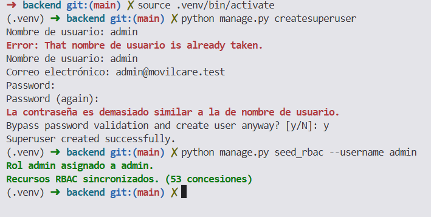

### Evidencia
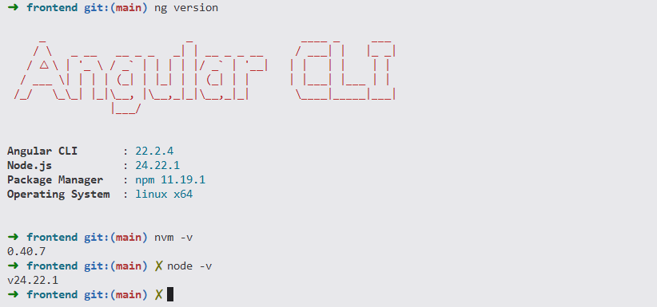

## Unidad ISS-01 — Bootstrap Angular 22 con CLI

### Creacion del workspace
```bash
npx @angular/cli@22 new frontend \
  --directory . \
  --style=tailwind \
  --ssr=false \s
  --routing \
  --zoneless \
  --skip-git \
  --package-manager=npm
```
### Evidencia
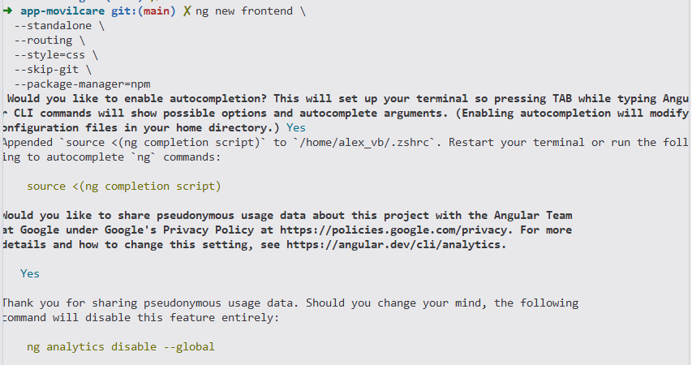


### Instalacion de Tailwind
```bash
npm install tailwindcss @tailwindcss/postcss postcss
```

### Evidencia
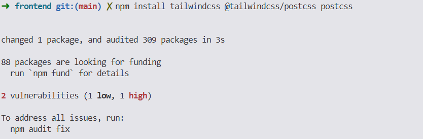
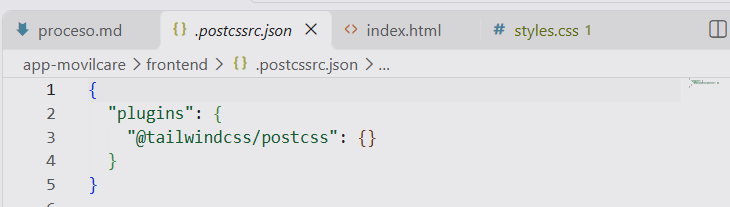

### Instalacion de dependencias
```bash
npm install primeng @primeuix/themes primeicons @angular/cdk
```
### Evidencia
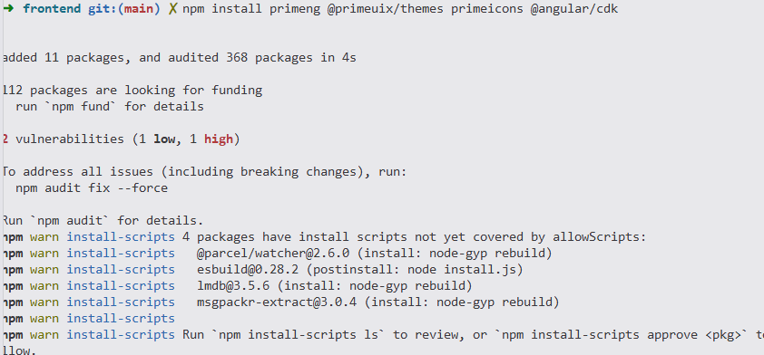

### Estilizado con Tailwind 4
`src/styles.css`
```css
@import "tailwindcss";
@import "primeicons/primeicons.css";

@layer base {
  html, body { height: 100%; }
  body {
    @apply bg-slate-100 text-slate-800 antialiased;
    font-family: Inter, ui-sans-serif, system-ui, sans-serif;
  }
}
```
### Evidencia
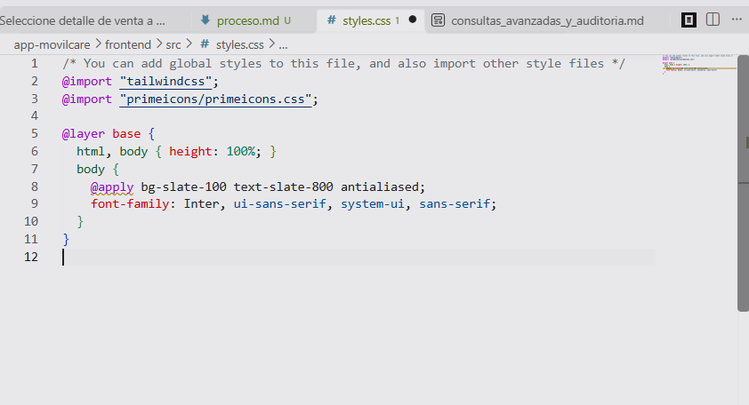

### PrimeNG Aura
`src/app/app.config.ts`
```typescript
import { ApplicationConfig, provideBrowserGlobalErrorListeners } from '@angular/core';
import { provideHttpClient, withInterceptors } from '@angular/common/http';
import { provideRouter, withComponentInputBinding, withInMemoryScrolling } from '@angular/router';
import { providePrimeNG } from 'primeng/config';
import Aura from '@primeuix/themes/aura';
import { ConfirmationService, MessageService } from 'primeng/api';

import { routes } from './app.routes';
import { authInterceptor } from './core/interceptors/auth-interceptor';
import { errorInterceptor } from './core/interceptors/error-interceptor';

export const appConfig: ApplicationConfig = {
  providers: [
    provideBrowserGlobalErrorListeners(),
    provideRouter(
      routes,
      withComponentInputBinding(),
      withInMemoryScrolling({ scrollPositionRestoration: 'top' }),
    ),
    provideHttpClient(withInterceptors([authInterceptor, errorInterceptor])),
    providePrimeNG({
      ripple: true,
      inputVariant: 'outlined',
      theme: {
        preset: Aura,
        options: { darkModeSelector: '.app-dark', cssLayer: false },
      },
    }),
    MessageService,
    ConfirmationService,
  ],
};
```
### Evidencia
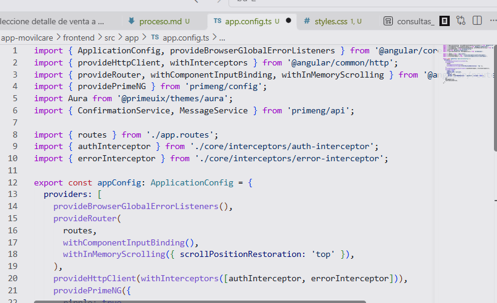

### Ejecucion
`npm run start`
### Evidencia
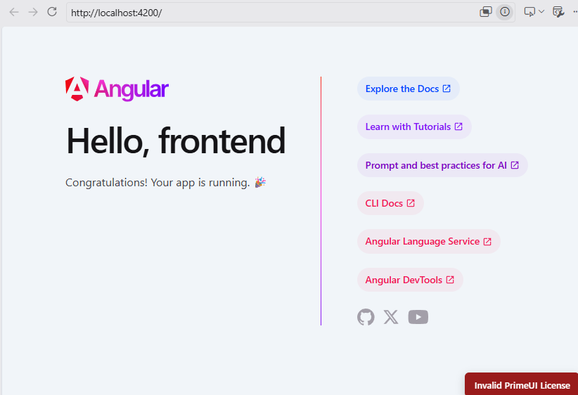

### Clave de PrimeUI
### Evidencias
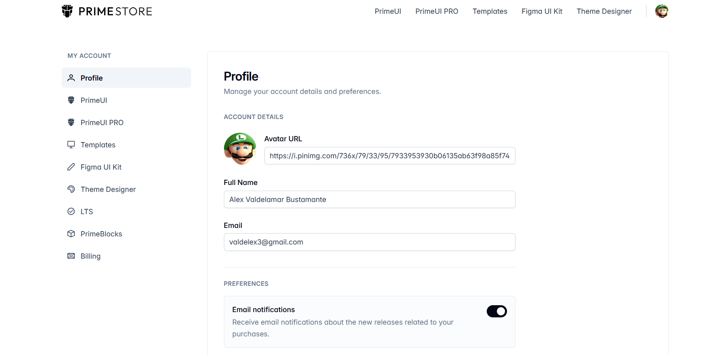
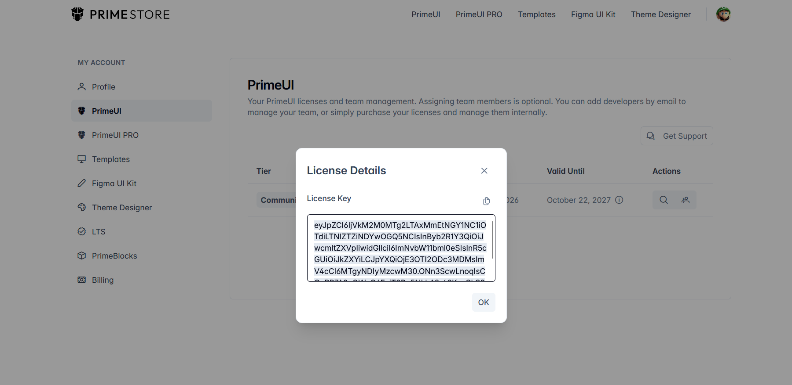

### Creacion de componente de ejemplo
```bash
ng generate component demo/ejemplo --standalone --style=css
```
#### `ejemplo.ts`
```ts
import { Component, signal, computed, effect } from '@angular/core';
import { CardModule } from 'primeng/card';
import { ButtonModule } from 'primeng/button';
import { TagModule } from 'primeng/tag';

interface Producto {
  nombre: string;
  precio: number;
  activo: boolean;
}

@Component({
  selector: 'app-ejemplo',
  standalone: true,
  imports: [CardModule, ButtonModule, TagModule],
  templateUrl: './ejemplo.html',
  styleUrl: './ejemplo.css',
  host: {
    class: 'block',
  },
})
export class Ejemplo {
  producto = signal<Producto>({
    nombre: 'Café molido 500 g',
    precio: 18000,
    activo: true,
  });

  iva = computed(() => this.producto().precio * 0.19);

  precioFinal = computed(
    () => this.producto().precio + this.iva()
  );

  estadoTexto = computed(
    () => this.producto().activo ? 'Activo' : 'Inactivo'
  );

  constructor() {
    effect(() => {
      const p = this.producto();

      console.log(
        `[ejemplo] ${p.nombre} · ${p.precio} · ${
          p.activo ? 'activo' : 'inactivo'
        }`
      );
    });
  }

  variarPrecio(): void {
    this.producto.update(actual => ({
      ...actual,
      precio: actual.precio + 1000,
    }));
  }

  cambiarEstado(): void {
    this.producto.update(actual => ({
      ...actual,
      activo: !actual.activo,
    }));
  }

  cambiarNombre(nombre: string): void {
    this.producto.update(actual => ({
      ...actual,
      nombre,
    }));
  }

  reiniciar(): void {
    this.producto.set({
      nombre: 'Café molido 500 g',
      precio: 18000,
      activo: true,
    });
  }
}
```
#### ejemplo.html
```html
<p-card header="Objeto producto">
  <div class="flex flex-col gap-4">

    <div>
      <label for="nombre" class="block mb-2 font-medium">
        Nombre del producto
      </label>

      <input
        id="nombre"
        type="text"
        class="w-full rounded-lg border border-slate-300 p-2"
        [value]="producto().nombre"
        (input)="cambiarNombre($any($event.target).value)"
      />

      <p class="mt-2 text-sm text-slate-500">
        Vista previa: {{ producto().nombre }}
      </p>
    </div>

    <div class="rounded-lg bg-slate-50 p-4">
      <p class="text-sm text-slate-500">Precio base</p>
      <p class="text-2xl font-semibold">
        {{ producto().precio }}
      </p>

      <p class="mt-2 text-sm text-slate-500">IVA (19 %)</p>
      <p>{{ iva() }}</p>

      <p class="mt-2 text-sm text-slate-500">Precio con IVA</p>
      <p class="text-xl font-semibold">{{ precioFinal() }}</p>

      <div class="mt-3">
        <p-tag
          [value]="estadoTexto()"
          [severity]="producto().activo ? 'success' : 'danger'"
        />
      </div>
    </div>

    <div class="flex flex-wrap gap-2">
      <p-button
        label="+1000"
        icon="pi pi-plus"
        (onClick)="variarPrecio()"
      />

      <p-button
        label="Cambiar estado"
        severity="secondary"
        (onClick)="cambiarEstado()"
      />

      <p-button
        label="Reiniciar"
        severity="contrast"
        (onClick)="reiniciar()"
      />
    </div>

    @if (producto().activo) {
      <p class="text-sm text-green-700">
        El producto está activo y disponible.
      </p>
    } @else {
      <p class="text-sm text-red-700">
        Producto inactivo. Se simula un borrado lógico.
      </p>
    }

  </div>
</p-card>
```
#### ejemplo.css
```css
.ejemplo-alcance {
  border-left: 4px solid #429c94;
}
```
#### ejemplo.spec.ts
```ts

import { TestBed } from '@angular/core/testing';
import { Ejemplo } from './ejemplo';

describe('Ejemplo', () => {
  beforeEach(async () => {
    await TestBed.configureTestingModule({
      imports: [Ejemplo],
    }).compileComponents();
  });

  it('crea el componente', () => {
    const fixture = TestBed.createComponent(Ejemplo);
    expect(fixture.componentInstance).toBeTruthy();
  });

  it('calcula el IVA y el precio final', () => {
    const fixture = TestBed.createComponent(Ejemplo);
    const componente = fixture.componentInstance;

    expect(componente.iva()).toBe(3420);
    expect(componente.precioFinal()).toBe(21420);
  });

  it('incrementa el precio en 1000', () => {
    const fixture = TestBed.createComponent(Ejemplo);
    const componente = fixture.componentInstance;

    componente.variarPrecio();

    expect(componente.producto().precio).toBe(19000);
    expect(componente.iva()).toBe(3610);
    expect(componente.precioFinal()).toBe(22610);
  });

  it('cambia el estado del producto', () => {
    const fixture = TestBed.createComponent(Ejemplo);
    const componente = fixture.componentInstance;

    componente.cambiarEstado();

    expect(componente.estadoTexto()).toBe('Inactivo');
  });

  it('cambia el nombre y permite reiniciar', () => {
    const fixture = TestBed.createComponent(Ejemplo);
    const componente = fixture.componentInstance;

    componente.cambiarNombre('Té verde');
    expect(componente.producto().nombre).toBe('Té verde');

    componente.reiniciar();
    expect(componente.producto().nombre).toBe('Café molido 500 g');
    expect(componente.producto().precio).toBe(18000);
    expect(componente.producto().activo).toBe(true);
  });
});
```
#### importacion en la app
```ts

import { Component } from '@angular/core';
import { Ejemplo } from './demo/ejemplo/ejemplo';

@Component({
  selector: 'app-root',
  standalone: true,
  imports: [Ejemplo],
  templateUrl: './app.html',
  styleUrl: './app.css',
})
export class App {}
```
```html
<main class="min-h-screen bg-slate-100 p-6 text-slate-900">
  <div class="mx-auto max-w-2xl">
    <h1 class="mb-6 text-2xl font-bold">
      Movilcare · Angular 22
    </h1>

    <app-ejemplo />
  </div>
</main>
```
### Evidencias
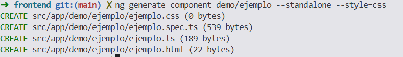
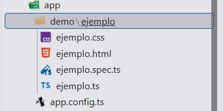
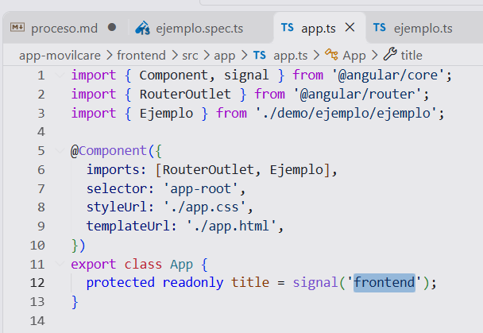
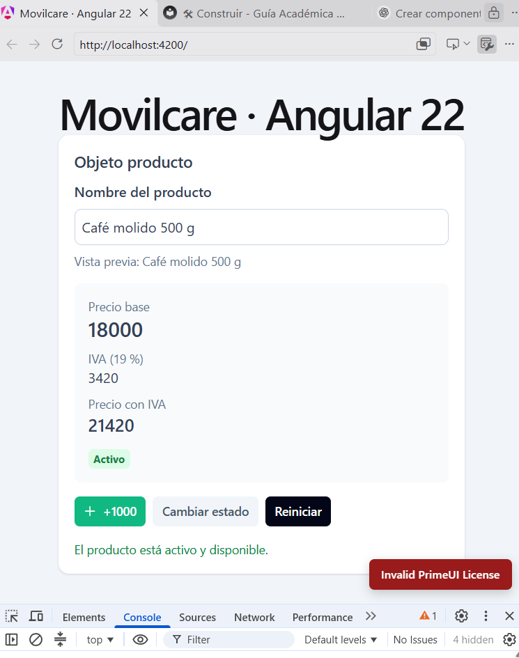

# Unidad ISS-01A — Esqueleto Header / Aside / contenido / Footer

## Generar las piezas del `layout/`
### Comandos
```bash
ng generate component layout/header --skip-tests --defaults
ng generate component layout/aside --skip-tests --defaults
ng generate component layout/footer --skip-tests --defaults
```
### Evidencias
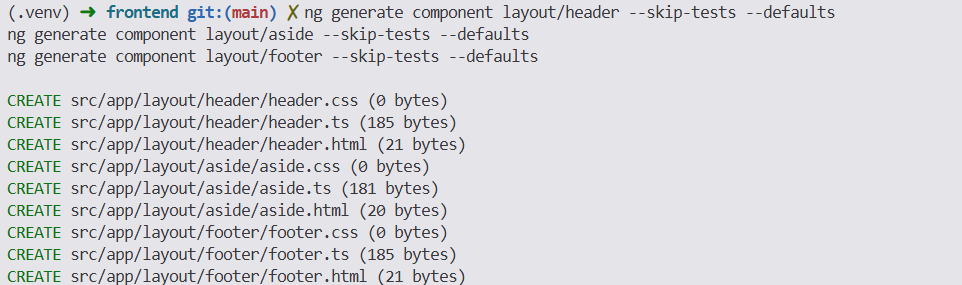
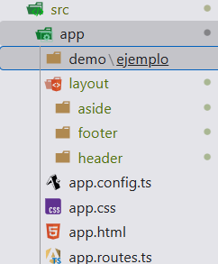

### contenido de header.ts
```ts
import { Component } from '@angular/core';

@Component({
  selector: 'app-header',
  standalone: true,
  imports: [],
  templateUrl: './header.html',
  styleUrl: './header.css',
})
export class Header {
  readonly title = 'Movilcare';
}
```
### contenido de header.html
```html
<header class="flex h-16 items-center border-b border-slate-200 bg-white px-6">
  <span class="text-xl font-bold text-slate-900">
    {{ title }}
  </span>
</header>
```
### Evidencias
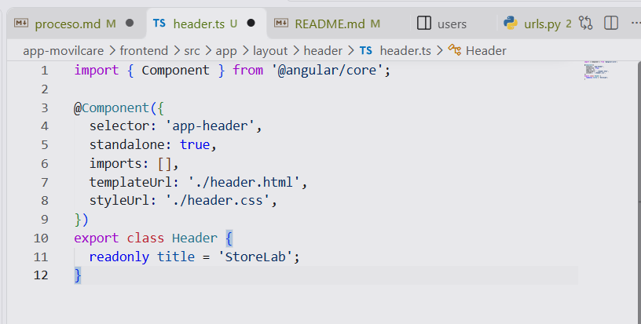
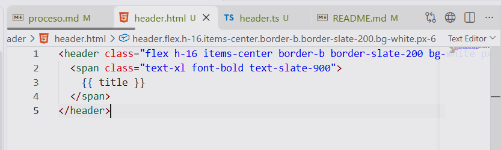

### contenido de aside.ts

```ts
import { Component } from '@angular/core';

@Component({
  selector: 'app-aside',
  standalone: true,
  imports: [],
  templateUrl: './aside.html',
  styleUrl: './aside.css',
})
export class Aside {}
```
### contenido de aside.html
```html
<nav
  aria-label="Navegación principal"
  class="min-h-full bg-slate-900 p-4 text-white"
>
  <h2 class="mb-4 text-sm font-semibold uppercase tracking-wide text-slate-400">
    Menú de Movilcare
  </h2>

  <p class="text-sm text-slate-300">
    La navegación se implementará en la siguiente etapa.
  </p>
</nav>
```

### Evidencias
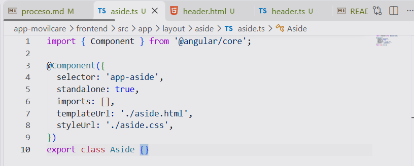
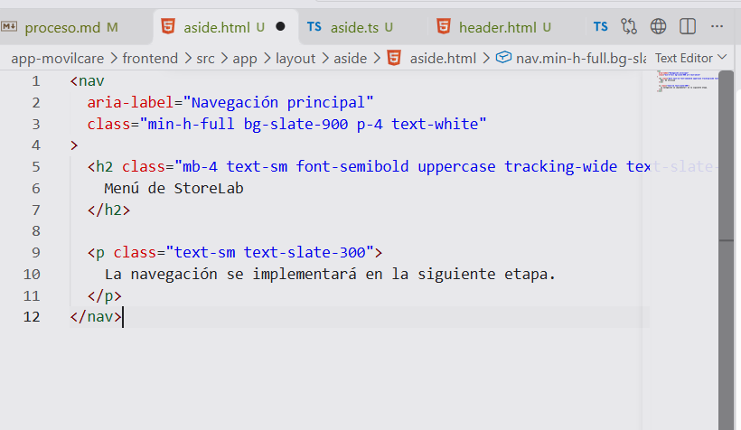

### contenido de footer.ts
```ts
import { Component } from '@angular/core';

@Component({
  selector: 'app-footer',
  standalone: true,
  imports: [],
  templateUrl: './footer.html',
  styleUrl: './footer.css',
})
export class Footer {}
```

### contenido de footer.html
```html
<footer class="border-t border-slate-200 bg-white px-6 py-4 text-sm text-slate-500">
  Movilcare · Gestión de clientes, productos y ventas.
</footer>
```

### Evidencias
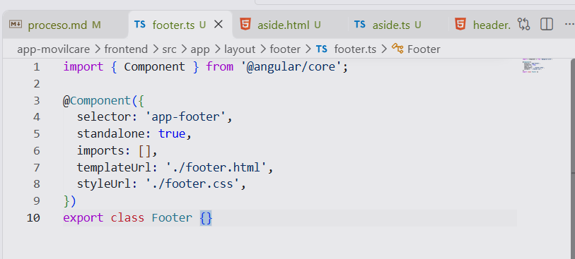
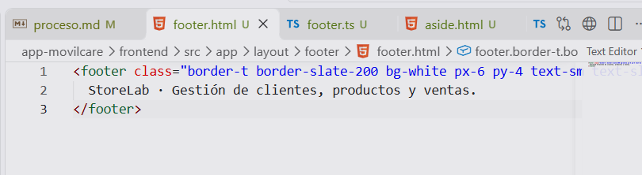

## Agregar componentes a la App

### Correccion de `app.ts`
```ts
import { Component, signal } from '@angular/core';
import { RouterOutlet } from '@angular/router';
import { Header } from './layout/header/header';
import { Aside } from './layout/aside/aside';
import { Footer } from './layout/footer/footer';

@Component({
  selector: 'app-root',
  standalone: true,
  imports: [RouterOutlet, Header, Aside, Footer],
  templateUrl: './app.html',
  styleUrl: './app.css',
})
export class App {
  protected readonly title = signal('Inicio');
}
```
### Correccion de `app.html`
```html
<div class="flex min-h-screen flex-col bg-slate-100 text-slate-900">

  <app-header />

  <div class="flex flex-1">

    <aside class="w-64 shrink-0">
      <app-aside />
    </aside>

    <main id="contenido" class="min-w-0 flex-1 p-6">
      <h1 class="mb-4 text-2xl font-bold">
        {{ title }}
      </h1>

      <p class="text-slate-600">
        Bienvenido a Movilcare.
      </p>
    </main>

  </div>

  <app-footer />

</div>
```

### Evidencias
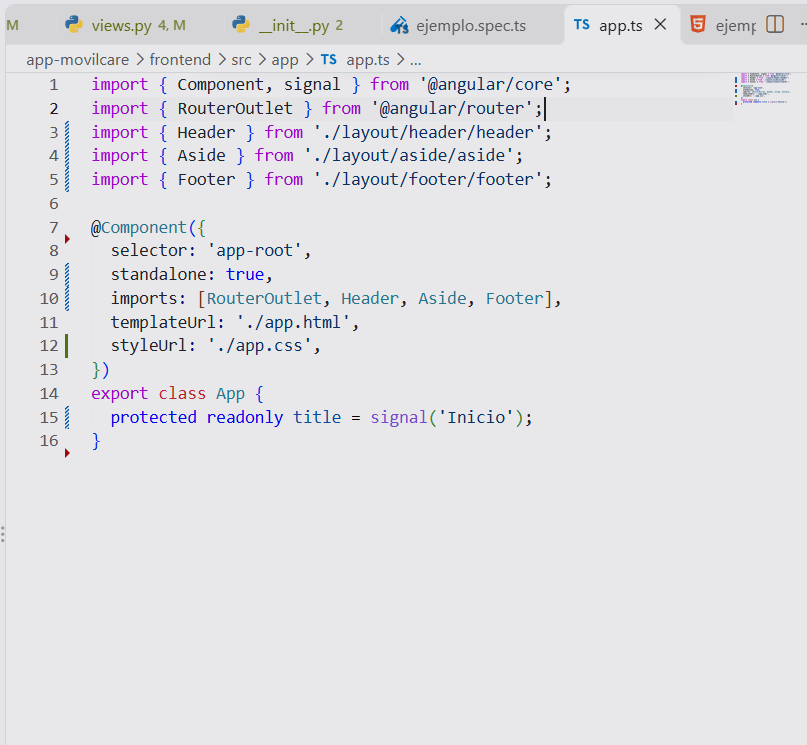
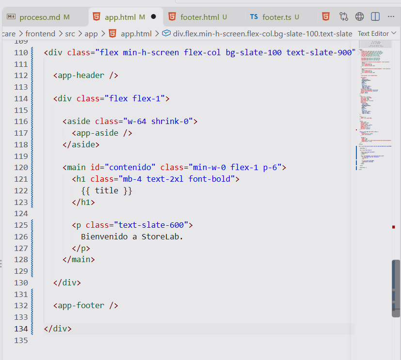
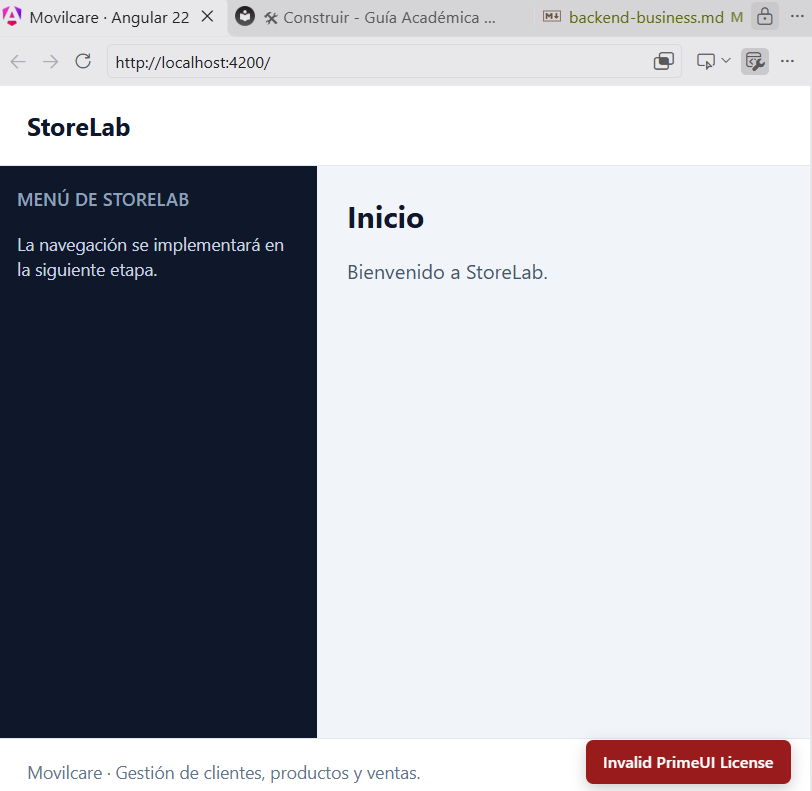

## Verificacion
### scripts
```bash
npm test -- --watch=false
grep -n 'app-ejemplo' src/app/app.html
Select-String -Path src/app/app.html -Pattern 'app-ejemplo'
```
### Evidencias
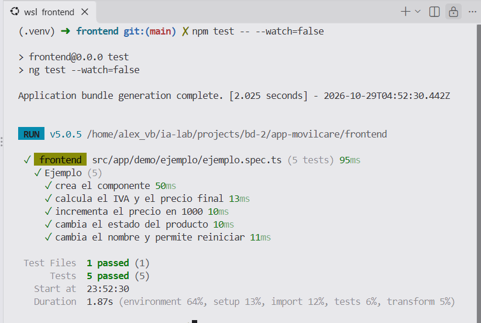
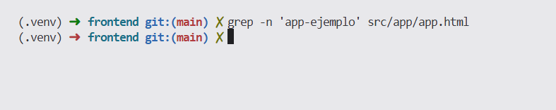

# Unidad ISS-01B Menú PrimeNG y primera interacción

## Actualizacion del Aside

### Contenido de `aside.ts`
```ts
import { Component, input, output } from '@angular/core';
import { MenuItem } from 'primeng/api';
import { ButtonModule } from 'primeng/button';
import { PanelMenuModule } from 'primeng/panelmenu';

@Component({
  selector: 'app-aside',
  imports: [ButtonModule, PanelMenuModule],
  templateUrl: './aside.html',
  styleUrl: './aside.css',
  host: {
    class: 'block h-full',
  },
})
export class Aside {
  readonly appName = input('Movilcare');
  readonly items = input<MenuItem[]>([]);

  readonly showSession = input(false);
  readonly username = input('');
  readonly roleLabel = input('Sin rol');
  readonly permissionCount = input(0);

  readonly navigated = output<void>();
  readonly logoutRequested = output<void>();

  onNavigationClick(event: Event): void {
    if (
      (event.target as HTMLElement).closest(
        'a, button, [role="button"]',
      )
    ) {
      this.navigated.emit();
    }
  }
}
```
### Contenido de `aside.html`
```html
<div class="flex h-full flex-col border-r border-slate-200 bg-white text-slate-900">
  <div class="flex h-16 items-center gap-3 border-b border-slate-200 px-5">
    <div class="flex h-9 w-9 items-center justify-center rounded-lg bg-slate-900 font-bold text-white">
      S
    </div>

    <div class="min-w-0">
      <p class="truncate text-sm font-semibold">
        {{ appName() }}
      </p>

      <p class="text-[11px] uppercase tracking-wider text-slate-400">
        Panel administrativo
      </p>
    </div>
  </div>

  <div class="flex-1 overflow-y-auto p-3">
    <nav
      aria-label="Navegación principal"
      (click)="onNavigationClick($event)"
    >
      <p-panelmenu
        [model]="items()"
        [multiple]="true"
      />
    </nav>
  </div>

  @if (showSession()) {
    <div class="border-t border-slate-200 p-4">
      <p class="text-sm font-medium">
        {{ username() || 'Invitado' }}
      </p>

      <p class="text-xs text-slate-400">
        {{ roleLabel() }}
      </p>

      <div class="mt-3 flex items-center justify-between text-xs text-slate-400">
        <span>{{ permissionCount() }} permisos</span>

        <button
          pButton
          type="button"
          text
          rounded
          aria-label="Cerrar sesión"
          (click)="logoutRequested.emit()"
        >
          <i pButtonIcon class="pi pi-sign-out"></i>
        </button>
      </div>
    </div>
  }
</div>
```

### Evidencias
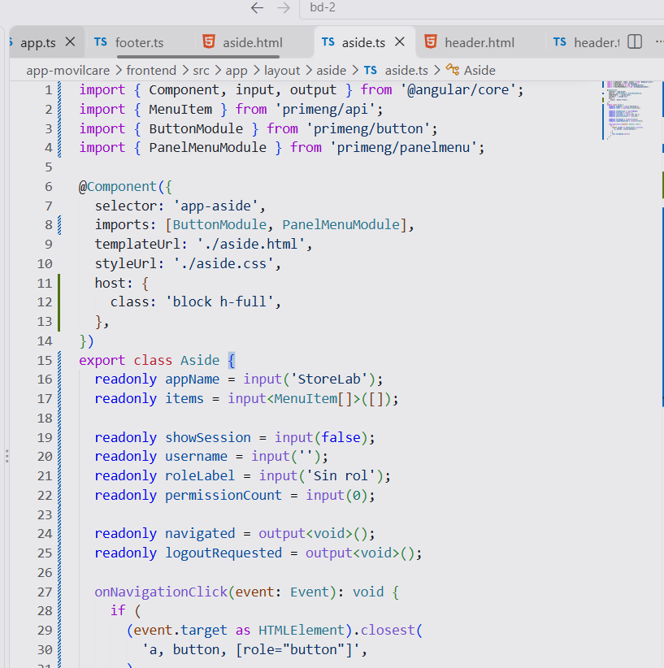
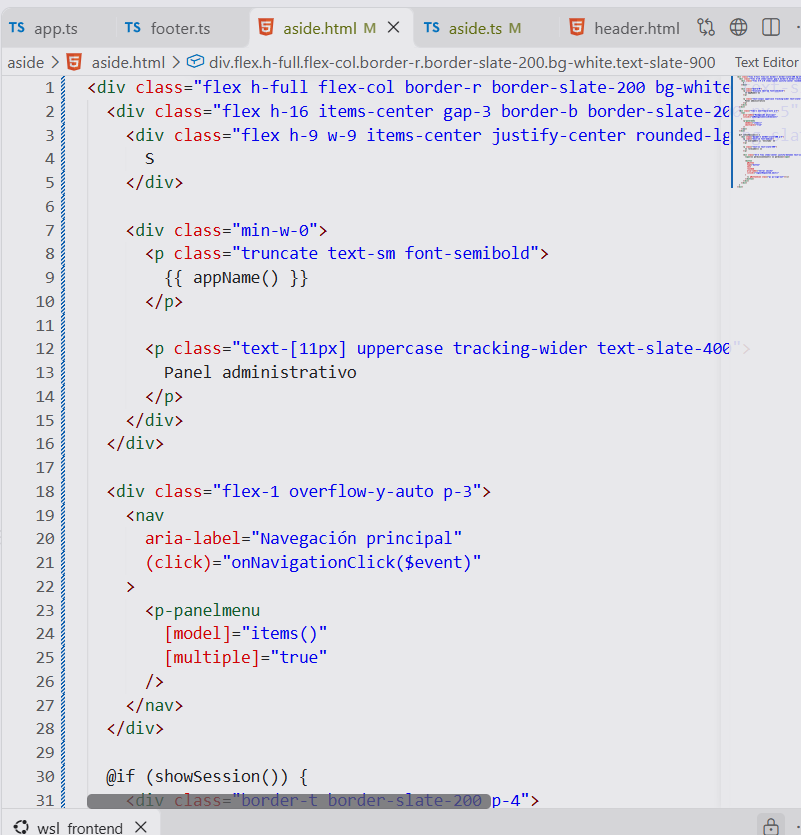

## Actializacion del Header
### contenido del `header.ts`
```ts
import { Component, input, output } from '@angular/core';
import { MenuItem } from 'primeng/api';
import { AvatarModule } from 'primeng/avatar';
import { ButtonModule } from 'primeng/button';
import { MenuModule } from 'primeng/menu';
import { TagModule } from 'primeng/tag';

@Component({
  selector: 'app-header',
  imports: [AvatarModule, ButtonModule, MenuModule, TagModule],
  templateUrl: './header.html',
  styleUrl: './header.css',
  host: {
    class: 'block',
  },
})
export class Header {
  readonly appName = input('Movilcare');

  readonly username = input('');
  readonly initials = input('IN');
  readonly roleLabel = input('Sin rol');
  readonly authEnabled = input(true);
  readonly showSession = input(false);
  readonly userItems = input<MenuItem[]>([]);

  readonly menuRequested = output<void>();
}
```
### contenido de `header.html`
```html
<header
  class="sticky top-0 z-30 flex h-16 items-center gap-3 border-b border-slate-200 bg-white px-4 sm:px-6"
>
  <button
    pButton
    type="button"
    text
    rounded
    aria-label="Mostrar u ocultar el menú"
    (click)="menuRequested.emit()"
  >
    <i pButtonIcon class="pi pi-bars"></i>
  </button>

  <div class="min-w-0 flex-1">
    <p class="truncate text-sm font-semibold text-slate-900">
      {{ appName() }}
    </p>

    <p class="truncate text-xs text-slate-500">
      Gestión de clientes, productos y ventas
    </p>
  </div>

  @if (showSession() && !authEnabled()) {
    <p-tag
      value="Fase I · sin auth"
      severity="warn"
      [rounded]="true"
    />
  }

  @if (username()) {
    <p-tag
      [value]="roleLabel()"
      severity="info"
      [rounded]="true"
      class="hidden sm:inline-flex"
    />
  }

  @if (showSession()) {
    <button
      pButton
      type="button"
      severity="secondary"
      outlined
      (click)="userMenuPanel.toggle($event)"
      aria-label="Menú de usuario"
    >
      <p-avatar
        [label]="initials()"
        shape="circle"
        size="normal"
      />

      <span class="hidden max-w-32 truncate text-sm font-medium text-slate-700 sm:block">
        {{ username() }}
      </span>

      <i class="pi pi-chevron-down pr-1 text-[10px] text-slate-400"></i>
    </button>

    <p-menu
      #userMenuPanel
      [model]="userItems()"
      [popup]="true"
      appendTo="body"
    />
  }
</header>
```
### Evidencias
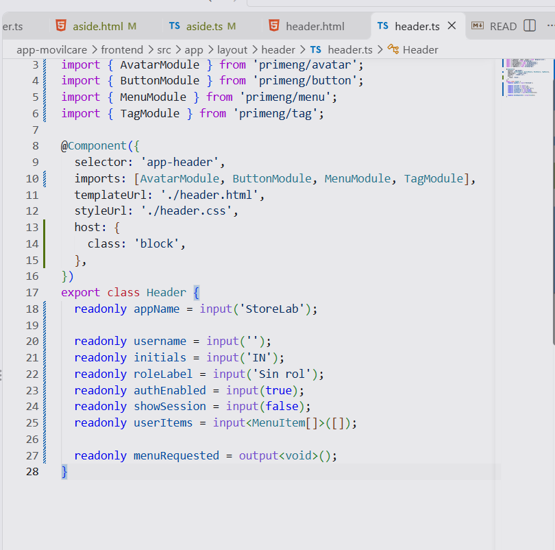
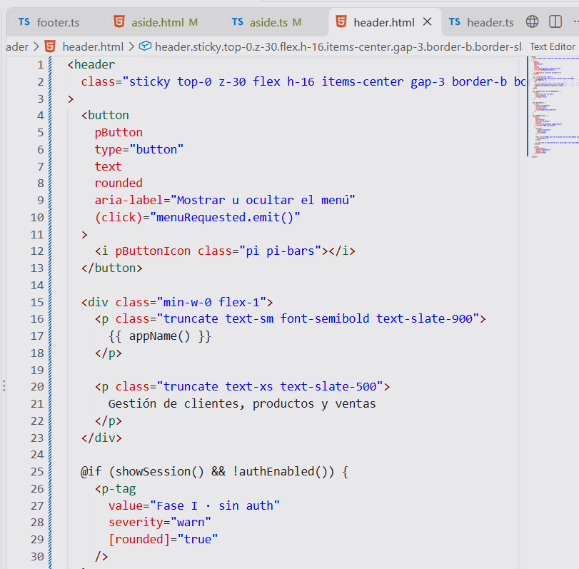

## Creacion del componente Construir

### scripts
```bash
ng generate component features/construir --skip-tests --defaults
mkdir -p src/app/core/utils
```

### Contenido de `src/app/core/utils/media-query.ts`
```ts
import {
  DestroyRef,
  Signal,
  inject,
  signal,
} from '@angular/core';

export function watchMediaQuery(
  query: string,
): Signal<boolean> {
  const destroyRef = inject(DestroyRef);

  const media =
    typeof window !== 'undefined' &&
    typeof window.matchMedia === 'function'
      ? window.matchMedia(query)
      : null;

  const matches = signal(media?.matches ?? false);

  if (media) {
    const listener = (
      event: MediaQueryListEvent,
    ): void => {
      matches.set(event.matches);
    };

    media.addEventListener('change', listener);

    destroyRef.onDestroy(() => {
      media.removeEventListener('change', listener);
    });
  }

  return matches.asReadonly();
}
```

### contenido de construir.ts
```ts
import { Component, signal } from '@angular/core';
import { MenuItem } from 'primeng/api';
import { ButtonModule } from 'primeng/button';
import { CardModule } from 'primeng/card';
import { DrawerModule } from 'primeng/drawer';

import { watchMediaQuery } from '../../core/utils/media-query';
import { Aside } from '../../layout/aside/aside';
import { Footer } from '../../layout/footer/footer';
import { Header } from '../../layout/header/header';

@Component({
  selector: 'app-construir',
  imports: [
    Aside,
    ButtonModule,
    CardModule,
    DrawerModule,
    Footer,
    Header,
  ],
  templateUrl: './construir.html',
  styleUrl: './construir.css',
  host: {
    class: 'block',
  },
})
export class Construir {
  private readonly isDesktop =
    watchMediaQuery('(min-width: 1024px)');

  readonly sidebarCollapsed = signal(false);
  readonly mobileOpen = signal(false);
  readonly title = signal('Inicio');

  readonly items: MenuItem[] = [
    {
      label: 'Inicio',
      icon: 'pi pi-home',
      command: () => this.seleccionar('Inicio'),
    },
    {
      label: 'Clientes',
      icon: 'pi pi-users',
      command: () => this.seleccionar('Clientes'),
    },
    {
      label: 'Tipos de producto',
      icon: 'pi pi-tags',
      command: () => this.seleccionar('Tipos de producto'),
    },
    {
      label: 'Productos',
      icon: 'pi pi-box',
      command: () => this.seleccionar('Productos'),
    },
    {
      label: 'Ventas',
      icon: 'pi pi-shopping-cart',
      command: () => this.seleccionar('Ventas'),
    },
  ];

  protected onMenuToggle(): void {
    if (this.isDesktop()) {
      this.sidebarCollapsed.update(
        (collapsed) => !collapsed,
      );
      return;
    }

    this.mobileOpen.set(true);
  }

  protected seleccionar(titulo: string): void {
    this.title.set(titulo);
    this.mobileOpen.set(false);
  }
}
```
### Evidencias
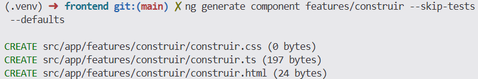
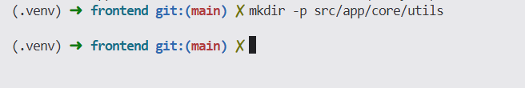
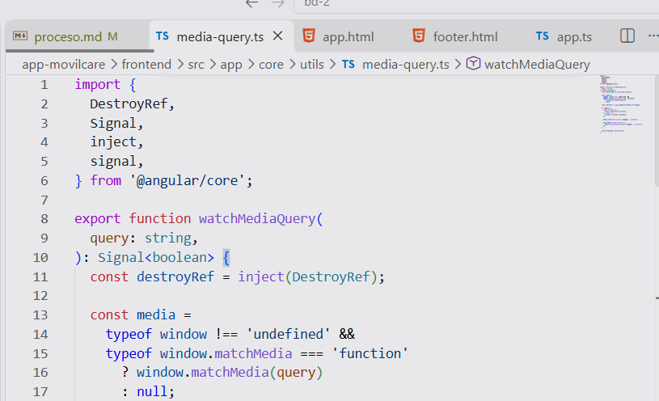
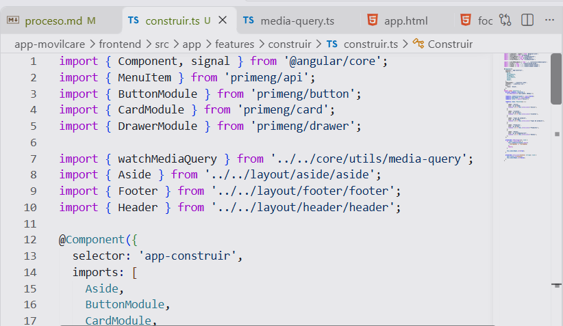
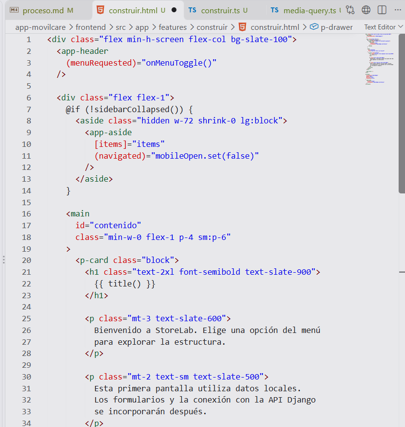

## Crear punto de entrada del router
### nuevo contenido de `app.ts`
```ts
import { Component } from '@angular/core';
import { RouterOutlet } from '@angular/router';

@Component({
  selector: 'app-root',
  imports: [RouterOutlet],
  templateUrl: './app.html',
  styleUrl: './app.css',
})
export class App {}
```
Se elimina todo de `src/app/app.html` menos `<router-outlet />`

### Contenido de `src/app/app.routes.ts`
```ts
import { Routes } from '@angular/router';

export const routes: Routes = [
  {
    path: 'construir',
    loadComponent: () =>
      import('./features/construir/construir')
        .then((m) => m.Construir),
  },
  {
    path: '',
    pathMatch: 'full',
    redirectTo: 'construir',
  },
  {
    path: '**',
    redirectTo: 'construir',
  },
];
```
### Evidencias
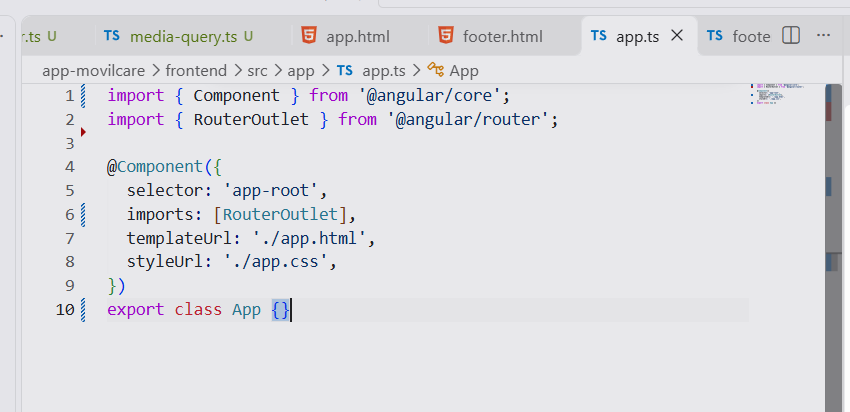
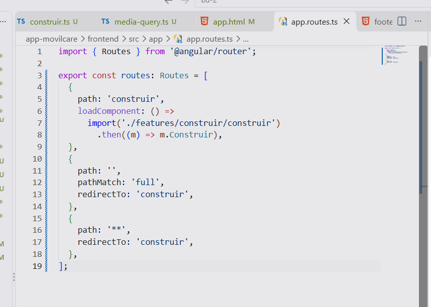

# ISS-02 — Núcleo, modelos y layout de MovilCare

## 1. Configuración del entorno

Primero centralicé la dirección del backend para evitar escribirla directamente en cada servicio.

### 1.1. Generar los archivos de entorno

```bash
ng generate environments
```

### Evidencia
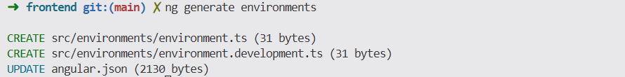

Este comando crea los archivos de configuración del entorno. Si ya existen, revisa su contenido en lugar de generarlos nuevamente.

La estructura resultado es:

```text
src/
├── environments/
│   ├── environment.ts
│   └── environment.development.ts
└── app/
```

### Evidencia
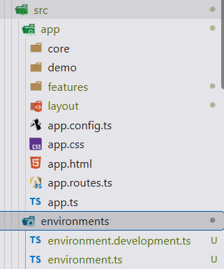

En `src/environments/environment.ts`, configura lo siguiente:

```typescript
export const environment = {
  production: true,
  appName: 'MovilCare',
  apiUrl: 'http://127.0.0.1:8000/api',
};
```

### Evidencia
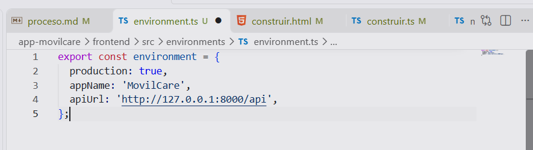

En `src/environments/environment.development.ts`, configura:

```typescript
export const environment = {
  production: false,
  appName: 'MovilCare',
  apiUrl: 'http://127.0.0.1:8000/api',
};
```

### Evidencia
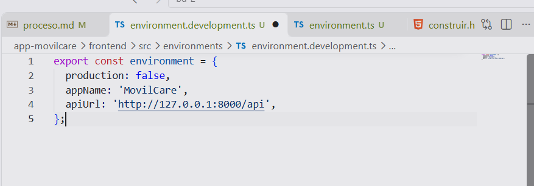

**Es importante que `apiUrl` no termine en una barra `/`.**

Esto nos permitirá construir las rutas de los servicios de manera consistente. Por ejemplo:

```text
apiUrl:       http://127.0.0.1:8000/api
Servicio:     /products/
URL completa: http://127.0.0.1:8000/api/products/
```

Si agregáramos la barra al final de `apiUrl` y después otra en el servicio, podríamos terminar generando direcciones incorrectas.

### 1.2. Configurar los entornos de Angular

Abri `angular.json` y busca la configuración del proyecto, dentro de:

```text
projects
└── frontend
    └── architect
        └── build
            └── configurations
                └── development
```

Dentro de la configuración `development`, existe la propiedad `fileReplacements`:

```json
"fileReplacements": [
  {
    "replace": "src/environments/environment.ts",
    "with": "src/environments/environment.development.ts"
  }
]
```

### Evidencia
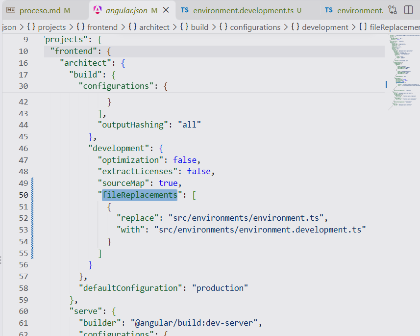

---

## 2. Organización de los modelos

El siguiente paso consiste en crear las interfaces TypeScript que representan los datos que intercambia MovilCare con Django REST Framework.

Para mantener el proyecto organizado, utilizaremos esta estructura:

```text
src/app/
├── core/
│   ├── models/
│   │   ├── api.model.ts
│   │   ├── customer.model.ts
│   │   ├── product.model.ts
│   │   ├── serialized-unit.model.ts
│   │   └── sale.model.ts
│   ├── services/
│   └── utils/
├── features/
│   ├── customers/
│   ├── products/
│   ├── serialized-units/
│   └── sales/
├── layout/
├── shared/
└── app.routes.ts
```

### 2.1 Scripts de creacion 
```bash
ng generate interface core/models/api --type=model --defaults
ng generate interface core/models/customer --type=model --defaults
ng generate interface core/models/serialized-unit --type=model --defaults
ng generate interface core/models/product --type=model --defaults
ng generate interface core/models/sale --type=model --defaults
ng generate interface core/models/sale-detail --type=model --defaults
ng generate interface core/models/auth --type=model --defaults
```

### Evidencia
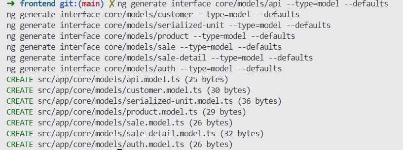
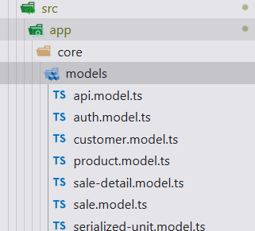

Organicé los modelos en `src/app/core/models` y adapté sus propiedades a las respuestas JSON del backend. Utilicé `camelCase` para los nombres de las propiedades y `string` para los importes monetarios y las fechas recibidas como texto.

#### **Archivo: `src/app/core/models/api.model.ts`**

```typescript
export type Status = 'active' | 'inactive';

export type Money = string;

export type HttpMethod =
  | 'GET'
  | 'POST'
  | 'PUT'
  | 'PATCH'
  | 'DELETE';

export interface Timestamps {
  createdAt?: string;
  updatedAt?: string;
}

export interface ApiError {
  detail?: string;
}

export function toNumber(
  value: Money | number | null | undefined,
): number {
  const parsed = Number(value ?? 0);
  return Number.isFinite(parsed) ? parsed : 0;
}
```

#### **Archivo: `src/app/core/models/customer.model.ts`**

```typescript
import { Status, Timestamps } from './api.model';

export interface Customer extends Timestamps {
  id: number;
  documentType: string;
  documentNumber: string;
  name: string;
  phone: string | null;
  email: string | null;
  status: Status;
}

export type CustomerPayload = Omit<
  Customer,
  'id' | 'createdAt' | 'updatedAt'
>;
```

#### **Archivo: `src/app/core/models/product.model.ts`**

```typescript
import { Money, Status, Timestamps } from './api.model';

export interface Product extends Timestamps {
  id: number;
  sku: string;
  name: string;
  description: string | null;
  price: Money;
  status: Status;
}

export type ProductPayload = Omit<
  Product,
  'id' | 'createdAt' | 'updatedAt'
>;
```

#### **Archivo: `src/app/core/models/serialized-unit.model.ts`**

```typescript
import { Status, Timestamps } from './api.model';

export interface SerializedUnit extends Timestamps {
  id: number;
  product: number;
  productId: number;
  productName: string;
  name: string;
  description: string | null;
  status: Status;
}

export type SerializedUnitPayload = Pick<
  SerializedUnit,
  'product' | 'name' | 'description'
>;
```

#### **Archivo: `src/app/core/models/sale-detail.model.ts`**

```typescript
import { Money } from './api.model';

export interface SaleDetail {
  productId: number;
  quantity: number;
  unitPrice: Money;
  lineTotal: Money;
}

export interface SaleDetailInput {
  productId: number;
  quantity: number;
}
```

#### **Archivo: `src/app/core/models/sale.model.ts`**

```typescript
import { Money, Status, Timestamps } from './api.model';
import { SaleDetail, SaleDetailInput } from './sale-detail.model';

export interface Sale extends Timestamps {
  id: number;
  customerId: number;
  customerName: string;
  saleDate: string;
  subtotal: Money;
  tax: Money;
  discounts: Money;
  total: Money;
  status: Status;
  lines: SaleDetail[];
}

export interface SaleCreatePayload {
  customerId: number;
  saleDate: string;
  discounts: Money;
  lines: SaleDetailInput[];
}
```

#### **Archivo: `src/app/core/models/auth.model.ts`**

```typescript
import { Status, Timestamps } from './api.model';

export interface User extends Timestamps {
  id: number;
  username: string;
  email: string;
  status: Status;
}

export interface SessionTokens {
  access: string;
  refresh: string;
  tokenType: 'Bearer';
}

export interface EffectivePermission {
  method: string;
  path: string;
  roleId: number;
  roleName: string;
}
```

De esta manera, separé las estructuras de clientes, productos, unidades serializadas y ventas, respetando la relación entre productos y unidades. Los nombres y tipos definitivos de cada propiedad deben coincidir con los serializadores reales del backend.

### Evidencia

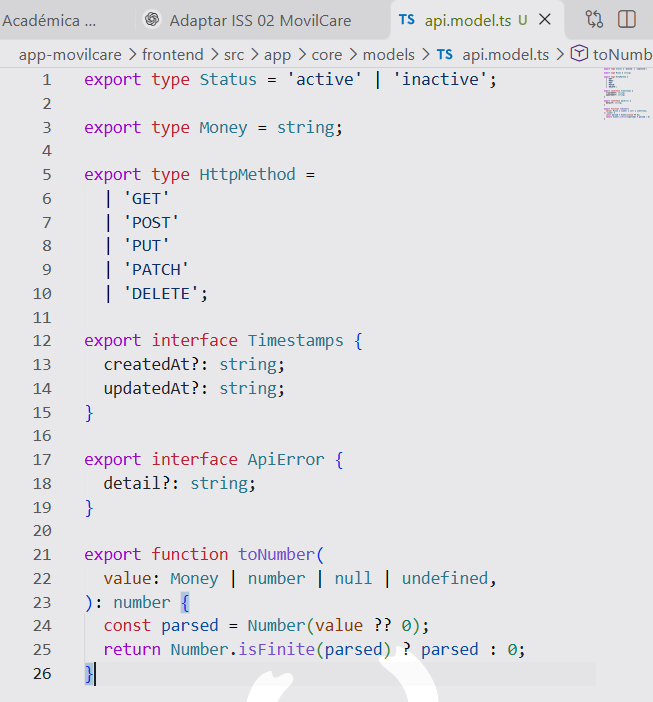
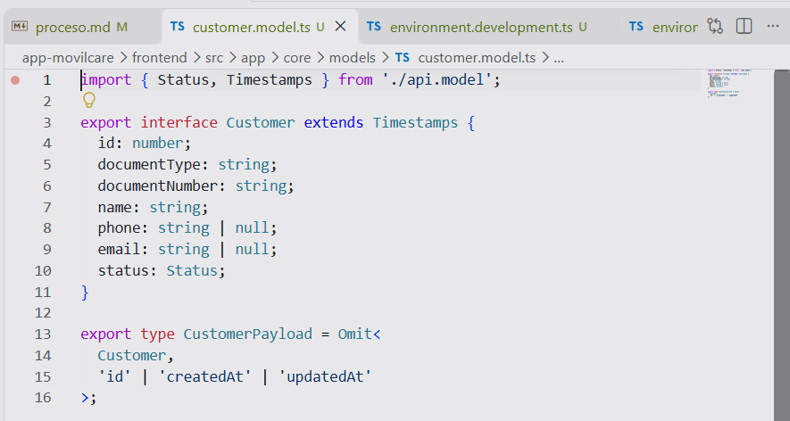
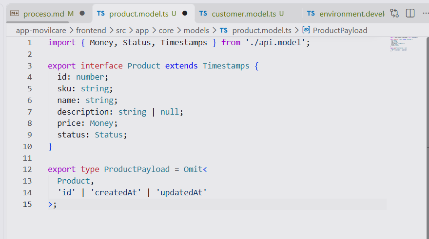
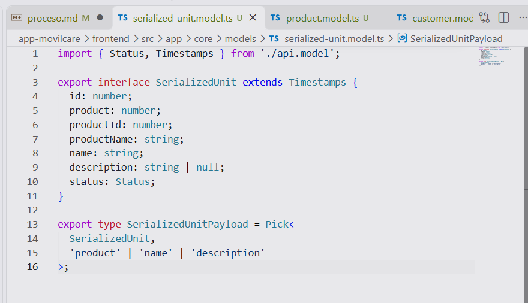


---

## 02.3. Creación de servicios por entidad

Generé los servicios para centralizar las solicitudes HTTP de MovilCare:

```bash
ng generate service features/customers/customer-api --skip-tests --defaults
ng generate service features/products/product-api --skip-tests --defaults
ng generate service features/serialized-units/serialized-unit-api --skip-tests --defaults
ng generate service features/sales/sale-api --skip-tests --defaults
ng generate service features/sale-details/sale-detail-api --skip-tests --defaults
```

### Evidencia


Implementé un servicio por recurso, utilizando `HttpClient`, `Observable` y la URL definida en `environment`. Configuré los métodos según los endpoints disponibles en el backend.

#### **Archivo: `src/app/features/customers/customer-api.ts`**

```typescript
import { HttpClient } from '@angular/common/http';
import { Injectable, inject } from '@angular/core';
import { Observable } from 'rxjs';
import { environment } from '../../../environments/environment';
import { Customer, CustomerPayload } from '../../core/models/customer.model';

@Injectable({ providedIn: 'root' })
export class CustomerApi {
  private readonly http = inject(HttpClient);
  private readonly base = `${environment.apiUrl}/customers`;

  list(): Observable<Customer[]> {
    return this.http.get<Customer[]>(`${this.base}/`);
  }

  get(id: number): Observable<Customer> {
    return this.http.get<Customer>(`${this.base}/${id}/`);
  }

  create(payload: CustomerPayload): Observable<Customer> {
    return this.http.post<Customer>(`${this.base}/`, payload);
  }

  update(
    id: number,
    payload: Partial<CustomerPayload>,
  ): Observable<Customer> {
    return this.http.patch<Customer>(
      `${this.base}/${id}/`,
      payload,
    );
  }

  remove(id: number): Observable<void> {
    return this.http.delete<void>(`${this.base}/${id}/`);
  }
}
```

#### **Archivo: `src/app/features/products/product-api.ts`**

```typescript
import { HttpClient } from '@angular/common/http';
import { Injectable, inject } from '@angular/core';
import { Observable } from 'rxjs';
import { environment } from '../../../environments/environment';
import { Product, ProductPayload } from '../../core/models/product.model';

@Injectable({ providedIn: 'root' })
export class ProductApi {
  private readonly http = inject(HttpClient);
  private readonly base = `${environment.apiUrl}/products`;

  list(): Observable<Product[]> {
    return this.http.get<Product[]>(`${this.base}/`);
  }

  get(id: number): Observable<Product> {
    return this.http.get<Product>(`${this.base}/${id}/`);
  }

  available(): Observable<Product[]> {
    return this.http.get<Product[]>(`${this.base}/available/`);
  }

  create(payload: ProductPayload): Observable<Product> {
    return this.http.post<Product>(`${this.base}/`, payload);
  }

  update(
    id: number,
    payload: Partial<ProductPayload>,
  ): Observable<Product> {
    return this.http.patch<Product>(
      `${this.base}/${id}/`,
      payload,
    );
  }

  remove(id: number): Observable<void> {
    return this.http.delete<void>(`${this.base}/${id}/`);
  }

  units(productId: number): Observable<unknown[]> {
    return this.http.get<unknown[]>(
      `${this.base}/${productId}/units/`,
    );
  }
}
```

#### **Archivo: `src/app/features/serialized-units/serialized-unit-api.ts`**

```typescript
import { HttpClient } from '@angular/common/http';
import { Injectable, inject } from '@angular/core';
import { Observable } from 'rxjs';
import { environment } from '../../../environments/environment';
import {
  SerializedUnit,
  SerializedUnitPayload,
} from '../../core/models/serialized-unit.model';

@Injectable({ providedIn: 'root' })
export class SerializedUnitApi {
  private readonly http = inject(HttpClient);
  private readonly base = `${environment.apiUrl}/serialized-units`;

  list(): Observable<SerializedUnit[]> {
    return this.http.get<SerializedUnit[]>(`${this.base}/`);
  }

  get(id: number): Observable<SerializedUnit> {
    return this.http.get<SerializedUnit>(`${this.base}/${id}/`);
  }

  create(payload: SerializedUnitPayload): Observable<SerializedUnit> {
    return this.http.post<SerializedUnit>(`${this.base}/`, payload);
  }

  update(
    id: number,
    payload: Partial<SerializedUnitPayload>,
  ): Observable<SerializedUnit> {
    return this.http.patch<SerializedUnit>(
      `${this.base}/${id}/`,
      payload,
    );
  }

  remove(id: number): Observable<void> {
    return this.http.delete<void>(`${this.base}/${id}/`);
  }
}
```

#### **Archivo: `src/app/features/sales/sale-api.ts`**

```typescript
import { HttpClient } from '@angular/common/http';
import { Injectable, inject } from '@angular/core';
import { Observable } from 'rxjs';
import { environment } from '../../../environments/environment';
import {
  Sale,
  SaleCreatePayload,
} from '../../core/models/sale.model';

@Injectable({ providedIn: 'root' })
export class SaleApi {
  private readonly http = inject(HttpClient);
  private readonly base = `${environment.apiUrl}/sales`;

  list(): Observable<Sale[]> {
    return this.http.get<Sale[]>(`${this.base}/`);
  }

  get(id: number): Observable<Sale> {
    return this.http.get<Sale>(`${this.base}/${id}/`);
  }

  create(payload: SaleCreatePayload): Observable<Sale> {
    return this.http.post<Sale>(`${this.base}/`, payload);
  }

  voidSale(id: number): Observable<void> {
    return this.http.delete<void>(`${this.base}/${id}/`);
  }
}
```

#### **Archivo: `src/app/features/sale-details/sale-detail-api.ts`**

```typescript
import { Injectable, inject } from '@angular/core';
import { map, Observable } from 'rxjs';
import { SaleDetail } from '../../core/models/sale-detail.model';
import { Sale } from '../../core/models/sale.model';
import { SaleApi } from '../sales/sale-api';

@Injectable({ providedIn: 'root' })
export class SaleDetailApi {
  private readonly sales = inject(SaleApi);

  list(): Observable<SaleDetail[]> {
    return this.sales.list().pipe(
      map((sales: Sale[]) => sales.flatMap((sale) => sale.lines ?? [])),
    );
  }

  bySale(saleId: number): Observable<SaleDetail[]> {
    return this.sales.get(saleId).pipe(
      map((sale) => sale.lines ?? []),
    );
  }
}
```

Habilité `HttpClient` en `src/app/app.config.ts`, agregando `provideHttpClient()` a los proveedores existentes:

```typescript
import { provideHttpClient } from '@angular/common/http';
```

```typescript
providers: [
  provideHttpClient(),
  // Mantener los demás proveedores existentes.
]
```

Finalmente, preparé los servicios para que las pantallas pudieran consumir los recursos sin duplicar las URL ni la lógica de comunicación con Django.

### Evidencia


---

## 02.4. Implementación de `NotificationService`

Implementé un servicio para centralizar las notificaciones de la interfaz mediante `MessageService` de PrimeNG.

#### **Archivo: `src/app/core/services/notification.ts`**

```typescript
import { Injectable, inject } from '@angular/core';
import { MessageService } from 'primeng/api';

@Injectable({ providedIn: 'root' })
export class NotificationService {
  private readonly messages = inject(MessageService);

  success(summary: string, detail?: string): void {
    this.messages.add({
      severity: 'success',
      summary,
      detail,
      life: 3000,
    });
  }

  info(summary: string, detail?: string): void {
    this.messages.add({
      severity: 'info',
      summary,
      detail,
      life: 4000,
    });
  }

  warn(summary: string, detail?: string): void {
    this.messages.add({
      severity: 'warn',
      summary,
      detail,
      life: 4500,
    });
  }

  error(summary: string, detail?: string): void {
    this.messages.add({
      severity: 'error',
      summary,
      detail,
      life: 6000,
    });
  }
}
```

Registré `MessageService` en los proveedores de la aplicación y conservé el componente Toast del layout para presentar las notificaciones sin duplicar su implementación en cada pantalla.

### Evidencia


---

## 02.5. Implementación de `toApiMessage`: tratamiento de errores de la API

Creé una utilidad para convertir las respuestas de error del backend en mensajes comprensibles para el usuario. Contemplé los errores generales, los errores de validación y los códigos HTTP más relevantes.

#### **Archivo: `src/app/core/utils/to-api-message.ts`**

```typescript
import { HttpErrorResponse } from '@angular/common/http';
import { ApiError } from '../models/api.model';

const HTTP_MESSAGES: Record<number, string> = {
  400: 'Revisa los datos del formulario.',
  401: 'La sesión no es válida. Inicia sesión nuevamente.',
  403: 'No tienes autorización para esta operación.',
  404: 'El registro solicitado no existe.',
  409: 'El registro genera un conflicto con los datos existentes.',
};

export function toApiMessage(error: unknown): string {
  if (!(error instanceof HttpErrorResponse)) {
    return error instanceof Error
      ? error.message
      : 'Se produjo un error inesperado.';
  }

  if (error.status === 0) {
    return 'No se pudo conectar con la API de MovilCare.';
  }

  const body: unknown = error.error;

  if (body && typeof body === 'object' && !Array.isArray(body)) {
    const detail = (body as ApiError).detail;

    if (typeof detail === 'string' && detail.trim()) {
      return detail.trim();
    }

    for (const [field, value] of Object.entries(
      body as Record<string, unknown>,
    )) {
      const message = Array.isArray(value) ? value[0] : value;

      if (typeof message === 'string' && message.trim()) {
        return `${field}: ${message.trim()}`;
      }
    }
  }

  return HTTP_MESSAGES[error.status] ?? error.message;
}
```

Con esta función, centralicé el tratamiento de errores para reutilizarlo en los formularios y operaciones de los distintos módulos.

### Evidencia


---

## 02.6. Implementación de `filterRows`: búsqueda local de registros

Implementé una función genérica para filtrar registros en memoria sin depender de Angular ni modificar las colecciones originales.

#### **Archivo: `src/app/core/utils/filter-rows.ts`**

```typescript
export function filterRows<T>(
  rows: readonly T[],
  query: string,
  pick: (
    row: T,
  ) => Array<string | number | null | undefined>,
): T[] {
  const term = query.trim().toLowerCase();

  if (!term) {
    return [...rows];
  }

  return rows.filter((row) =>
    pick(row).some((value) =>
      (value ?? '').toString().toLowerCase().includes(term),
    ),
  );
}
```

Preparé la utilidad para utilizarla en los listados de clientes, productos y unidades serializadas, seleccionando los campos relevantes de cada entidad.

### Evidencia


---

## 02.7. Configuración de rutas e integración del layout

Organicé las rutas de Angular para alojar las pantallas de MovilCare dentro del componente `Shell`. Conservé el `router-outlet` principal y utilicé componentes provisionales mientras se desarrollan las pantallas funcionales.

Creé el componente provisional mediante Angular CLI:

```bash
ng generate component features/placeholder --skip-tests --defaults
```

#### **Archivo: `src/app/features/placeholder/placeholder.ts`**

```typescript
import { Component } from '@angular/core';
import { CardModule } from 'primeng/card';
import { TagModule } from 'primeng/tag';

@Component({
  selector: 'app-placeholder',
  imports: [CardModule, TagModule],
  template: `
    <p-tag value="En desarrollo" severity="warn" [rounded]="true" />

    <p-card header="Pantalla en construcción" class="mt-4">
      <p class="m-0 text-slate-600">
        El módulo se implementará en los siguientes issues.
      </p>
    </p-card>
  `,
})
export class Placeholder {}
```

Modifiqué `src/app/app.routes.ts` para registrar las rutas de clientes, productos, unidades serializadas y ventas, utilizando `loadComponent` para cargar las pantallas de forma diferida.

```typescript
import { Routes } from '@angular/router';

const provisional = () =>
  import('./features/placeholder/placeholder').then(
    (m) => m.Placeholder,
  );

export const routes: Routes = [
  {
    path: 'construir',
    loadComponent: () =>
      import('./features/construir/construir').then(
        (m) => m.Construir,
      ),
  },
  {
    path: '',
    loadComponent: () =>
      import('./layout/shell/shell').then((m) => m.Shell),
    children: [
      {
        path: '',
        pathMatch: 'full',
        redirectTo: 'clientes',
      },
      {
        path: 'clientes',
        title: 'Clientes · MovilCare',
        loadComponent: provisional,
      },
      {
        path: 'productos',
        title: 'Productos · MovilCare',
        loadComponent: provisional,
      },
      {
        path: 'unidades-serializadas',
        title: 'Unidades serializadas · MovilCare',
        loadComponent: provisional,
      },
      {
        path: 'ventas',
        title: 'Ventas · MovilCare',
        loadComponent: provisional,
      },
    ],
  },
  { path: '**', redirectTo: 'clientes' },
];
```

Verifiqué que `src/app/app.html` mantuviera el punto de inserción del enrutador:

```html
<router-outlet />
```

### Evidencia


---

## 02.8. Creación de componentes compartidos de interfaz

Generé los componentes reutilizables para presentar estados, encabezados y listas vacías:

```bash
ng generate component shared/ui/status-tag --skip-tests --defaults
ng generate component shared/ui/page-header --skip-tests --defaults
ng generate component shared/ui/empty-state --skip-tests --defaults
```
Implementé los componentes como elementos independientes, utilizando las características de Angular y los componentes de PrimeNG cuando correspondía.

### Evidencia


#### **Archivo: `src/app/shared/ui/status-tag/status-tag.ts`**

```typescript
import { Component, computed, input } from '@angular/core';
import { TagModule } from 'primeng/tag';
import { Status } from '../../../core/models/api.model';

@Component({
  selector: 'app-status-tag',
  imports: [TagModule],
  template: `<p-tag [value]="label()" [severity]="severity()" />`,
  host: { class: 'inline-block' },
})
export class StatusTag {
  readonly status = input.required<Status>();

  readonly label = computed(() =>
    this.status() === 'active' ? 'Activo' : 'Inactivo',
  );

  readonly severity = computed(() =>
    this.status() === 'active' ? 'success' : 'danger',
  );
}
```

#### **Archivo: `src/app/shared/ui/page-header/page-header.ts`**

```typescript
import { Component, input } from '@angular/core';

@Component({
  selector: 'app-page-header',
  template: `
    <header
      class="flex flex-col gap-2 md:flex-row md:items-end md:justify-between"
    >
      <div class="flex flex-col gap-1">
        <h1 class="text-2xl font-semibold text-slate-900">
          {{ title() }}
        </h1>

        @if (subtitle()) {
          <p class="text-sm text-slate-500">{{ subtitle() }}</p>
        }
      </div>

      <div class="flex flex-wrap gap-2">
        <ng-content />
      </div>
    </header>
  `,
  host: { class: 'block' },
})
export class PageHeader {
  readonly title = input.required<string>();
  readonly subtitle = input('');
}
```

#### **Archivo: `src/app/shared/ui/empty-state/empty-state.ts`**

```typescript
import { Component, input } from '@angular/core';

@Component({
  selector: 'app-empty-state',
  template: `
    <div class="flex flex-col items-center gap-2 py-10 text-center">
      <i [class]="icon() + ' text-4xl text-slate-300'"></i>

      <p class="font-medium text-slate-600">{{ title() }}</p>

      <p class="text-sm text-slate-500">{{ message() }}</p>
    </div>
  `,
})
export class EmptyState {
  readonly icon = input('pi pi-inbox');
  readonly title = input.required<string>();
  readonly message = input('');
}
```

Estos componentes permiten reutilizar los mismos patrones visuales en los módulos de MovilCare, sin incorporar solicitudes HTTP ni lógica de negocio dentro de ellos.

### Evidencia


---

## 02.9. Arranque y verificación de la aplicación

Ejecuté los comandos de compilación, pruebas e inicio del servidor de desarrollo:

```bash
ng build
ng test --watch=false
ng serve
```

Revisé los resultados de la compilación y las pruebas automatizadas. También comprobé que la aplicación iniciara correctamente, que el layout se mostrara y que las rutas provisionales permitieran navegar entre los módulos de MovilCare.

### Evidencia


---

## Resultado del issue

Con este issue organicé la estructura central del frontend de MovilCare, incluyendo los entornos, los modelos, los servicios HTTP, las utilidades compartidas, las rutas y los componentes reutilizables. Esta base permite continuar con la implementación de las pantallas funcionales de los módulos en los siguientes issues.
