# Informe técnico — Frontend Angular (MovilCare)

Este documento recoge el desarrollo por unidades del frontend del proyecto MovilCare, desde la instalacion de herramientas de node hastla creacion de interfaces. Cada unidad describe el objetivo, las acciones realizadas, el código resultante y las evidencias asociadas.

---

## Unidad ISS-00 — Requisitos previos
### Requisitos previos
```bash
node -v     # v20 o superior
npm -v      # 10 o superior
python3 --version   # 3.12 recomendado
```
### Creacion de superusuario administrador
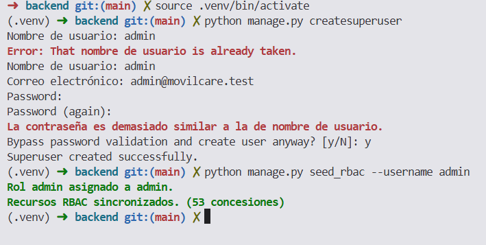

### Evidencia
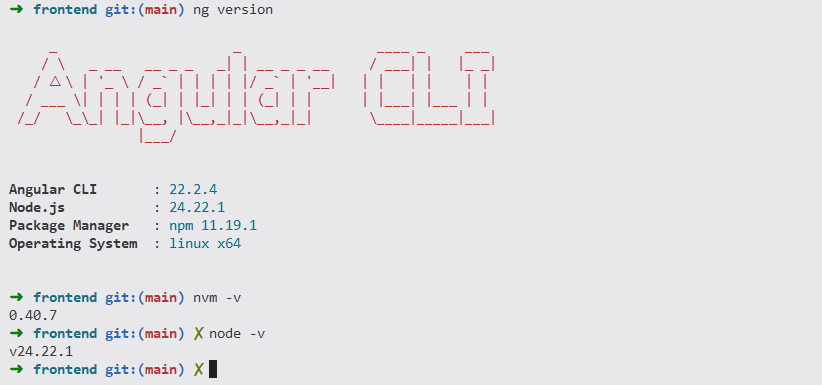

## Unidad ISS-01 — Bootstrap Angular 22 con CLI

### Creacion del workspace
```bash
npx @angular/cli@22 new frontend \
  --directory . \
  --style=tailwind \
  --ssr=false \s
  --routing \
  --zoneless \
  --skip-git \
  --package-manager=npm
```
### Evidencia
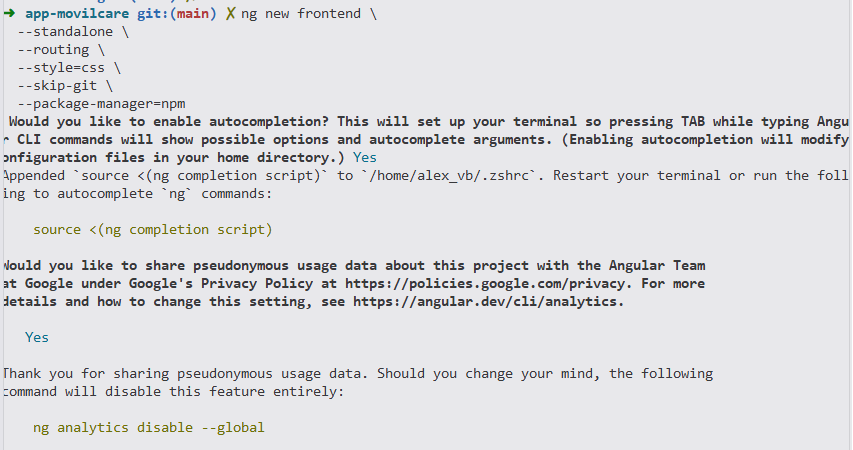


### Instalacion de Tailwind
```bash
npm install tailwindcss @tailwindcss/postcss postcss
```

### Evidencia
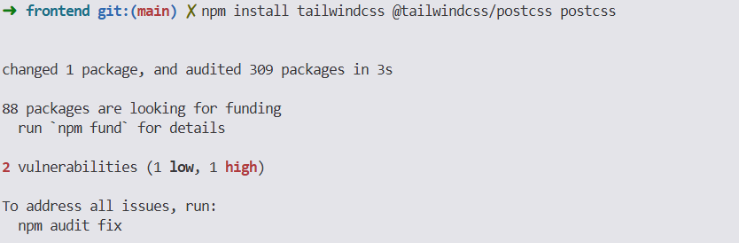
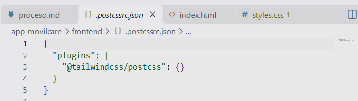

### Instalacion de dependencias
```bash
npm install primeng @primeuix/themes primeicons @angular/cdk
```
### Evidencia
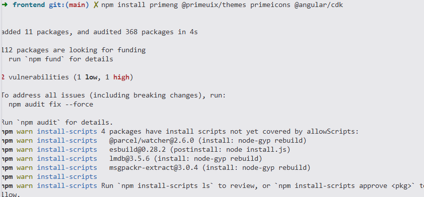

### Estilizado con Tailwind 4
`src/styles.css`
```css
@import "tailwindcss";
@import "primeicons/primeicons.css";

@layer base {
  html, body { height: 100%; }
  body {
    @apply bg-slate-100 text-slate-800 antialiased;
    font-family: Inter, ui-sans-serif, system-ui, sans-serif;
  }
}
```
### Evidencia
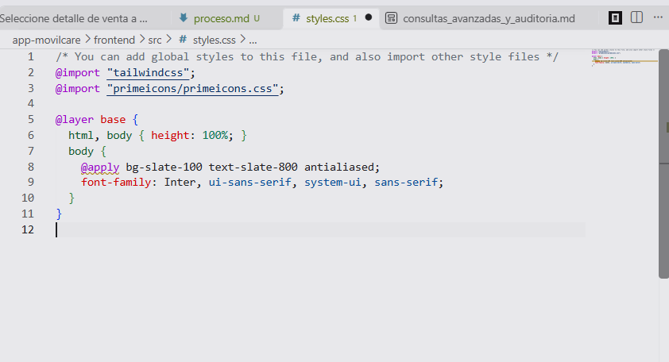

### PrimeNG Aura
`src/app/app.config.ts`
```typescript
import { ApplicationConfig, provideBrowserGlobalErrorListeners } from '@angular/core';
import { provideHttpClient, withInterceptors } from '@angular/common/http';
import { provideRouter, withComponentInputBinding, withInMemoryScrolling } from '@angular/router';
import { providePrimeNG } from 'primeng/config';
import Aura from '@primeuix/themes/aura';
import { ConfirmationService, MessageService } from 'primeng/api';

import { routes } from './app.routes';
import { authInterceptor } from './core/interceptors/auth-interceptor';
import { errorInterceptor } from './core/interceptors/error-interceptor';

export const appConfig: ApplicationConfig = {
  providers: [
    provideBrowserGlobalErrorListeners(),
    provideRouter(
      routes,
      withComponentInputBinding(),
      withInMemoryScrolling({ scrollPositionRestoration: 'top' }),
    ),
    provideHttpClient(withInterceptors([authInterceptor, errorInterceptor])),
    providePrimeNG({
      ripple: true,
      inputVariant: 'outlined',
      theme: {
        preset: Aura,
        options: { darkModeSelector: '.app-dark', cssLayer: false },
      },
    }),
    MessageService,
    ConfirmationService,
  ],
};
```
### Evidencia
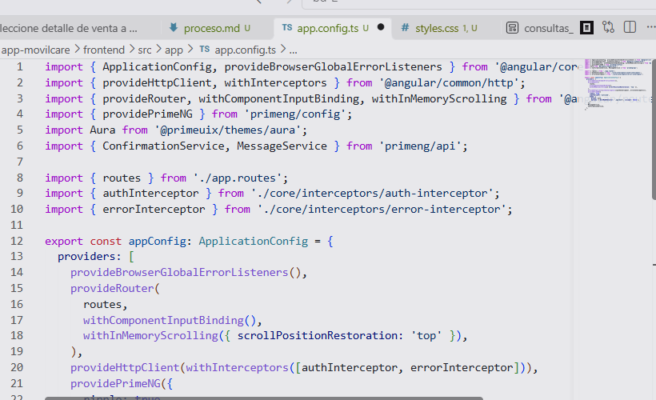

### Ejecucion
`npm run start`
### Evidencia
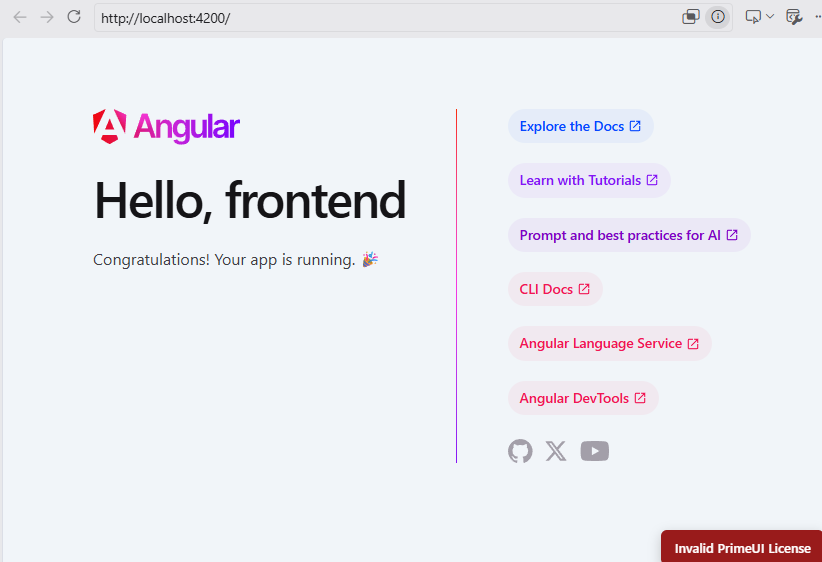

### Clave de PrimeUI
### Evidencias
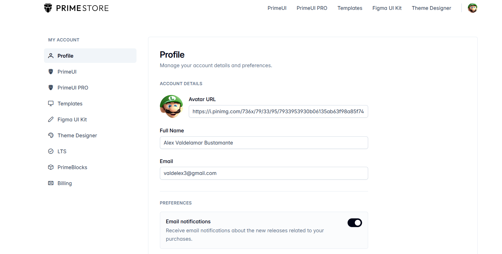
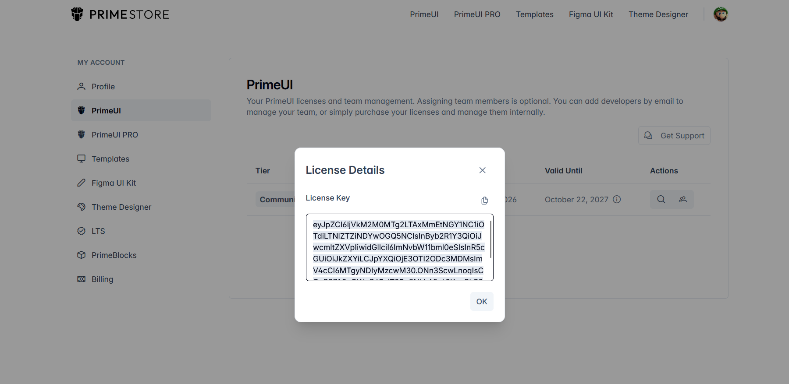

### Creacion de componente de ejemplo
```bash
ng generate component demo/ejemplo --standalone --style=css
```
#### `ejemplo.ts`
```ts
import { Component, signal, computed, effect } from '@angular/core';
import { CardModule } from 'primeng/card';
import { ButtonModule } from 'primeng/button';
import { TagModule } from 'primeng/tag';

interface Producto {
  nombre: string;
  precio: number;
  activo: boolean;
}

@Component({
  selector: 'app-ejemplo',
  standalone: true,
  imports: [CardModule, ButtonModule, TagModule],
  templateUrl: './ejemplo.html',
  styleUrl: './ejemplo.css',
  host: {
    class: 'block',
  },
})
export class Ejemplo {
  producto = signal<Producto>({
    nombre: 'Café molido 500 g',
    precio: 18000,
    activo: true,
  });

  iva = computed(() => this.producto().precio * 0.19);

  precioFinal = computed(
    () => this.producto().precio + this.iva()
  );

  estadoTexto = computed(
    () => this.producto().activo ? 'Activo' : 'Inactivo'
  );

  constructor() {
    effect(() => {
      const p = this.producto();

      console.log(
        `[ejemplo] ${p.nombre} · ${p.precio} · ${
          p.activo ? 'activo' : 'inactivo'
        }`
      );
    });
  }

  variarPrecio(): void {
    this.producto.update(actual => ({
      ...actual,
      precio: actual.precio + 1000,
    }));
  }

  cambiarEstado(): void {
    this.producto.update(actual => ({
      ...actual,
      activo: !actual.activo,
    }));
  }

  cambiarNombre(nombre: string): void {
    this.producto.update(actual => ({
      ...actual,
      nombre,
    }));
  }

  reiniciar(): void {
    this.producto.set({
      nombre: 'Café molido 500 g',
      precio: 18000,
      activo: true,
    });
  }
}
```
#### ejemplo.html
```html
<p-card header="Objeto producto">
  <div class="flex flex-col gap-4">

    <div>
      <label for="nombre" class="block mb-2 font-medium">
        Nombre del producto
      </label>

      <input
        id="nombre"
        type="text"
        class="w-full rounded-lg border border-slate-300 p-2"
        [value]="producto().nombre"
        (input)="cambiarNombre($any($event.target).value)"
      />

      <p class="mt-2 text-sm text-slate-500">
        Vista previa: {{ producto().nombre }}
      </p>
    </div>

    <div class="rounded-lg bg-slate-50 p-4">
      <p class="text-sm text-slate-500">Precio base</p>
      <p class="text-2xl font-semibold">
        {{ producto().precio }}
      </p>

      <p class="mt-2 text-sm text-slate-500">IVA (19 %)</p>
      <p>{{ iva() }}</p>

      <p class="mt-2 text-sm text-slate-500">Precio con IVA</p>
      <p class="text-xl font-semibold">{{ precioFinal() }}</p>

      <div class="mt-3">
        <p-tag
          [value]="estadoTexto()"
          [severity]="producto().activo ? 'success' : 'danger'"
        />
      </div>
    </div>

    <div class="flex flex-wrap gap-2">
      <p-button
        label="+1000"
        icon="pi pi-plus"
        (onClick)="variarPrecio()"
      />

      <p-button
        label="Cambiar estado"
        severity="secondary"
        (onClick)="cambiarEstado()"
      />

      <p-button
        label="Reiniciar"
        severity="contrast"
        (onClick)="reiniciar()"
      />
    </div>

    @if (producto().activo) {
      <p class="text-sm text-green-700">
        El producto está activo y disponible.
      </p>
    } @else {
      <p class="text-sm text-red-700">
        Producto inactivo. Se simula un borrado lógico.
      </p>
    }

  </div>
</p-card>
```
#### ejemplo.css
```css
.ejemplo-alcance {
  border-left: 4px solid #429c94;
}
```
#### ejemplo.spec.ts
```ts

import { TestBed } from '@angular/core/testing';
import { Ejemplo } from './ejemplo';

describe('Ejemplo', () => {
  beforeEach(async () => {
    await TestBed.configureTestingModule({
      imports: [Ejemplo],
    }).compileComponents();
  });

  it('crea el componente', () => {
    const fixture = TestBed.createComponent(Ejemplo);
    expect(fixture.componentInstance).toBeTruthy();
  });

  it('calcula el IVA y el precio final', () => {
    const fixture = TestBed.createComponent(Ejemplo);
    const componente = fixture.componentInstance;

    expect(componente.iva()).toBe(3420);
    expect(componente.precioFinal()).toBe(21420);
  });

  it('incrementa el precio en 1000', () => {
    const fixture = TestBed.createComponent(Ejemplo);
    const componente = fixture.componentInstance;

    componente.variarPrecio();

    expect(componente.producto().precio).toBe(19000);
    expect(componente.iva()).toBe(3610);
    expect(componente.precioFinal()).toBe(22610);
  });

  it('cambia el estado del producto', () => {
    const fixture = TestBed.createComponent(Ejemplo);
    const componente = fixture.componentInstance;

    componente.cambiarEstado();

    expect(componente.estadoTexto()).toBe('Inactivo');
  });

  it('cambia el nombre y permite reiniciar', () => {
    const fixture = TestBed.createComponent(Ejemplo);
    const componente = fixture.componentInstance;

    componente.cambiarNombre('Té verde');
    expect(componente.producto().nombre).toBe('Té verde');

    componente.reiniciar();
    expect(componente.producto().nombre).toBe('Café molido 500 g');
    expect(componente.producto().precio).toBe(18000);
    expect(componente.producto().activo).toBe(true);
  });
});
```
#### importacion en la app
```ts

import { Component } from '@angular/core';
import { Ejemplo } from './demo/ejemplo/ejemplo';

@Component({
  selector: 'app-root',
  standalone: true,
  imports: [Ejemplo],
  templateUrl: './app.html',
  styleUrl: './app.css',
})
export class App {}
```
```html
<main class="min-h-screen bg-slate-100 p-6 text-slate-900">
  <div class="mx-auto max-w-2xl">
    <h1 class="mb-6 text-2xl font-bold">
      Movilcare · Angular 22
    </h1>

    <app-ejemplo />
  </div>
</main>
```
### Evidencias
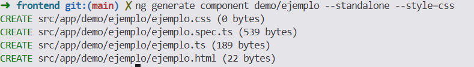
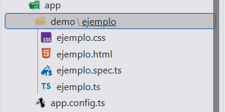
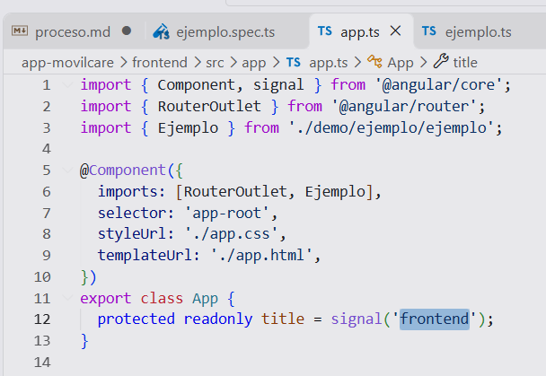
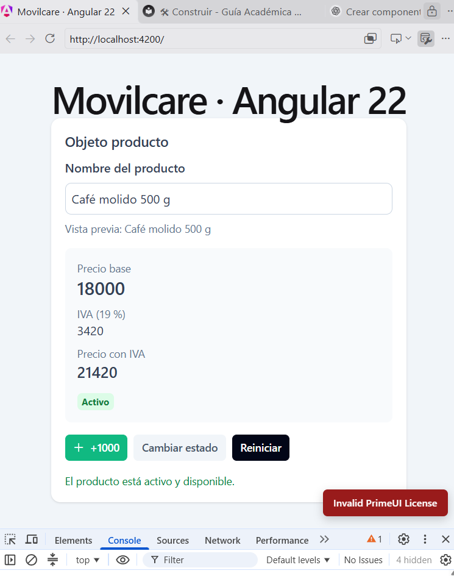

# Unidad ISS-01A — Esqueleto Header / Aside / contenido / Footer

## Generar las piezas del `layout/`
### Comandos
```bash
ng generate component layout/header --skip-tests --defaults
ng generate component layout/aside --skip-tests --defaults
ng generate component layout/footer --skip-tests --defaults
```
### Evidencias
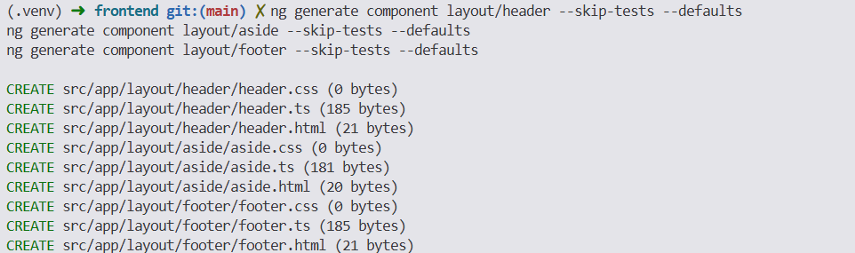
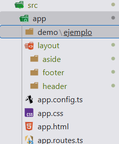

### contenido de header.ts
```ts
import { Component } from '@angular/core';

@Component({
  selector: 'app-header',
  standalone: true,
  imports: [],
  templateUrl: './header.html',
  styleUrl: './header.css',
})
export class Header {
  readonly title = 'Movilcare';
}
```
### contenido de header.html
```html
<header class="flex h-16 items-center border-b border-slate-200 bg-white px-6">
  <span class="text-xl font-bold text-slate-900">
    {{ title }}
  </span>
</header>
```
### Evidencias
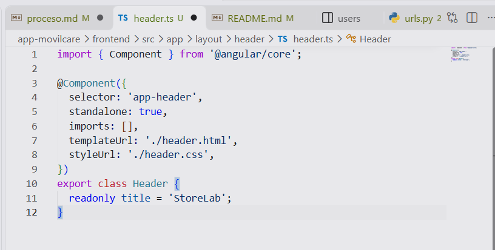
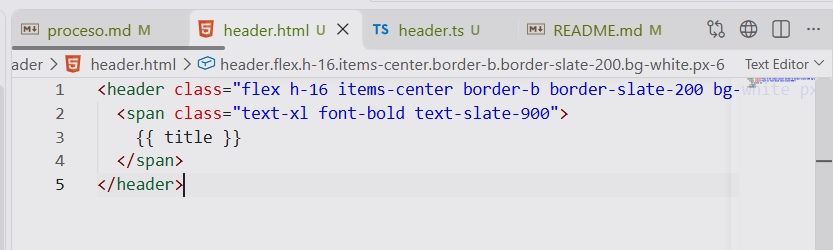

### contenido de aside.ts

```ts
import { Component } from '@angular/core';

@Component({
  selector: 'app-aside',
  standalone: true,
  imports: [],
  templateUrl: './aside.html',
  styleUrl: './aside.css',
})
export class Aside {}
```
### contenido de aside.html
```html
<nav
  aria-label="Navegación principal"
  class="min-h-full bg-slate-900 p-4 text-white"
>
  <h2 class="mb-4 text-sm font-semibold uppercase tracking-wide text-slate-400">
    Menú de Movilcare
  </h2>

  <p class="text-sm text-slate-300">
    La navegación se implementará en la siguiente etapa.
  </p>
</nav>
```

### Evidencias
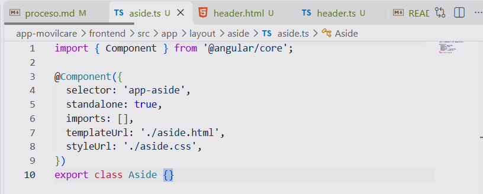
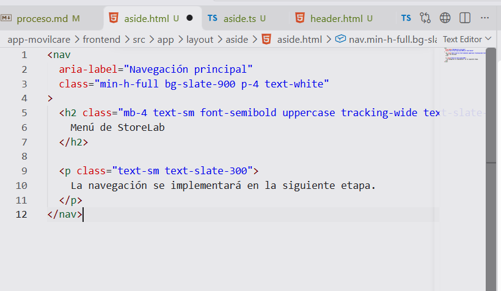

### contenido de footer.ts
```ts
import { Component } from '@angular/core';

@Component({
  selector: 'app-footer',
  standalone: true,
  imports: [],
  templateUrl: './footer.html',
  styleUrl: './footer.css',
})
export class Footer {}
```

### contenido de footer.html
```html
<footer class="border-t border-slate-200 bg-white px-6 py-4 text-sm text-slate-500">
  Movilcare · Gestión de clientes, productos y ventas.
</footer>
```

### Evidencias
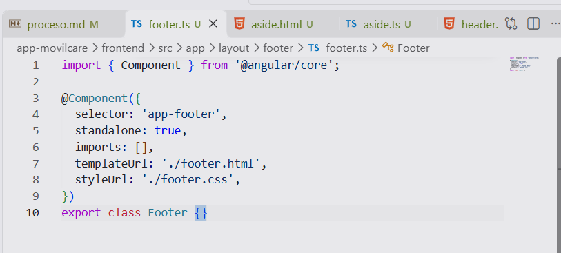
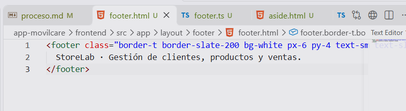

## Agregar componentes a la App

### Correccion de `app.ts`
```ts
import { Component, signal } from '@angular/core';
import { RouterOutlet } from '@angular/router';
import { Header } from './layout/header/header';
import { Aside } from './layout/aside/aside';
import { Footer } from './layout/footer/footer';

@Component({
  selector: 'app-root',
  standalone: true,
  imports: [RouterOutlet, Header, Aside, Footer],
  templateUrl: './app.html',
  styleUrl: './app.css',
})
export class App {
  protected readonly title = signal('Inicio');
}
```
### Correccion de `app.html`
```html
<div class="flex min-h-screen flex-col bg-slate-100 text-slate-900">

  <app-header />

  <div class="flex flex-1">

    <aside class="w-64 shrink-0">
      <app-aside />
    </aside>

    <main id="contenido" class="min-w-0 flex-1 p-6">
      <h1 class="mb-4 text-2xl font-bold">
        {{ title }}
      </h1>

      <p class="text-slate-600">
        Bienvenido a Movilcare.
      </p>
    </main>

  </div>

  <app-footer />

</div>
```

### Evidencias
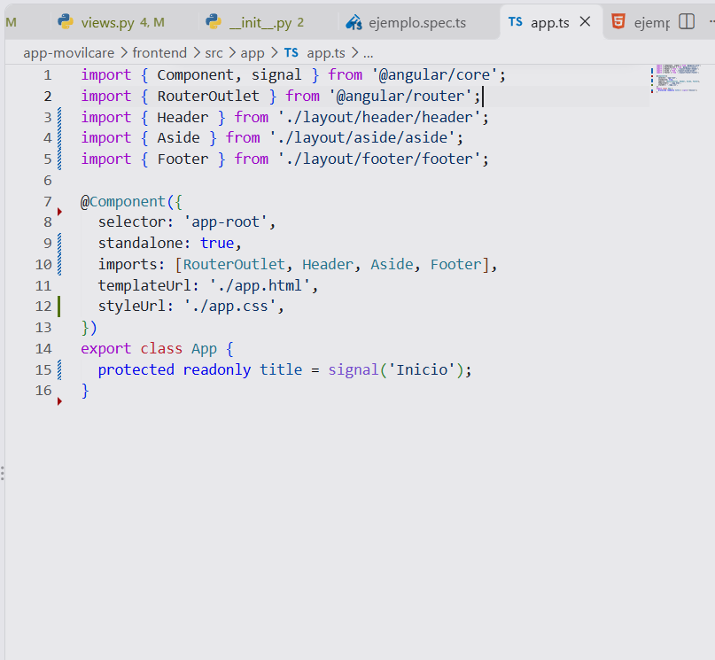
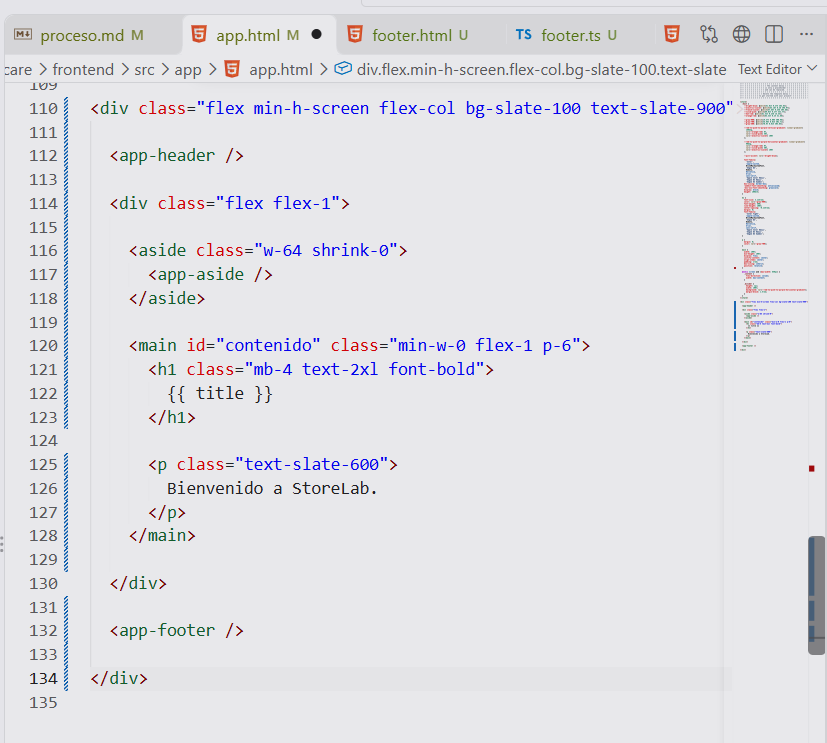
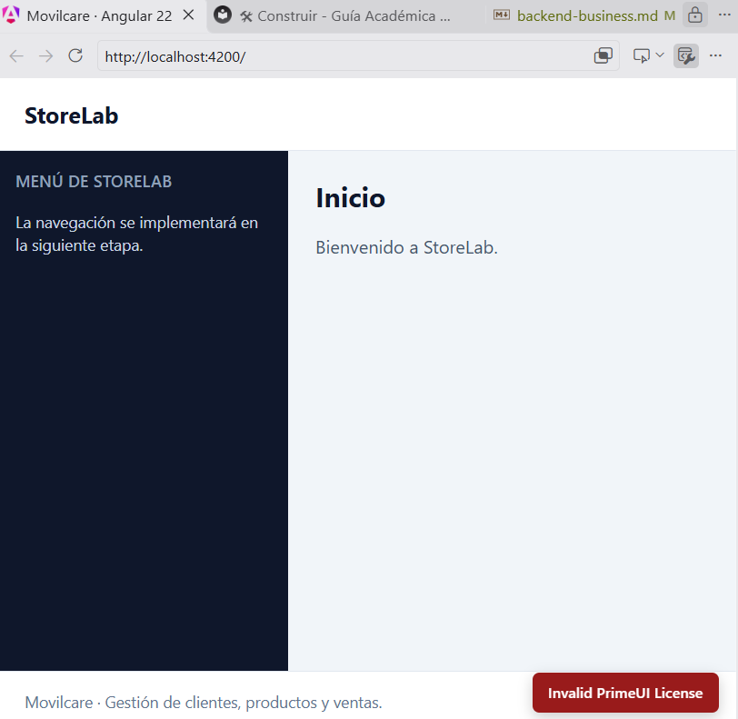

## Verificacion
### scripts
```bash
npm test -- --watch=false
grep -n 'app-ejemplo' src/app/app.html
Select-String -Path src/app/app.html -Pattern 'app-ejemplo'
```
### Evidencias
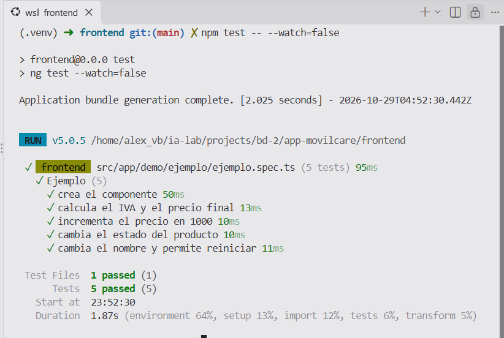
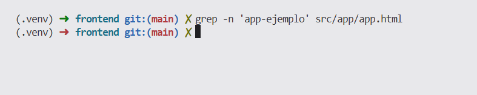

# Unidad ISS-01B Menú PrimeNG y primera interacción

## Actualizacion del Aside

### Contenido de `aside.ts`
```ts
import { Component, input, output } from '@angular/core';
import { MenuItem } from 'primeng/api';
import { ButtonModule } from 'primeng/button';
import { PanelMenuModule } from 'primeng/panelmenu';

@Component({
  selector: 'app-aside',
  imports: [ButtonModule, PanelMenuModule],
  templateUrl: './aside.html',
  styleUrl: './aside.css',
  host: {
    class: 'block h-full',
  },
})
export class Aside {
  readonly appName = input('Movilcare');
  readonly items = input<MenuItem[]>([]);

  readonly showSession = input(false);
  readonly username = input('');
  readonly roleLabel = input('Sin rol');
  readonly permissionCount = input(0);

  readonly navigated = output<void>();
  readonly logoutRequested = output<void>();

  onNavigationClick(event: Event): void {
    if (
      (event.target as HTMLElement).closest(
        'a, button, [role="button"]',
      )
    ) {
      this.navigated.emit();
    }
  }
}
```
### Contenido de `aside.html`
```html
<div class="flex h-full flex-col border-r border-slate-200 bg-white text-slate-900">
  <div class="flex h-16 items-center gap-3 border-b border-slate-200 px-5">
    <div class="flex h-9 w-9 items-center justify-center rounded-lg bg-slate-900 font-bold text-white">
      S
    </div>

    <div class="min-w-0">
      <p class="truncate text-sm font-semibold">
        {{ appName() }}
      </p>

      <p class="text-[11px] uppercase tracking-wider text-slate-400">
        Panel administrativo
      </p>
    </div>
  </div>

  <div class="flex-1 overflow-y-auto p-3">
    <nav
      aria-label="Navegación principal"
      (click)="onNavigationClick($event)"
    >
      <p-panelmenu
        [model]="items()"
        [multiple]="true"
      />
    </nav>
  </div>

  @if (showSession()) {
    <div class="border-t border-slate-200 p-4">
      <p class="text-sm font-medium">
        {{ username() || 'Invitado' }}
      </p>

      <p class="text-xs text-slate-400">
        {{ roleLabel() }}
      </p>

      <div class="mt-3 flex items-center justify-between text-xs text-slate-400">
        <span>{{ permissionCount() }} permisos</span>

        <button
          pButton
          type="button"
          text
          rounded
          aria-label="Cerrar sesión"
          (click)="logoutRequested.emit()"
        >
          <i pButtonIcon class="pi pi-sign-out"></i>
        </button>
      </div>
    </div>
  }
</div>
```

### Evidencias
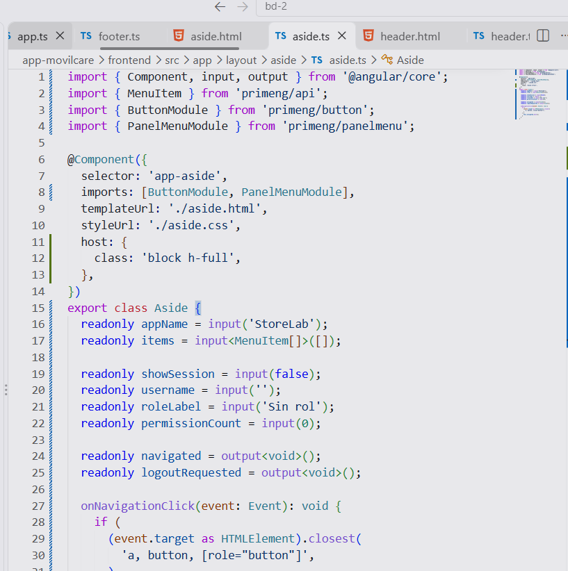
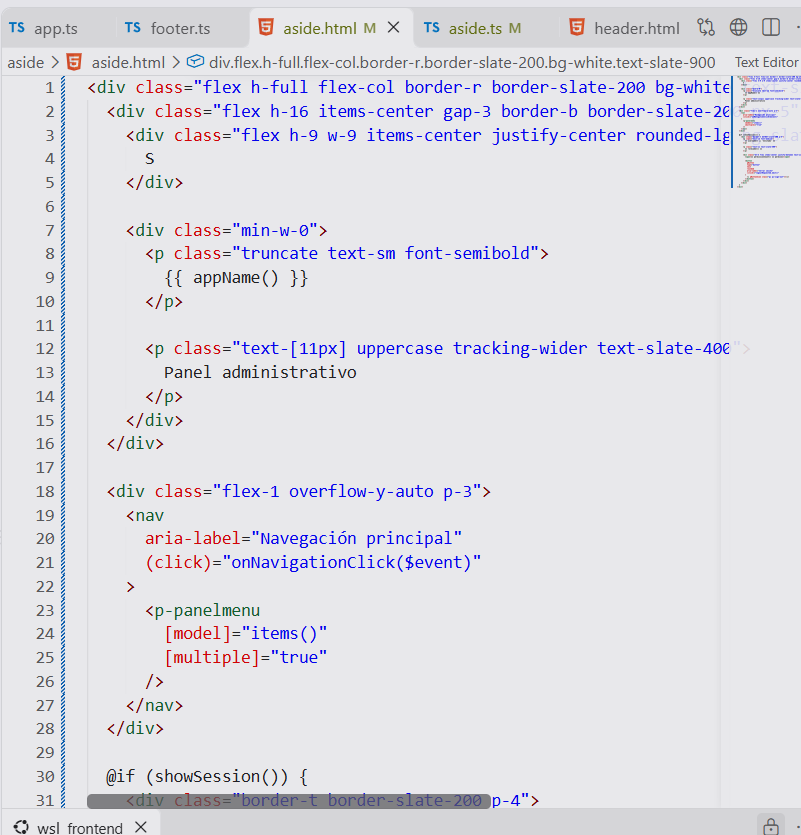

## Actializacion del Header
### contenido del `header.ts`
```ts
import { Component, input, output } from '@angular/core';
import { MenuItem } from 'primeng/api';
import { AvatarModule } from 'primeng/avatar';
import { ButtonModule } from 'primeng/button';
import { MenuModule } from 'primeng/menu';
import { TagModule } from 'primeng/tag';

@Component({
  selector: 'app-header',
  imports: [AvatarModule, ButtonModule, MenuModule, TagModule],
  templateUrl: './header.html',
  styleUrl: './header.css',
  host: {
    class: 'block',
  },
})
export class Header {
  readonly appName = input('Movilcare');

  readonly username = input('');
  readonly initials = input('IN');
  readonly roleLabel = input('Sin rol');
  readonly authEnabled = input(true);
  readonly showSession = input(false);
  readonly userItems = input<MenuItem[]>([]);

  readonly menuRequested = output<void>();
}
```
### contenido de `header.html`
```html
<header
  class="sticky top-0 z-30 flex h-16 items-center gap-3 border-b border-slate-200 bg-white px-4 sm:px-6"
>
  <button
    pButton
    type="button"
    text
    rounded
    aria-label="Mostrar u ocultar el menú"
    (click)="menuRequested.emit()"
  >
    <i pButtonIcon class="pi pi-bars"></i>
  </button>

  <div class="min-w-0 flex-1">
    <p class="truncate text-sm font-semibold text-slate-900">
      {{ appName() }}
    </p>

    <p class="truncate text-xs text-slate-500">
      Gestión de clientes, productos y ventas
    </p>
  </div>

  @if (showSession() && !authEnabled()) {
    <p-tag
      value="Fase I · sin auth"
      severity="warn"
      [rounded]="true"
    />
  }

  @if (username()) {
    <p-tag
      [value]="roleLabel()"
      severity="info"
      [rounded]="true"
      class="hidden sm:inline-flex"
    />
  }

  @if (showSession()) {
    <button
      pButton
      type="button"
      severity="secondary"
      outlined
      (click)="userMenuPanel.toggle($event)"
      aria-label="Menú de usuario"
    >
      <p-avatar
        [label]="initials()"
        shape="circle"
        size="normal"
      />

      <span class="hidden max-w-32 truncate text-sm font-medium text-slate-700 sm:block">
        {{ username() }}
      </span>

      <i class="pi pi-chevron-down pr-1 text-[10px] text-slate-400"></i>
    </button>

    <p-menu
      #userMenuPanel
      [model]="userItems()"
      [popup]="true"
      appendTo="body"
    />
  }
</header>
```
### Evidencias
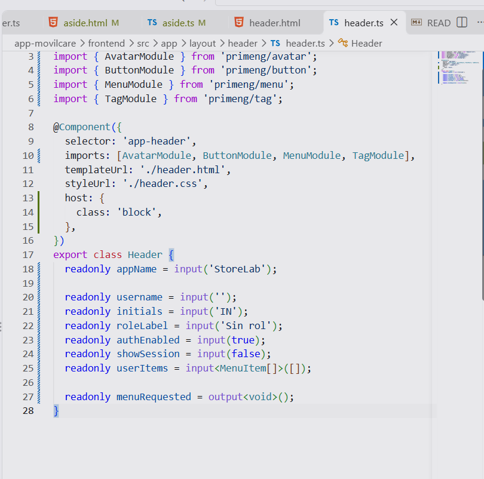
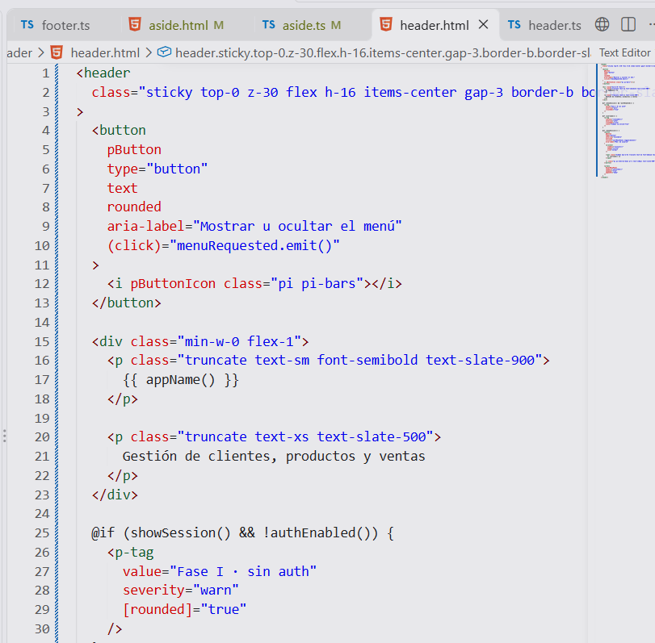

## Creacion del componente Construir

### scripts
```bash
ng generate component features/construir --skip-tests --defaults
mkdir -p src/app/core/utils
```

### Contenido de `src/app/core/utils/media-query.ts`
```ts
import {
  DestroyRef,
  Signal,
  inject,
  signal,
} from '@angular/core';

export function watchMediaQuery(
  query: string,
): Signal<boolean> {
  const destroyRef = inject(DestroyRef);

  const media =
    typeof window !== 'undefined' &&
    typeof window.matchMedia === 'function'
      ? window.matchMedia(query)
      : null;

  const matches = signal(media?.matches ?? false);

  if (media) {
    const listener = (
      event: MediaQueryListEvent,
    ): void => {
      matches.set(event.matches);
    };

    media.addEventListener('change', listener);

    destroyRef.onDestroy(() => {
      media.removeEventListener('change', listener);
    });
  }

  return matches.asReadonly();
}
```

### contenido de construir.ts
```ts
import { Component, signal } from '@angular/core';
import { MenuItem } from 'primeng/api';
import { ButtonModule } from 'primeng/button';
import { CardModule } from 'primeng/card';
import { DrawerModule } from 'primeng/drawer';

import { watchMediaQuery } from '../../core/utils/media-query';
import { Aside } from '../../layout/aside/aside';
import { Footer } from '../../layout/footer/footer';
import { Header } from '../../layout/header/header';

@Component({
  selector: 'app-construir',
  imports: [
    Aside,
    ButtonModule,
    CardModule,
    DrawerModule,
    Footer,
    Header,
  ],
  templateUrl: './construir.html',
  styleUrl: './construir.css',
  host: {
    class: 'block',
  },
})
export class Construir {
  private readonly isDesktop =
    watchMediaQuery('(min-width: 1024px)');

  readonly sidebarCollapsed = signal(false);
  readonly mobileOpen = signal(false);
  readonly title = signal('Inicio');

  readonly items: MenuItem[] = [
    {
      label: 'Inicio',
      icon: 'pi pi-home',
      command: () => this.seleccionar('Inicio'),
    },
    {
      label: 'Clientes',
      icon: 'pi pi-users',
      command: () => this.seleccionar('Clientes'),
    },
    {
      label: 'Tipos de producto',
      icon: 'pi pi-tags',
      command: () => this.seleccionar('Tipos de producto'),
    },
    {
      label: 'Productos',
      icon: 'pi pi-box',
      command: () => this.seleccionar('Productos'),
    },
    {
      label: 'Ventas',
      icon: 'pi pi-shopping-cart',
      command: () => this.seleccionar('Ventas'),
    },
  ];

  protected onMenuToggle(): void {
    if (this.isDesktop()) {
      this.sidebarCollapsed.update(
        (collapsed) => !collapsed,
      );
      return;
    }

    this.mobileOpen.set(true);
  }

  protected seleccionar(titulo: string): void {
    this.title.set(titulo);
    this.mobileOpen.set(false);
  }
}
```
### Evidencias
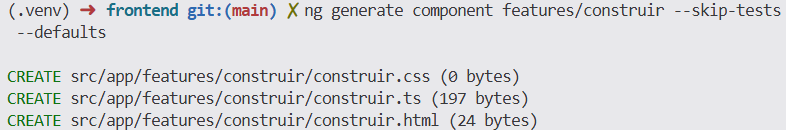
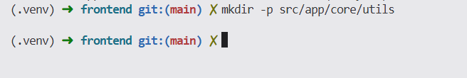
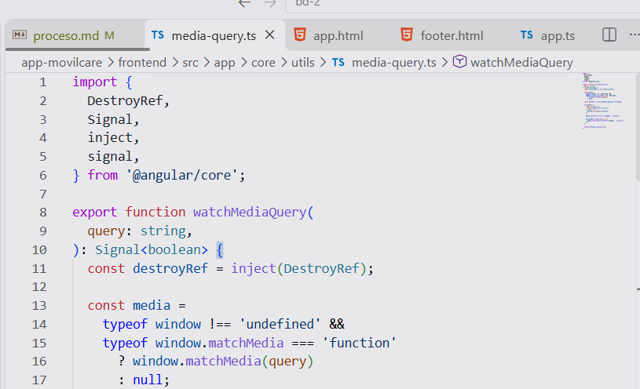
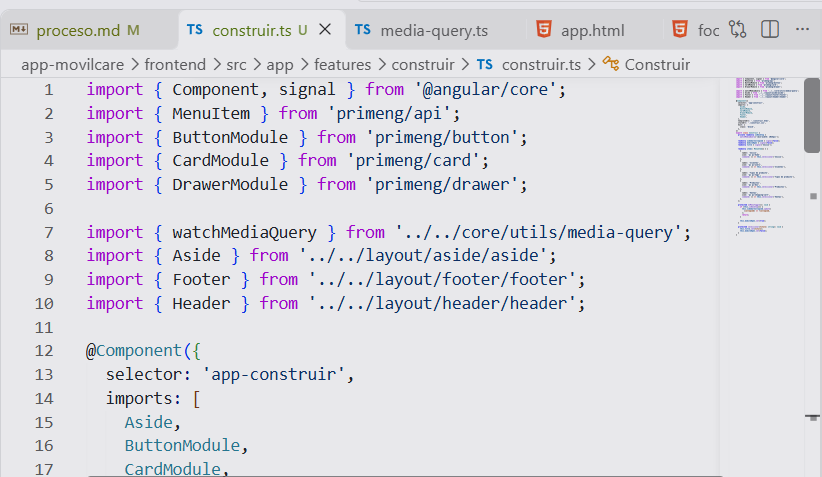
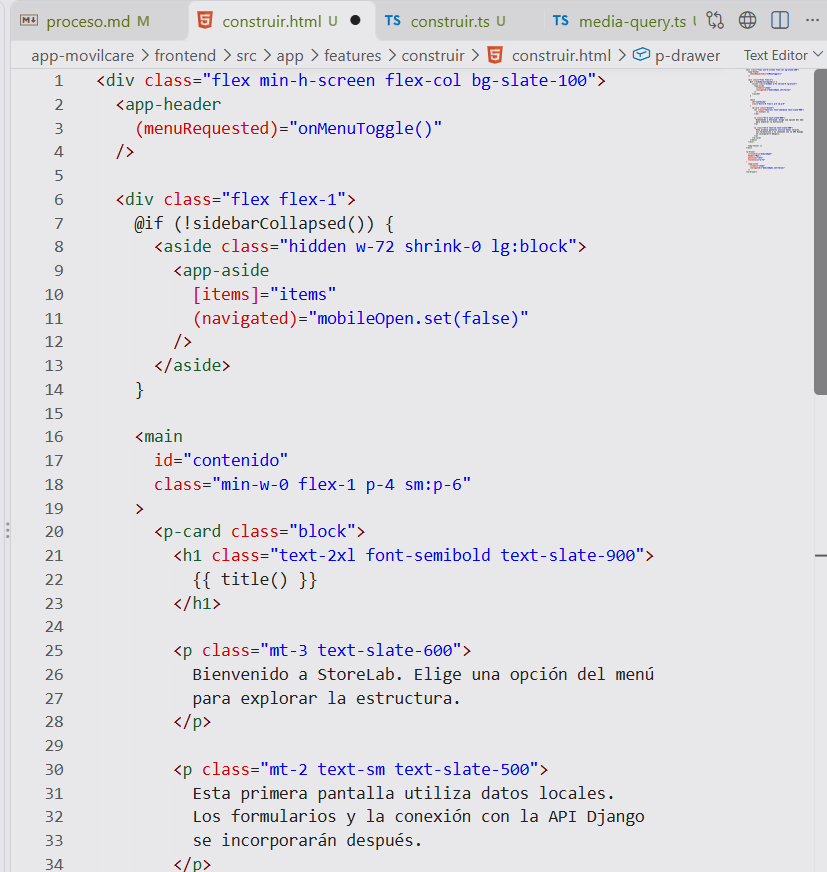

## Crear punto de entrada del router
### nuevo contenido de `app.ts`
```ts
import { Component } from '@angular/core';
import { RouterOutlet } from '@angular/router';

@Component({
  selector: 'app-root',
  imports: [RouterOutlet],
  templateUrl: './app.html',
  styleUrl: './app.css',
})
export class App {}
```
Se elimina todo de `src/app/app.html` menos `<router-outlet />`

### Contenido de `src/app/app.routes.ts`
```ts
import { Routes } from '@angular/router';

export const routes: Routes = [
  {
    path: 'construir',
    loadComponent: () =>
      import('./features/construir/construir')
        .then((m) => m.Construir),
  },
  {
    path: '',
    pathMatch: 'full',
    redirectTo: 'construir',
  },
  {
    path: '**',
    redirectTo: 'construir',
  },
];
```
### Evidencias
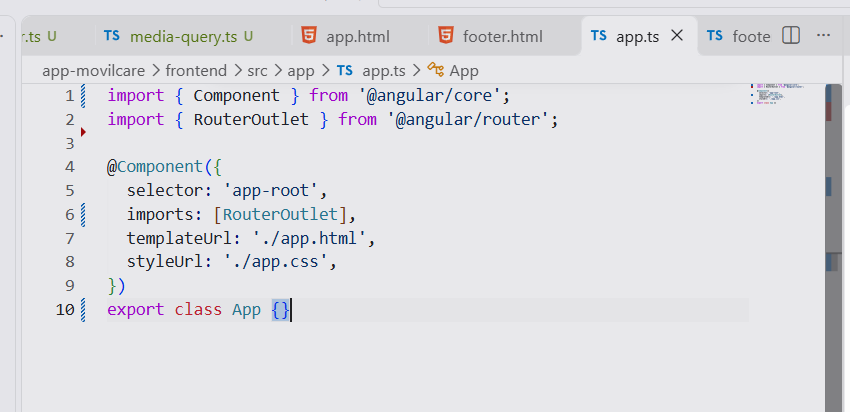
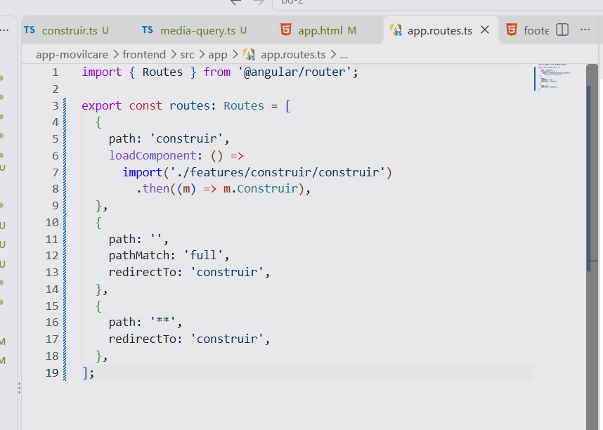

# ISS-02 — Núcleo, modelos y layout de MovilCare

## 1. Configuración del entorno

Primero centralicé la dirección del backend para evitar escribirla directamente en cada servicio.

### 1.1. Generar los archivos de entorno

```bash
ng generate environments
```

### Evidencia
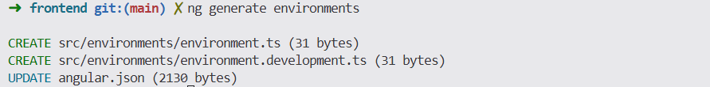

Este comando crea los archivos de configuración del entorno. Si ya existen, revisa su contenido en lugar de generarlos nuevamente.

La estructura resultado es:

```text
src/
├── environments/
│   ├── environment.ts
│   └── environment.development.ts
└── app/
```

### Evidencia
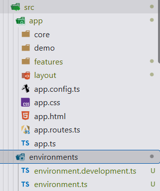

En `src/environments/environment.ts`, configura lo siguiente:

```typescript
export const environment = {
  production: true,
  appName: 'MovilCare',
  apiUrl: 'http://127.0.0.1:8000/api',
};
```

### Evidencia
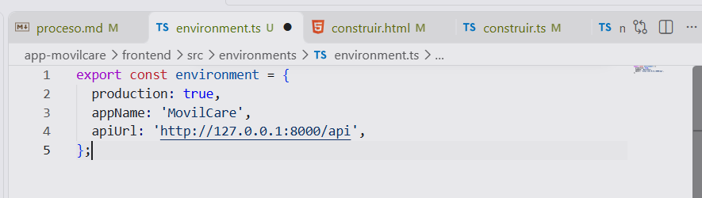

En `src/environments/environment.development.ts`, configura:

```typescript
export const environment = {
  production: false,
  appName: 'MovilCare',
  apiUrl: 'http://127.0.0.1:8000/api',
};
```

### Evidencia
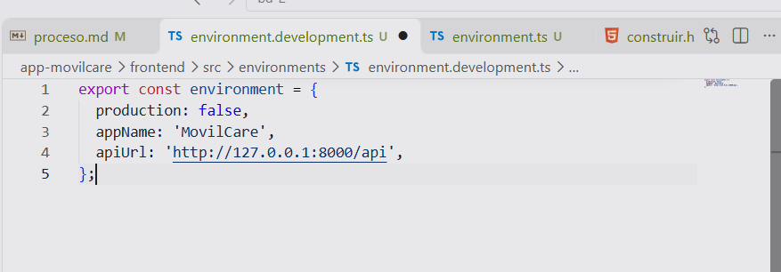

**Es importante que `apiUrl` no termine en una barra `/`.**

Esto nos permitirá construir las rutas de los servicios de manera consistente. Por ejemplo:

```text
apiUrl:       http://127.0.0.1:8000/api
Servicio:     /products/
URL completa: http://127.0.0.1:8000/api/products/
```

Si agregáramos la barra al final de `apiUrl` y después otra en el servicio, podríamos terminar generando direcciones incorrectas.

### 1.2. Configurar los entornos de Angular

Abri `angular.json` y busca la configuración del proyecto, dentro de:

```text
projects
└── frontend
    └── architect
        └── build
            └── configurations
                └── development
```

Dentro de la configuración `development`, existe la propiedad `fileReplacements`:

```json
"fileReplacements": [
  {
    "replace": "src/environments/environment.ts",
    "with": "src/environments/environment.development.ts"
  }
]
```

### Evidencia
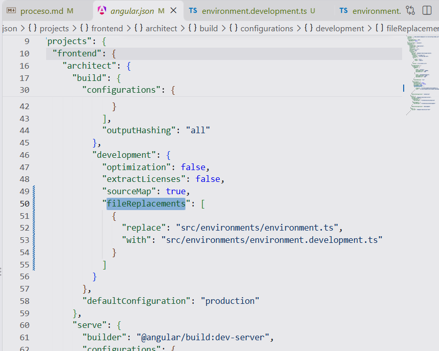

---

## 2. Organización de los modelos

El siguiente paso consiste en crear las interfaces TypeScript que representan los datos que intercambia MovilCare con Django REST Framework.

Para mantener el proyecto organizado, utilizaremos esta estructura:

```text
src/app/
├── core/
│   ├── models/
│   │   ├── api.model.ts
│   │   ├── customer.model.ts
│   │   ├── product.model.ts
│   │   ├── serialized-unit.model.ts
│   │   └── sale.model.ts
│   ├── services/
│   └── utils/
├── features/
│   ├── customers/
│   ├── products/
│   ├── serialized-units/
│   └── sales/
├── layout/
├── shared/
└── app.routes.ts
```

### 2.1 Scripts de creacion 
```bash
ng generate interface core/models/api --type=model --defaults
ng generate interface core/models/customer --type=model --defaults
ng generate interface core/models/serialized-unit --type=model --defaults
ng generate interface core/models/product --type=model --defaults
ng generate interface core/models/sale --type=model --defaults
ng generate interface core/models/sale-detail --type=model --defaults
ng generate interface core/models/auth --type=model --defaults
```

### Evidencia
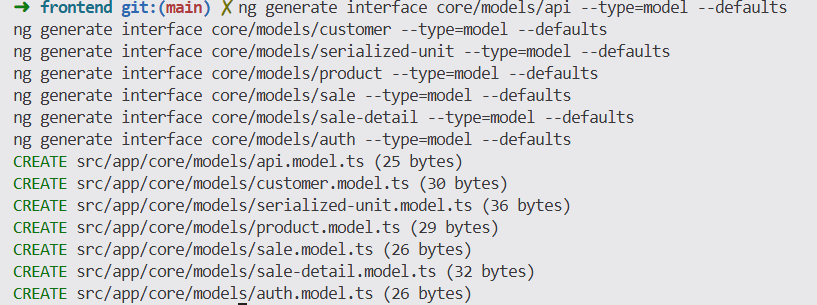
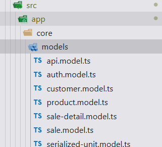

Organicé los modelos en `src/app/core/models` y adapté sus propiedades a las respuestas JSON del backend. Utilicé `camelCase` para los nombres de las propiedades y `string` para los importes monetarios y las fechas recibidas como texto.

#### **Archivo: `src/app/core/models/api.model.ts`**

```typescript
export type Status = 'active' | 'inactive';

export type Money = string;

export type HttpMethod =
  | 'GET'
  | 'POST'
  | 'PUT'
  | 'PATCH'
  | 'DELETE';

export interface Timestamps {
  createdAt?: string;
  updatedAt?: string;
}

export interface ApiError {
  detail?: string;
}

export function toNumber(
  value: Money | number | null | undefined,
): number {
  const parsed = Number(value ?? 0);
  return Number.isFinite(parsed) ? parsed : 0;
}
```

#### **Archivo: `src/app/core/models/customer.model.ts`**

```typescript
import { Status, Timestamps } from './api.model';

export interface Customer extends Timestamps {
  id: number;
  documentType: string;
  documentNumber: string;
  name: string;
  phone: string | null;
  email: string | null;
  status: Status;
}

export type CustomerPayload = Omit<
  Customer,
  'id' | 'createdAt' | 'updatedAt'
>;
```

#### **Archivo: `src/app/core/models/product.model.ts`**

```typescript
import { Money, Status, Timestamps } from './api.model';

export interface Product extends Timestamps {
  id: number;
  sku: string;
  name: string;
  description: string | null;
  price: Money;
  status: Status;
}

export type ProductPayload = Omit<
  Product,
  'id' | 'createdAt' | 'updatedAt'
>;
```

#### **Archivo: `src/app/core/models/serialized-unit.model.ts`**

```typescript
import { Status, Timestamps } from './api.model';

export interface SerializedUnit extends Timestamps {
  id: number;
  product: number;
  productId: number;
  productName: string;
  name: string;
  description: string | null;
  status: Status;
}

export type SerializedUnitPayload = Pick<
  SerializedUnit,
  'product' | 'name' | 'description'
>;
```

#### **Archivo: `src/app/core/models/sale-detail.model.ts`**

```typescript
import { Money } from './api.model';

export interface SaleDetail {
  productId: number;
  quantity: number;
  unitPrice: Money;
  lineTotal: Money;
}

export interface SaleDetailInput {
  productId: number;
  quantity: number;
}
```

#### **Archivo: `src/app/core/models/sale.model.ts`**

```typescript
import { Money, Status, Timestamps } from './api.model';
import { SaleDetail, SaleDetailInput } from './sale-detail.model';

export interface Sale extends Timestamps {
  id: number;
  customerId: number;
  customerName: string;
  saleDate: string;
  subtotal: Money;
  tax: Money;
  discounts: Money;
  total: Money;
  status: Status;
  lines: SaleDetail[];
}

export interface SaleCreatePayload {
  customerId: number;
  saleDate: string;
  discounts: Money;
  lines: SaleDetailInput[];
}
```

#### **Archivo: `src/app/core/models/auth.model.ts`**

```typescript
import { Status, Timestamps } from './api.model';

export interface User extends Timestamps {
  id: number;
  username: string;
  email: string;
  status: Status;
}

export interface SessionTokens {
  access: string;
  refresh: string;
  tokenType: 'Bearer';
}

export interface EffectivePermission {
  method: string;
  path: string;
  roleId: number;
  roleName: string;
}
```

De esta manera, separé las estructuras de clientes, productos, unidades serializadas y ventas, respetando la relación entre productos y unidades. Los nombres y tipos definitivos de cada propiedad deben coincidir con los serializadores reales del backend.

### Evidencia

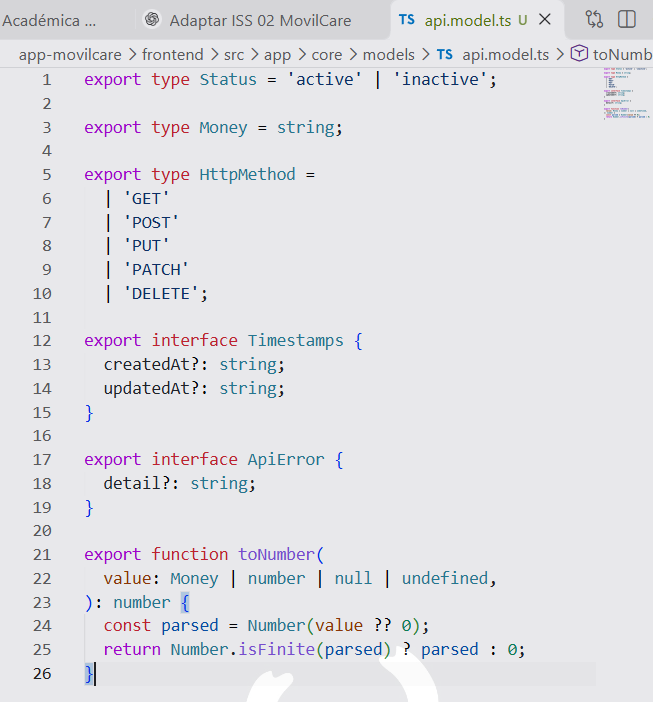
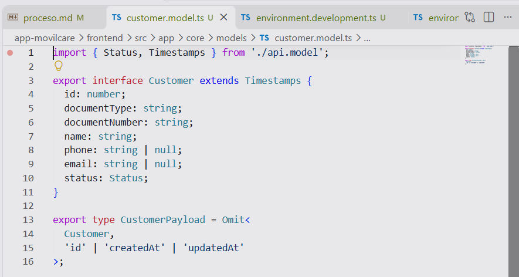
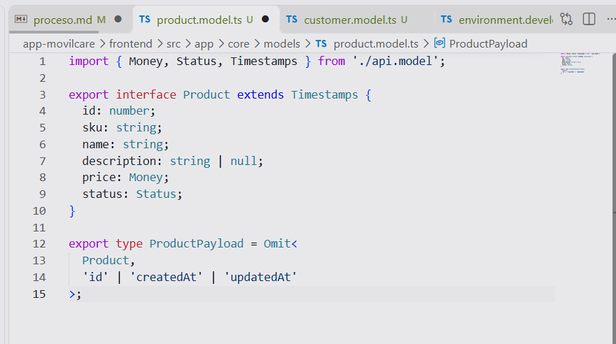
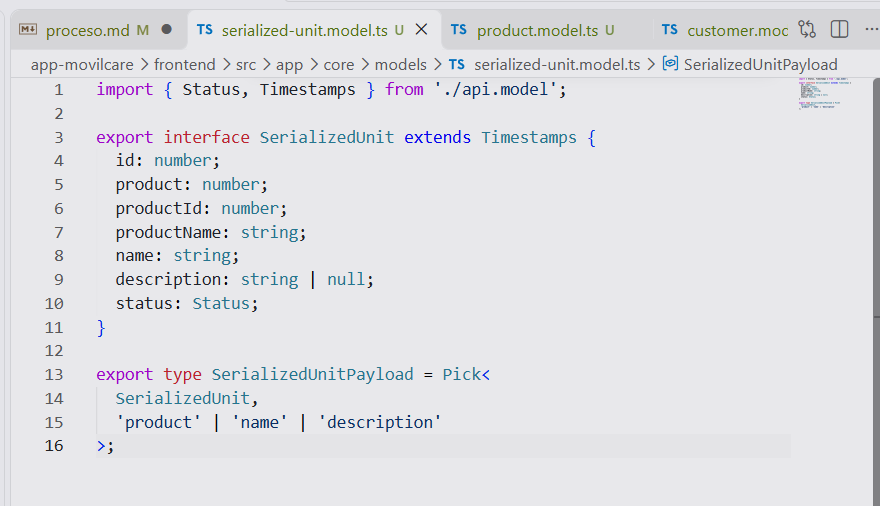


---

## 02.3. Creación de servicios por entidad

Generé los servicios para centralizar las solicitudes HTTP de MovilCare:

```bash
ng generate service features/customers/customer-api --skip-tests --defaults
ng generate service features/products/product-api --skip-tests --defaults
ng generate service features/serialized-units/serialized-unit-api --skip-tests --defaults
ng generate service features/sales/sale-api --skip-tests --defaults
ng generate service features/sale-details/sale-detail-api --skip-tests --defaults
```

### Evidencia


Implementé un servicio por recurso, utilizando `HttpClient`, `Observable` y la URL definida en `environment`. Configuré los métodos según los endpoints disponibles en el backend.

#### **Archivo: `src/app/features/customers/customer-api.ts`**

```typescript
import { HttpClient } from '@angular/common/http';
import { Injectable, inject } from '@angular/core';
import { Observable } from 'rxjs';

import { environment } from '../../../environments/environment';
import {
  Customer,
  CustomerPayload,
} from '../../core/models/customer.model';

@Injectable({
  providedIn: 'root',
})
export class CustomerApi {
  private readonly http = inject(HttpClient);
  private readonly base = `${environment.apiUrl}/customers`;

  list(): Observable<Customer[]> {
    return this.http.get<Customer[]>(`${this.base}/`);
  }

  create(payload: CustomerPayload): Observable<Customer> {
    return this.http.post<Customer>(
      `${this.base}/`,
      payload,
    );
  }

  update(
    id: number,
    payload: Partial<CustomerPayload>,
  ): Observable<Customer> {
    return this.http.patch<Customer>(
      `${this.base}/${id}/`,
      payload,
    );
  }

  remove(id: number): Observable<void> {
    return this.http.delete<void>(
      `${this.base}/${id}/`,
    );
  }
}
```

#### **Archivo: `src/app/features/products/product-api.ts`**

```typescript
import { HttpClient } from '@angular/common/http';
import { Injectable, inject } from '@angular/core';
import { Observable } from 'rxjs';
import { environment } from '../../../environments/environment';
import { Product, ProductPayload } from '../../core/models/product.model';

@Injectable({ providedIn: 'root' })
export class ProductApi {
  private readonly http = inject(HttpClient);
  private readonly base = `${environment.apiUrl}/products`;

  list(): Observable<Product[]> {
    return this.http.get<Product[]>(`${this.base}/`);
  }

  get(id: number): Observable<Product> {
    return this.http.get<Product>(`${this.base}/${id}/`);
  }

  available(): Observable<Product[]> {
    return this.http.get<Product[]>(`${this.base}/available/`);
  }

  create(payload: ProductPayload): Observable<Product> {
    return this.http.post<Product>(`${this.base}/`, payload);
  }

  update(
    id: number,
    payload: Partial<ProductPayload>,
  ): Observable<Product> {
    return this.http.patch<Product>(
      `${this.base}/${id}/`,
      payload,
    );
  }

  remove(id: number): Observable<void> {
    return this.http.delete<void>(`${this.base}/${id}/`);
  }

  units(productId: number): Observable<unknown[]> {
    return this.http.get<unknown[]>(
      `${this.base}/${productId}/units/`,
    );
  }
}
```

#### **Archivo: `src/app/features/serialized-units/serialized-unit-api.ts`**

```typescript
import { HttpClient } from '@angular/common/http';
import { Injectable, inject } from '@angular/core';
import { Observable } from 'rxjs';
import { environment } from '../../../environments/environment';
import {
  SerializedUnit,
  SerializedUnitPayload,
} from '../../core/models/serialized-unit.model';

@Injectable({ providedIn: 'root' })
export class SerializedUnitApi {
  private readonly http = inject(HttpClient);
  private readonly base = `${environment.apiUrl}/serialized-units`;

  list(): Observable<SerializedUnit[]> {
    return this.http.get<SerializedUnit[]>(`${this.base}/`);
  }

  get(id: number): Observable<SerializedUnit> {
    return this.http.get<SerializedUnit>(`${this.base}/${id}/`);
  }

  create(payload: SerializedUnitPayload): Observable<SerializedUnit> {
    return this.http.post<SerializedUnit>(`${this.base}/`, payload);
  }

  update(
    id: number,
    payload: Partial<SerializedUnitPayload>,
  ): Observable<SerializedUnit> {
    return this.http.patch<SerializedUnit>(
      `${this.base}/${id}/`,
      payload,
    );
  }

  remove(id: number): Observable<void> {
    return this.http.delete<void>(`${this.base}/${id}/`);
  }
}
```

#### **Archivo: `src/app/features/sales/sale-api.ts`**

```typescript
import { HttpClient } from '@angular/common/http';
import { Injectable, inject } from '@angular/core';
import { Observable } from 'rxjs';
import { environment } from '../../../environments/environment';
import {
  Sale,
  SaleCreatePayload,
} from '../../core/models/sale.model';

@Injectable({ providedIn: 'root' })
export class SaleApi {
  private readonly http = inject(HttpClient);
  private readonly base = `${environment.apiUrl}/sales`;

  list(): Observable<Sale[]> {
    return this.http.get<Sale[]>(`${this.base}/`);
  }

  get(id: number): Observable<Sale> {
    return this.http.get<Sale>(`${this.base}/${id}/`);
  }

  create(payload: SaleCreatePayload): Observable<Sale> {
    return this.http.post<Sale>(`${this.base}/`, payload);
  }

  voidSale(id: number): Observable<void> {
    return this.http.delete<void>(`${this.base}/${id}/`);
  }
}
```

#### **Archivo: `src/app/features/sale-details/sale-detail-api.ts`**

```typescript
import { Injectable, inject } from '@angular/core';
import { map, Observable } from 'rxjs';
import { SaleDetail } from '../../core/models/sale-detail.model';
import { Sale } from '../../core/models/sale.model';
import { SaleApi } from '../sales/sale-api';

@Injectable({ providedIn: 'root' })
export class SaleDetailApi {
  private readonly sales = inject(SaleApi);

  list(): Observable<SaleDetail[]> {
    return this.sales.list().pipe(
      map((sales: Sale[]) => sales.flatMap((sale) => sale.lines ?? [])),
    );
  }

  bySale(saleId: number): Observable<SaleDetail[]> {
    return this.sales.get(saleId).pipe(
      map((sale) => sale.lines ?? []),
    );
  }
}
```

Habilité `HttpClient` en `src/app/app.config.ts`, agregando `provideHttpClient()` a los proveedores existentes:

```typescript
import { provideHttpClient } from '@angular/common/http';
```

```typescript
providers: [
  provideHttpClient(),
  // Mantener los demás proveedores existentes.
]
```

Finalmente, preparé los servicios para que las pantallas pudieran consumir los recursos sin duplicar las URL ni la lógica de comunicación con Django.

### Evidencia


---

## 02.4. Implementación de `Notification`

Implementé un servicio para centralizar las notificaciones de la interfaz mediante `MessageService` de PrimeNG.

#### **Archivo: `src/app/core/services/notification.ts`**

```typescript
import { Injectable, inject } from '@angular/core';
import { MessageService } from 'primeng/api';

@Injectable({ providedIn: 'root' })
export class Notification {
  private readonly messageService = inject(MessageService);

  success(summary: string, detail?: string): void {
    this.messageService.add({
      severity: 'success',
      summary,
      detail,
      life: 3000,
    });
  }

  info(summary: string, detail?: string): void {
    this.messageService.add({
      severity: 'info',
      summary,
      detail,
      life: 4000,
    });
  }

  warn(summary: string, detail?: string): void {
    this.messageService.add({
      severity: 'warn',
      summary,
      detail,
      life: 4500,
    });
  }

  error(summary: string, detail?: string): void {
    this.messageService.add({
      severity: 'error',
      summary,
      detail,
      life: 6000,
    });
  }
}
```

Registré `MessageService` y `ConfirmationService` en los proveedores de la aplicación. El montaje de `<p-toast />` y `<p-confirmdialog />` en el layout quedó pendiente hasta el ISS-03, donde se agregan una sola vez en el shell para presentar las notificaciones y las confirmaciones sin duplicarlos en cada pantalla.

### Evidencia


---

## 02.5. Implementación de `toApiMessage`: tratamiento de errores de la API

Creé una utilidad para convertir las respuestas de error del backend en mensajes comprensibles para el usuario. Contemplé los errores generales, los errores de validación y los códigos HTTP más relevantes.

#### **Archivo: `src/app/core/utils/to-api-message.ts`**

```typescript
import { HttpErrorResponse } from '@angular/common/http';
import { ApiError } from '../models/api.model';

const HTTP_MESSAGES: Record<number, string> = {
  400: 'Revisa los datos del formulario.',
  401: 'La sesión no es válida. Inicia sesión nuevamente.',
  403: 'No tienes autorización para esta operación.',
  404: 'El registro solicitado no existe.',
  409: 'El registro genera un conflicto con los datos existentes.',
};

export function toApiMessage(error: unknown): string {
  if (!(error instanceof HttpErrorResponse)) {
    return error instanceof Error
      ? error.message
      : 'Se produjo un error inesperado.';
  }

  if (error.status === 0) {
    return 'No se pudo conectar con la API de MovilCare.';
  }

  const body: unknown = error.error;

  if (body && typeof body === 'object' && !Array.isArray(body)) {
    const detail = (body as ApiError).detail;

    if (typeof detail === 'string' && detail.trim()) {
      return detail.trim();
    }

    for (const [field, value] of Object.entries(
      body as Record<string, unknown>,
    )) {
      const message = Array.isArray(value) ? value[0] : value;

      if (typeof message === 'string' && message.trim()) {
        return `${field}: ${message.trim()}`;
      }
    }
  }

  return HTTP_MESSAGES[error.status] ?? error.message;
}
```

Con esta función, centralicé el tratamiento de errores para reutilizarlo en los formularios y operaciones de los distintos módulos.

### Evidencia


---

## 02.6. Implementación de `filterRows`: búsqueda local de registros

Implementé una función genérica para filtrar registros en memoria sin depender de Angular ni modificar las colecciones originales.

#### **Archivo: `src/app/core/utils/filter-rows.ts`**

```typescript
export function filterRows<T>(
  rows: readonly T[],
  query: string,
  pick: (
    row: T,
  ) => Array<string | number | null | undefined>,
): T[] {
  const term = query.trim().toLowerCase();

  if (!term) {
    return [...rows];
  }

  return rows.filter((row) =>
    pick(row).some((value) =>
      (value ?? '').toString().toLowerCase().includes(term),
    ),
  );
}
```

Preparé la utilidad para utilizarla en los listados de clientes, productos y unidades serializadas, seleccionando los campos relevantes de cada entidad.

### Evidencia


---

## 02.7. Configuración de rutas e integración del layout

Organicé las rutas de Angular para alojar las pantallas de MovilCare dentro del componente `Shell`. Conservé el `router-outlet` principal y utilicé componentes provisionales mientras se desarrollan las pantallas funcionales.

Creé el componente provisional mediante Angular CLI:

```bash
ng generate component features/placeholder --skip-tests --defaults
```

#### **Archivo: `src/app/features/placeholder/placeholder.ts`**

```typescript
import { Component } from '@angular/core';
import { CardModule } from 'primeng/card';
import { TagModule } from 'primeng/tag';

@Component({
  selector: 'app-placeholder',
  imports: [CardModule, TagModule],
  template: `
    <p-tag value="En desarrollo" severity="warn" [rounded]="true" />

    <p-card header="Pantalla en construcción" class="mt-4">
      <p class="m-0 text-slate-600">
        El módulo se implementará en los siguientes issues.
      </p>
    </p-card>
  `,
})
export class Placeholder {}
```

Modifiqué `src/app/app.routes.ts` para registrar las rutas de clientes, productos, unidades serializadas y ventas, utilizando `loadComponent` para cargar las pantallas de forma diferida.

```typescript
import { Routes } from '@angular/router';

const provisional = () =>
  import('./features/placeholder/placeholder').then(
    (m) => m.Placeholder,
  );

export const routes: Routes = [
  {
    path: 'construir',
    loadComponent: () =>
      import('./features/construir/construir').then(
        (m) => m.Construir,
      ),
  },
  {
    path: '',
    loadComponent: () =>
      import('./layout/shell/shell').then((m) => m.Shell),
    children: [
      {
        path: '',
        pathMatch: 'full',
        redirectTo: 'clientes',
      },
      {
        path: 'clientes',
        title: 'Clientes · MovilCare',
        loadComponent: provisional,
      },
      {
        path: 'productos',
        title: 'Productos · MovilCare',
        loadComponent: provisional,
      },
      {
        path: 'unidades-serializadas',
        title: 'Unidades serializadas · MovilCare',
        loadComponent: provisional,
      },
      {
        path: 'ventas',
        title: 'Ventas · MovilCare',
        loadComponent: provisional,
      },
    ],
  },
  { path: '**', redirectTo: 'clientes' },
];
```

Verifiqué que `src/app/app.html` mantuviera el punto de inserción del enrutador:

```html
<router-outlet />
```

### Evidencia


---

## 02.8. Creación de componentes compartidos de interfaz

Generé los componentes reutilizables para presentar estados, encabezados y listas vacías:

```bash
ng generate component shared/ui/status-tag --skip-tests --defaults
ng generate component shared/ui/page-header --skip-tests --defaults
ng generate component shared/ui/empty-state --skip-tests --defaults
```
Implementé los componentes como elementos independientes, utilizando las características de Angular y los componentes de PrimeNG cuando correspondía.

### Evidencia


#### **Archivo: `src/app/shared/ui/status-tag/status-tag.ts`**

```typescript
import { Component, computed, input } from '@angular/core';
import { TagModule } from 'primeng/tag';
import { Status } from '../../../core/models/api.model';

@Component({
  selector: 'app-status-tag',
  imports: [TagModule],
  template: `<p-tag [value]="label()" [severity]="severity()" />`,
  host: { class: 'inline-block' },
})
export class StatusTag {
  readonly status = input.required<Status>();

  readonly label = computed(() =>
    this.status() === 'active' ? 'Activo' : 'Inactivo',
  );

  readonly severity = computed(() =>
    this.status() === 'active' ? 'success' : 'danger',
  );
}
```

#### **Archivo: `src/app/shared/ui/page-header/page-header.ts`**

```typescript
import { Component, input } from '@angular/core';

@Component({
  selector: 'app-page-header',
  template: `
    <header
      class="flex flex-col gap-2 md:flex-row md:items-end md:justify-between"
    >
      <div class="flex flex-col gap-1">
        <h1 class="text-2xl font-semibold text-slate-900">
          {{ title() }}
        </h1>

        @if (subtitle()) {
          <p class="text-sm text-slate-500">{{ subtitle() }}</p>
        }
      </div>

      <div class="flex flex-wrap gap-2">
        <ng-content />
      </div>
    </header>
  `,
  host: { class: 'block' },
})
export class PageHeader {
  readonly title = input.required<string>();
  readonly subtitle = input('');
}
```

#### **Archivo: `src/app/shared/ui/empty-state/empty-state.ts`**

```typescript
import { Component, input } from '@angular/core';

@Component({
  selector: 'app-empty-state',
  template: `
    <div class="flex flex-col items-center gap-2 py-10 text-center">
      <i [class]="icon() + ' text-4xl text-slate-300'"></i>

      <p class="font-medium text-slate-600">{{ title() }}</p>

      <p class="text-sm text-slate-500">{{ message() }}</p>
    </div>
  `,
})
export class EmptyState {
  readonly icon = input('pi pi-inbox');
  readonly title = input.required<string>();
  readonly message = input('');
}
```

Estos componentes permiten reutilizar los mismos patrones visuales en los módulos de MovilCare, sin incorporar solicitudes HTTP ni lógica de negocio dentro de ellos.

### Evidencia


---

## 02.9. Arranque y verificación de la aplicación

Ejecuté los comandos de compilación, pruebas e inicio del servidor de desarrollo:

```bash
ng build
ng test --watch=false
ng serve
```

Revisé los resultados de la compilación y las pruebas automatizadas. También comprobé que la aplicación iniciara correctamente, que el layout se mostrara y que las rutas provisionales permitieran navegar entre los módulos de MovilCare.

### Evidencia


---

## Resultado del issue

Con este issue organicé la estructura central del frontend de MovilCare, incluyendo los entornos, los modelos, los servicios HTTP, las utilidades compartidas, las rutas y los componentes reutilizables. Esta base permite continuar con la implementación de las pantallas funcionales de los módulos en los siguientes issues.

# ISS-03. CRUD de clientes con Angular Signals

## Objetivo

Implementé el módulo de gestión de clientes de MovilCare mediante Angular Signals, PrimeNG y Tailwind CSS. El objetivo fue permitir la consulta, búsqueda, creación, edición y baja de clientes, conectando el frontend con la API desarrollada en Django REST Framework.

Reutilicé la estructura del proyecto creada en los ISS anteriores y mantuve separados los componentes de presentación, el formulario y el servicio encargado de las peticiones HTTP. Antes de empezar, comparé la guía original con el estado actual del proyecto y dejé documentadas las diferencias en la nota de adaptación sobre autenticación.

## Nota de adaptación — autenticación y permisos (diferencia con la guía)

La guía original indica que este módulo se prueba contra el backend de Django en su estado de **ISS-08**, con el negocio abierto, y avisa que contra un backend consolidado —ya con JWT— se verá `401` en el `p-message`: es el comportamiento correcto en esta fase y se resuelve al terminar los ISS-08 e ISS-09 del frontend.

En MovilCare el backend ya está consolidado: desde el **ISS-22 del backend**, `CustomerViewSet` exige `[IsAuthenticated, HasResourceAccess]` y la configuración de DRF define `IsAuthenticated` como permiso por defecto. El frontend, en cambio, está en **Fase I · Business**: todavía no tiene login, interceptor ni guards, y no envía la cabecera `Authorization`. Por lo tanto, tal como está hoy, cualquier llamada a `http://127.0.0.1:8000/api/customers/` responde `401` y la pantalla mostrará el mensaje de error en el `p-message`.

Para verificar el CRUD completo durante este ISS, elegí una de estas opciones (las tres son válidas):

| Opción | Procedimiento | Resultado |
|---|---|---|
| **A (recomendada)** | Cambio **temporal y local** en `apps/customer/views.py`: importar `AllowAny` y dejar `permission_classes = [AllowAny]` en `CustomerViewSet` (el permiso de la vista sustituye al de la configuración). Después de tomar las evidencias, restauro el archivo con `git restore app-movilcare/backend/apps/customer/views.py`. **Este cambio no se commitea.** | El CRUD completo funciona contra el contrato actual del backend (JSON en camelCase, sin paginación). |
| **B** | Ejecutar el backend en el commit `a5d92cd` (ISS 08 del backend), donde `CustomerViewSet` tenía `permission_classes = [AllowAny]` y DRF permitía peticiones anónimas: es exactamente el «estado ISS-08» que menciona la guía. Uso un worktree temporal (`git worktree add <ruta> a5d92cd`) copiando el `.env` del backend y conservando la base de datos actual. | Igual que la opción A, probando el backend en su estado histórico. |
| **C** | No modificar el backend y capturar el `401` como comportamiento esperado de esta fase. | Las AC que requieren datos reales (AC-03-01 a AC-03-05) se completan al finalizar el ISS-08/ISS-09 del frontend, cuando exista autenticación. |

`ng test` y `ng build` no dependen del backend y se ejecutan igual en las tres opciones. Las capturas de las secciones siguientes que requieren datos del backend asumen la opción **A** (o **B**).

## 03.1. Generar los dos componentes

Primero, verifiqué la estructura existente del módulo de clientes para evitar generar archivos duplicados.

```bash
ls src/app/features/customers
```

Después, generé los componentes `CustomerList` y `CustomerForm`, encargados de mostrar la lista de clientes y gestionar el formulario de creación y edición.

```bash
ng generate component features/customers/customer-list --skip-tests --defaults
ng generate component features/customers/customer-form --skip-tests --defaults
```

Estos componentes se crearon como componentes independientes de Angular (*standalone*), siguiendo la estructura utilizada en el proyecto.

La estructura resultante fue:

```text
src/app/features/customers/
├── customer-api.ts
├── customer-list/
│   ├── customer-list.ts
│   ├── customer-list.html
│   └── customer-list.css
└── customer-form/
    ├── customer-form.ts
    ├── customer-form.html
    └── customer-form.css
```

Conservé el servicio `customer-api.ts` existente para centralizar las peticiones al backend. Los componentes se generaron con `--skip-tests`; los archivos de pruebas se crean manualmente en la sección 03.10.

### Evidencia


## 03.2. Recorrido por incrementos

Desarrollé el CRUD de manera incremental para comprobar el funcionamiento de cada parte antes de continuar con la siguiente.

| Incremento | Implementación | Verificación |
|---|---|---|
| 1 | Lista con datos locales mediante `signal()` | Comprobé la visualización de registros de prueba. |
| 2 | Tabla con PrimeNG | Comprobé la presentación de filas y encabezados. |
| 3 | Consulta mediante `CustomerApi` | Verifiqué la respuesta de la API. |
| 4 | Búsqueda con `computed()` | Comprobé el filtrado local. |
| 5 | Formulario reactivo | Verifiqué las validaciones. |
| 6 | Creación de clientes mediante `POST` | Comprobé el registro de nuevos clientes. |
| 7 | Edición mediante `PATCH` | Comprobé la actualización de los datos. |
| 8 | Baja mediante `DELETE` | Verifiqué la respuesta del servidor y el estado del cliente. |

Este procedimiento me permitió identificar los errores por etapas y conservar el funcionamiento de los componentes que ya estaban implementados.

### Evidencia


## 03.3. Modelo y servicio de clientes

Revisé el modelo `Customer` y el servicio `CustomerApi` existentes (creados en el ISS-02) para adaptarlos al contrato real de la API de MovilCare.

El modelo representa la información que recibe el frontend desde Django REST Framework. Utilicé los campos `name`, `documentType`, `documentNumber`, `phone`, `email` y `status`, que coinciden con el serializador del backend gracias al renderizador y al parser en camelCase configurados en DRF: aunque internamente Django usa snake_case (`document_type`, `document_number`, `created_at`), el JSON que se intercambia está en camelCase. `id`, `createdAt` y `updatedAt` son de solo lectura en el backend y no se envían en las peticiones de escritura.

El archivo de referencia fue:

`src/app/core/models/customer.model.ts`

```typescript
import { Status, Timestamps } from './api.model';

export interface Customer extends Timestamps {
  id: number;
  documentType: string;
  documentNumber: string;
  name: string;
  phone: string | null;
  email: string | null;
  status: Status;
}

export type CustomerPayload = Omit<
  Customer,
  'id' | 'createdAt' | 'updatedAt'
>;
```

Conservé los nombres de las propiedades del JSON y evité utilizar directamente los nombres internos de la base de datos.

A continuación, revisé el servicio ubicado en:

`src/app/features/customers/customer-api.ts`

El servicio centraliza las operaciones HTTP y utiliza la URL base configurada en `environment.apiUrl` (`http://127.0.0.1:8000/api`, sin barra final; cada método añade la suya).

```typescript
import { HttpClient } from '@angular/common/http';
import { Injectable, inject } from '@angular/core';
import { Observable } from 'rxjs';

import { environment } from '../../../environments/environment';
import {
  Customer,
  CustomerPayload,
} from '../../core/models/customer.model';

@Injectable({
  providedIn: 'root',
})
export class CustomerApi {
  private readonly http = inject(HttpClient);
  private readonly base = `${environment.apiUrl}/customers`;

  list(): Observable<Customer[]> {
    return this.http.get<Customer[]>(`${this.base}/`);
  }

  create(payload: CustomerPayload): Observable<Customer> {
    return this.http.post<Customer>(
      `${this.base}/`,
      payload,
    );
  }

  update(
    id: number,
    payload: Partial<CustomerPayload>,
  ): Observable<Customer> {
    return this.http.patch<Customer>(
      `${this.base}/${id}/`,
      payload,
    );
  }

  remove(id: number): Observable<void> {
    return this.http.delete<void>(
      `${this.base}/${id}/`,
    );
  }
}
```

**Cómo se divide el estado:**

- `list()` → `GET /api/customers/`: arreglo plano, sin envoltura JSON y sin paginación (así lo configura el backend).
- `create()` → `POST /api/customers/` con `CustomerPayload` completo, incluido `status`.
- `update()` → `PATCH /api/customers/{id}/` con un cuerpo parcial: la edición **no** envía `status`.
- `remove()` → `DELETE /api/customers/{id}/`: baja lógica; el backend responde `204` y la fila queda en `status: "inactive"`.
- El alta envía `status: "active"` porque el backend crea los clientes como `inactive` por defecto.

`CustomerPayload` incluye `status` porque el backend lo usa en el alta, pero el formulario no lo pide: el formulario emite `Omit<CustomerPayload, 'status'>` y `CustomerList` agrega `status: 'active'` solo cuando crea un registro, siguiendo el patrón de la guía.

**Nota de adaptación:** conservé el servicio existente y verifiqué que `environment.apiUrl` no incluyera una barra final y que los endpoints, campos y métodos coincidieran con el backend de MovilCare. La barra final no es un detalle: Django responde `301` a un `GET` sin barra y rechaza un `POST`.

**Nota de autenticación:** con el backend en su estado consolidado, estas llamadas responden `401` hasta que el frontend tenga autenticación (ver la nota de adaptación al inicio de esta unidad).

### Evidencia


- Captura de la respuesta JSON del endpoint de clientes.

## 03.4. Filtro local reutilizable

Implementé el filtrado local mediante una función reutilizable que permite buscar registros sin realizar una nueva petición al servidor.

El archivo utilizado fue:

`src/app/core/utils/filter-rows.ts`

```typescript
export function filterRows<T>(
  rows: readonly T[],
  query: string,
  pick: (
    row: T,
  ) => Array<string | number | null | undefined>,
): T[] {
  const term = query.trim().toLowerCase();

  if (!term) {
    return [...rows];
  }

  return rows.filter((row) =>
    pick(row).some((value) =>
      (value ?? '')
        .toString()
        .toLowerCase()
        .includes(term),
    ),
  );
}
```

La función normaliza el texto de búsqueda, admite valores nulos y devuelve los registros que coinciden con el término introducido.

Reutilicé esta función desde el componente de lista para buscar clientes por nombre, correo electrónico, teléfono o número de documento (`name`, `email`, `phone` y `documentNumber`).

### Evidencia


## 03.5. Componente `CustomerList`: gestión del estado

Configuré el componente `CustomerList` para administrar los registros, los estados de carga, los errores, el buscador y el diálogo del formulario.

El componente utiliza Angular Signals para almacenar el estado y `computed()` para obtener los resultados filtrados.

Archivo:

`src/app/features/customers/customer-list/customer-list.ts`

```typescript
import {
  Component,
  computed,
  inject,
  signal,
} from '@angular/core';

import { ConfirmationService } from 'primeng/api';
import { ButtonModule } from 'primeng/button';
import { DialogModule } from 'primeng/dialog';
import { InputTextModule } from 'primeng/inputtext';
import { MessageModule } from 'primeng/message';
import { TableModule } from 'primeng/table';
import { TagModule } from 'primeng/tag';
import { TooltipModule } from 'primeng/tooltip';

import {
  Customer,
  CustomerPayload,
} from '../../../core/models/customer.model';

import { Notification } from '../../../core/services/notification';
import { filterRows } from '../../../core/utils/filter-rows';
import { toApiMessage } from '../../../core/utils/to-api-message';
import { EmptyState } from '../../../shared/ui/empty-state/empty-state';
import { PageHeader } from '../../../shared/ui/page-header/page-header';
import { StatusTag } from '../../../shared/ui/status-tag/status-tag';
import { CustomerApi } from '../customer-api';
import { CustomerForm } from '../customer-form/customer-form';

@Component({
  selector: 'app-customer-list',
  imports: [
    ButtonModule,
    DialogModule,
    EmptyState,
    InputTextModule,
    MessageModule,
    PageHeader,
    StatusTag,
    TableModule,
    TagModule,
    TooltipModule,
    CustomerForm,
  ],
  templateUrl: './customer-list.html',
  styleUrl: './customer-list.css',
  host: {
    class: 'block',
  },
})
export class CustomerList {
  private readonly api = inject(CustomerApi);
  private readonly notify = inject(Notification);
  private readonly confirmation = inject(ConfirmationService);

  readonly rows = signal<Customer[]>([]);
  readonly loading = signal(true);
  readonly saving = signal(false);
  readonly error = signal<string | null>(null);

  readonly filter = signal('');
  readonly dialogVisible = signal(false);
  readonly editing = signal<Customer | null>(null);
  readonly resetKey = signal(0);

  readonly visibleRows = computed(() =>
    filterRows(
      this.rows(),
      this.filter(),
      (customer) => [
        customer.name,
        customer.email,
        customer.phone,
        customer.documentNumber,
      ],
    ),
  );

  constructor() {
    this.load();
  }

  load(): void {
    this.loading.set(true);
    this.error.set(null);

    this.api.list().subscribe({
      next: (rows) => {
        this.rows.set(rows);
        this.loading.set(false);
      },
      error: (error) => {
        this.rows.set([]);
        this.error.set(toApiMessage(error));
        this.loading.set(false);
      },
    });
  }

  openCreate(): void {
    this.editing.set(null);
    this.resetKey.update((key) => key + 1);
    this.dialogVisible.set(true);
  }

  openEdit(customer: Customer): void {
    this.editing.set(customer);
    this.resetKey.update((key) => key + 1);
    this.dialogVisible.set(true);
  }

  save(payload: Omit<CustomerPayload, 'status'>): void {
    const current = this.editing();

    this.saving.set(true);

    const request = current
      ? this.api.update(current.id, payload)
      : this.api.create({
          ...payload,
          status: 'active',
        });

    request.subscribe({
      next: () => {
        this.saving.set(false);
        this.dialogVisible.set(false);
        this.notify.success(
          current ? 'Cliente actualizado' : 'Cliente creado',
        );
        this.load();
      },
      error: (error) => {
        this.saving.set(false);
        this.notify.error(toApiMessage(error));
      },
    });
  }

  remove(customer: Customer): void {
    this.confirmation.confirm({
      header: 'Dar de baja',
      message: `¿Deseas dar de baja a ${customer.name}?`,
      icon: 'pi pi-exclamation-triangle',
      acceptLabel: 'Dar de baja',
      rejectLabel: 'Cancelar',

      accept: () => {
        this.api.remove(customer.id).subscribe({
          next: () => {
            this.notify.warn('Cliente dado de baja');
            this.load();
          },
          error: (error) => {
            this.notify.error(toApiMessage(error));
          },
        });
      },
    });
  }
}
```

El componente concentra las operaciones del CRUD, mientras que el formulario se encarga de validar y emitir los datos. El fallo de **carga** se muestra en el `p-message` persistente de la plantilla; los fallos de **operación** (guardar o dar de baja) y los mensajes de éxito van al toast.

`visibleRows` combina `filterRows` con los campos `name`, `email`, `phone` y `documentNumber`, de modo que la búsqueda también encuentra un cliente por su número de documento, igual que en el modelo `Customer` y en el serializador del backend.

También reutilicé el servicio de notificaciones existente, exportado como `Notification` en `src/app/core/services/notification.ts`, y la utilidad `toApiMessage` creada en el ISS-02 (`src/app/core/utils/to-api-message.ts`) para convertir cada error de la API en un mensaje comprensible. No creé servicios duplicados.

Importé `PageHeader`, `EmptyState` y `StatusTag` desde `src/app/shared/ui/` (creados en el ISS-02) y los utilicé en la plantilla de la sección 03.6; no generé componentes duplicados.

### Preparación del layout: toast y confirmación

La guía indica que `<p-toast />` y `<p-confirmdialog />` se montan una sola vez en el shell, no en cada pantalla. El layout de MovilCare todavía no los incluía, por lo que los agregué para que las notificaciones y la confirmación de la baja funcionen:

```typescript
// src/app/layout/shell/shell.ts — imports del componente
imports: [
  RouterOutlet,
  Header,
  Footer,
  Aside,
  ToastModule,          // nuevo
  ConfirmDialogModule,  // nuevo
],
```

```html
<!-- src/app/layout/shell/shell.html: al final del elemento raíz -->
    </div>
  </div>

  <p-toast />
  <p-confirm-dialog />
</div>
```

`MessageService` y `ConfirmationService` ya estaban registrados en `app.config.ts` desde los ISS anteriores, por lo que no hizo falta tocar los proveedores.

### Evidencia


## 03.6. Plantilla de la lista de clientes

Construí la interfaz de la lista utilizando `p-table` de PrimeNG y las clases de Tailwind CSS, reutilizando los componentes compartidos del ISS-02.

La plantilla incluye el encabezado de la página (`PageHeader` con el contador de registros y el botón de alta), el mensaje de error, el buscador, la tabla de resultados (con la columna **Documento** que muestra tipo y número de identificación), la etiqueta de estado (`StatusTag`), el estado vacío (`EmptyState`) y el diálogo con el formulario.

Archivo:

`src/app/features/customers/customer-list/customer-list.html`

```html
<div class="space-y-6">
  <app-page-header
    title="Clientes"
    subtitle="Consulta y administra los clientes registrados."
  >
    <p-tag
      [value]="rows().length + ' registros'"
      severity="info"
      [rounded]="true"
    />

    <button
      pButton
      type="button"
      (click)="openCreate()"
    >
      <i pButtonIcon class="pi pi-plus"></i>
      <span pButtonLabel>Nuevo cliente</span>
    </button>
  </app-page-header>

  @if (error()) {
    <p-message
      severity="error"
      styleClass="mb-4 w-full"
    >
      {{ error() }}
    </p-message>
  }

  <p-table
    [value]="visibleRows()"
    [loading]="loading()"
    dataKey="id"
    [paginator]="visibleRows().length > 10"
    [rows]="10"
    [rowHover]="true"
  >
    <ng-template #caption>
      <input
        pInputText
        type="search"
        class="w-full"
        aria-label="Buscar clientes"
        placeholder="Buscar por nombre, correo o número de documento..."
        [value]="filter()"
        (input)="filter.set($any($event.target).value)"
      />
    </ng-template>

    <ng-template #header>
      <tr>
        <th>Nombre</th>
        <th>Documento</th>
        <th>Correo electrónico</th>
        <th>Teléfono</th>
        <th>Estado</th>
        <th class="text-right">Acciones</th>
      </tr>
    </ng-template>

    <ng-template #body let-customer>
      <tr>
        <td>{{ customer.name }}</td>
        <td>
          {{ customer.documentType }} {{ customer.documentNumber }}
        </td>
        <td>{{ customer.email || '—' }}</td>
        <td>{{ customer.phone || '—' }}</td>

        <td>
          <app-status-tag [status]="customer.status" />
        </td>

        <td class="text-right">
          <button
            pButton
            type="button"
            text
            rounded
            severity="secondary"
            aria-label="Editar cliente"
            pTooltip="Editar"
            (click)="openEdit(customer)"
          >
            <i pButtonIcon class="pi pi-pencil"></i>
          </button>

          <button
            pButton
            type="button"
            text
            rounded
            severity="danger"
            aria-label="Dar de baja al cliente"
            pTooltip="Dar de baja"
            [disabled]="customer.status === 'inactive'"
            (click)="remove(customer)"
          >
            <i pButtonIcon class="pi pi-trash"></i>
          </button>
        </td>
      </tr>
    </ng-template>

    <ng-template #emptymessage>
      <tr>
        <td colspan="6">
          @if (filter()) {
            <app-empty-state
              icon="pi pi-search"
              title="Sin coincidencias"
              message="Ningún cliente coincide. Borra el filtro para ver todos."
            />
          } @else {
            <app-empty-state
              icon="pi pi-users"
              title="Sin clientes registrados"
              message="Registra el primer cliente con el botón «Nuevo cliente»."
            />
          }
        </td>
      </tr>
    </ng-template>
  </p-table>

  <p-dialog
    [visible]="dialogVisible()"
    (visibleChange)="dialogVisible.set($event)"
    [header]="editing() ? 'Editar cliente' : 'Nuevo cliente'"
    [modal]="true"
    [draggable]="false"
    [resizable]="false"
    styleClass="w-full max-w-2xl mx-4"
  >
    <app-customer-form
      [customer]="editing()"
      [saving]="saving()"
      [resetKey]="resetKey()"
      (saved)="save($event)"
      (cancelled)="dialogVisible.set(false)"
    />
  </p-dialog>
</div>
```

La plantilla presenta los resultados de `visibleRows()` con las columnas nombre, documento, correo, teléfono, estado y acciones, y distingue entre una lista vacía y una búsqueda sin coincidencias mediante `EmptyState`. También deshabilita la acción de baja para los clientes que ya están inactivos. La columna **Documento** muestra `documentType` y `documentNumber`, los mismos campos que el modelo `Customer`, el serializador del backend y la tabla `customer` de la base de datos.

**Nota (PrimeNG 22):** las plantillas de `p-table` usan las variables `#caption`, `#header`, `#body` y `#emptymessage`. Con la sintaxis antigua `pTemplate="body"` la compilación pasa, pero la tabla se pinta vacía sin ningún error.

### Evidencia


## 03.7. Componente `CustomerForm` con `input()` y `output()`

Implementé un único formulario para registrar y editar clientes.

Utilicé `input()` para recibir el cliente seleccionado, el estado de guardado y la clave de reinicio. Utilicé `output()` para emitir los datos validados y comunicar la cancelación.

**Adaptación al modelo de MovilCare:** la guía original trabaja con un campo `address` que no existe en el modelo `Customer` de MovilCare. En su lugar, este formulario recoge los campos de identificación `documentType` y `documentNumber`, que el serializador del backend valida entre 2 y 30 caracteres (tipo) y entre 5 y 11 (número). Son opcionales en el backend, pero este formulario los exige porque son los datos de identificación del cliente.

Archivo:

`src/app/features/customers/customer-form/customer-form.ts`

```typescript
import {
  Component,
  effect,
  inject,
  input,
  output,
} from '@angular/core';

import {
  NonNullableFormBuilder,
  ReactiveFormsModule,
  Validators,
} from '@angular/forms';

import { ButtonModule } from 'primeng/button';
import { InputTextModule } from 'primeng/inputtext';
import { MessageModule } from 'primeng/message';

import {
  Customer,
  CustomerPayload,
} from '../../../core/models/customer.model';

/** Cuerpo de escritura sin `status`: el alta lo agrega `CustomerList`. */
type CustomerDraft = Omit<CustomerPayload, 'status'>;

@Component({
  selector: 'app-customer-form',
  imports: [
    ButtonModule,
    InputTextModule,
    MessageModule,
    ReactiveFormsModule,
  ],
  templateUrl: './customer-form.html',
  styleUrl: './customer-form.css',
  host: {
    class: 'block',
  },
})
export class CustomerForm {
  readonly customer = input<Customer | null>(null);
  readonly resetKey = input(0);
  readonly saving = input(false);

  readonly saved = output<CustomerDraft>();
  readonly cancelled = output<void>();

  private readonly fb = inject(NonNullableFormBuilder);

  readonly form = this.fb.group({
    name: [
      '',
      [
        Validators.required,
        Validators.minLength(2),
        Validators.maxLength(150),
      ],
    ],
    documentType: [
      '',
      [
        Validators.required,
        Validators.minLength(2),
        Validators.maxLength(30),
      ],
    ],
    documentNumber: [
      '',
      [
        Validators.required,
        Validators.minLength(5),
        Validators.maxLength(11),
      ],
    ],
    phone: [
      '',
      [
        Validators.pattern(/^[0-9+()\s-]{7,30}$/),
      ],
    ],
    email: [
      '',
      [
        Validators.email,
        Validators.maxLength(150),
      ],
    ],
  });

  constructor() {
    effect(() => {
      const current = this.customer();

      this.resetKey();

      this.form.reset({
        name: current?.name ?? '',
        documentType: current?.documentType ?? '',
        documentNumber: current?.documentNumber ?? '',
        phone: current?.phone ?? '',
        email: current?.email ?? '',
      });
    });
  }

  submit(): void {
    if (this.form.invalid) {
      this.form.markAllAsTouched();
      return;
    }

    const value = this.form.getRawValue();

    this.saved.emit({
      name: value.name.trim(),
      documentType: value.documentType.trim(),
      documentNumber: value.documentNumber.trim(),
      phone: value.phone.trim() || null,
      email: value.email.trim() || null,
    });
  }
}
```

El formulario se reinicia al abrirse y carga los datos cuando recibe un cliente para editar. Cuando se envía, valida los campos, normaliza los valores (recorta los espacios y convierte teléfono o correo vacíos en `null`) y emite el resultado mediante `saved`, sin `status`: ese valor lo decide `CustomerList`.

El componente no realiza peticiones HTTP. La selección entre creación y edición queda a cargo de `CustomerList`.

**Nota:** el patrón del teléfono usa `\s` para admitir espacios (un solo backslash en la expresión regular).

### Evidencia


## 03.8. Plantilla del formulario

Construí la plantilla del formulario con controles reactivos y componentes de PrimeNG. La plantilla refleja los cinco controles del formulario: nombre, tipo y número de documento, teléfono y correo.

Archivo:

`src/app/features/customers/customer-form/customer-form.html`

```html
<form
  [formGroup]="form"
  (ngSubmit)="submit()"
  class="grid gap-4"
>
  <div class="flex flex-col gap-2">
    <label for="customer-name">
      Nombre <span class="text-red-500">*</span>
    </label>

    <input
      id="customer-name"
      pInputText
      formControlName="name"
      class="w-full"
      placeholder="Nombre del cliente"
      autocomplete="name"
    />

    @if (
      form.controls.name.touched &&
      form.controls.name.invalid
    ) {
      <p-message
        severity="error"
        size="small"
        variant="simple"
      >
        El nombre es obligatorio y debe tener al menos dos caracteres.
      </p-message>
    }
  </div>

  <div class="grid gap-4 sm:grid-cols-2">
    <div class="flex flex-col gap-2">
      <label for="customer-document-type">
        Tipo de documento <span class="text-red-500">*</span>
      </label>

      <input
        id="customer-document-type"
        pInputText
        formControlName="documentType"
        class="w-full"
        placeholder="CC, NIT, TI..."
        autocomplete="off"
      />

      @if (
        form.controls.documentType.touched &&
        form.controls.documentType.invalid
      ) {
        <p-message
          severity="error"
          size="small"
          variant="simple"
        >
          El tipo de documento es obligatorio (entre 2 y 30 caracteres).
        </p-message>
      }
    </div>

    <div class="flex flex-col gap-2">
      <label for="customer-document-number">
        Número de documento <span class="text-red-500">*</span>
      </label>

      <input
        id="customer-document-number"
        pInputText
        formControlName="documentNumber"
        class="w-full"
        placeholder="Número de documento"
        inputmode="numeric"
      />

      @if (
        form.controls.documentNumber.touched &&
        form.controls.documentNumber.invalid
      ) {
        <p-message
          severity="error"
          size="small"
          variant="simple"
        >
          El número de documento es obligatorio (entre 5 y 11 caracteres).
        </p-message>
      }
    </div>
  </div>

  <div class="grid gap-4 sm:grid-cols-2">
    <div class="flex flex-col gap-2">
      <label for="customer-phone">Teléfono</label>

      <input
        id="customer-phone"
        pInputText
        formControlName="phone"
        class="w-full"
        placeholder="Teléfono del cliente"
        autocomplete="tel"
      />

      @if (
        form.controls.phone.touched &&
        form.controls.phone.invalid
      ) {
        <p-message
          severity="error"
          size="small"
          variant="simple"
        >
          Introduce un teléfono válido.
        </p-message>
      }
    </div>

    <div class="flex flex-col gap-2">
      <label for="customer-email">Correo electrónico</label>

      <input
        id="customer-email"
        type="email"
        pInputText
        formControlName="email"
        class="w-full"
        placeholder="cliente@correo.com"
        autocomplete="email"
      />

      @if (
        form.controls.email.touched &&
        form.controls.email.invalid
      ) {
        <p-message
          severity="error"
          size="small"
          variant="simple"
        >
          Introduce un correo electrónico válido.
        </p-message>
      }
    </div>
  </div>

  <div
    class="flex flex-col-reverse gap-2 border-t border-slate-100 pt-4 sm:flex-row sm:justify-end"
  >
    <button
      pButton
      type="button"
      severity="secondary"
      outlined
      (click)="cancelled.emit()"
    >
      <span pButtonLabel>Cancelar</span>
    </button>

    <button
      pButton
      type="submit"
      [loading]="saving()"
      [disabled]="saving()"
    >
      <i pButtonIcon class="pi pi-check"></i>
      <span pButtonLabel>Guardar</span>
    </button>
  </div>
</form>
```

El formulario presenta los mensajes de validación cuando los controles han sido tocados y contienen datos inválidos. Además, el botón de guardado refleja el estado de la operación para evitar envíos repetidos.

### Evidencia


## 03.9. Configurar la ruta y el menú

Integré el componente `CustomerList` en la ruta `/clientes`, sustituyendo el componente provisional que se utilizaba durante el ISS-02.

En `src/app/app.routes.ts`, conservé la estructura de rutas existente e incorporé la carga del componente de clientes (el título sigue el mismo patrón `Módulo · MovilCare` de las rutas creadas en el ISS-02):

```typescript
{
  path: 'clientes',
  title: 'Clientes · MovilCare',
  loadComponent: () =>
    import('./features/customers/customer-list/customer-list')
      .then((module) => module.CustomerList),
}
```

Adapté este fragmento a la configuración actual de rutas, sin duplicar la ruta de clientes ni modificar innecesariamente el `Shell`.

También conservé la opción de clientes en el menú lateral, que ya existía desde el ISS-02. La lista vive en la propiedad `menuItems` de `Shell`, `shell.html` la pasa al `Aside` mediante `[items]="menuItems"` y el `Aside` la recibe a través de su input `items`. La opción correspondiente es:

```typescript
{
  label: 'Clientes',
  icon: 'pi pi-users',
  routerLink: '/clientes',
}
```

De esta forma, el usuario puede acceder al CRUD desde el menú lateral y la navegación continúa utilizando el layout existente de MovilCare.

### Evidencia


## 03.10. Pruebas

Preparé las pruebas para comprobar las operaciones principales del CRUD y el comportamiento de los componentes. Como los componentes se generaron con `--skip-tests`, creé manualmente los archivos `*.spec.ts` junto a cada pieza:

- `src/app/features/customers/customer-api.spec.ts`
- `src/app/features/customers/customer-list/customer-list.spec.ts`
- `src/app/features/customers/customer-form/customer-form.spec.ts`

Las pruebas se centraron en tres aspectos:

1. Verificar que `CustomerApi` construya correctamente las URL de la API.
2. Verificar que `CustomerList` muestre los clientes recibidos del servicio.
3. Verificar que `CustomerForm` emita los datos normalizados y no envíe información inválida.

```typescript
// customer-api.spec.ts: la URL lleva barra final
it('should call /api/customers/ with trailing slash', () => {
  api.list().subscribe();
  http.expectOne('http://127.0.0.1:8000/api/customers/').flush([]);
  api.remove(1).subscribe();
  http
    .expectOne('http://127.0.0.1:8000/api/customers/1/')
    .flush(null, { status: 204, statusText: 'No Content' });
});
```

```typescript
// customer-list.spec.ts: una fila por cliente del servicio simulado
const CUSTOMER: Customer = {
  id: 1,
  documentType: 'CC',
  documentNumber: '1098765432',
  name: 'Ana Torres',
  phone: '3001234567',
  email: 'ana@movilcare.test',
  status: 'active',
};

it('should render one row per customer', async () => {
  await TestBed.configureTestingModule({
    imports: [CustomerList],
    providers: [
      ConfirmationService,
      { provide: CustomerApi, useValue: { list: () => of([CUSTOMER]) } },
      {
        provide: Notification,
        useValue: { success() {}, warn() {}, error() {} },
      },
    ],
  }).compileComponents();

  const fixture = TestBed.createComponent(CustomerList);
  await fixture.whenStable();

  const element = fixture.nativeElement as HTMLElement;

  expect(element.querySelectorAll('tbody tr').length).toBe(1);
  expect(element.textContent).toContain('CC 1098765432');
});
```

```typescript
// customer-form.spec.ts: emite `saved` con el cuerpo normalizado
it('should emit saved with the trimmed body', async () => {
  await TestBed.configureTestingModule({
    imports: [CustomerForm],
  }).compileComponents();

  const fixture = TestBed.createComponent(CustomerForm);
  await fixture.whenStable();

  let body: Omit<CustomerPayload, 'status'> | undefined;
  fixture.componentInstance.saved.subscribe((payload) => (body = payload));

  fixture.componentInstance.form.setValue({
    name: ' Ana ',
    documentType: ' CC ',
    documentNumber: ' 1098765432',
    phone: '',
    email: '',
  });
  fixture.componentInstance.submit();

  expect(body).toEqual({
    name: 'Ana',
    documentType: 'CC',
    documentNumber: '1098765432',
    phone: null,
    email: null,
  });
});
```

Los bloques omiten los imports de cada archivo y el `beforeEach` con `provideHttpClientTesting()` necesario en el spec del servicio. La URL `http://127.0.0.1:8000/api/customers/` proviene de `environment.apiUrl`, igual en los entornos `production` y `development`.

En el spec del formulario, `documentNumber` se envuelve con un solo espacio (`' 1098765432'`) porque `Validators.maxLength(11)` se aplica al valor **sin** recortar: con un espacio a cada lado el control llegaría a 12 caracteres, el formulario se marcaría inválido y `saved` no se emitiría.

Para ejecutar las pruebas, utilicé:

```bash
ng test --watch=false
```

También revisé que las pruebas existentes (`core/services/notification.spec.ts` y `demo/ejemplo/ejemplo.spec.ts`) continuaran funcionando y que los servicios de PrimeNG necesarios estuvieran disponibles en el entorno de pruebas.

Cuando la API devuelve una colección vacía, la tabla debe presentar el estado vacío. Cuando la petición falla, debe mostrar el mensaje de error correspondiente.

### Evidencia

- Captura de la ejecución de las pruebas.
- Captura del resultado de las pruebas del servicio.
- Captura del resultado de las pruebas de la lista y del formulario.

## 03.11. Arranque y verificación del CRUD

Inicié el servidor de desarrollo de Angular mediante:

```bash
ng serve
```

Después, abrí la siguiente dirección en el navegador:

```text
http://localhost:4200/clientes
```

Verifiqué que la pantalla de clientes se integrara con el `Header`, el `Aside` y el `Footer` existentes, manteniendo el comportamiento responsive del layout.

Comprobé el funcionamiento de las operaciones:

- Consultar los clientes registrados.
- Buscar clientes por nombre, correo electrónico, teléfono o número de documento.
- Abrir el formulario de creación.
- Validar los datos antes de guardarlos.
- Editar un cliente existente.
- Dar de baja un cliente y comprobar el resultado.

**Nota:** si el backend sigue exigiendo JWT (opción C de la nota de autenticación), la lista mostrará el mensaje de `401` en el `p-message` en lugar de los registros; ese es el comportamiento esperado en esta fase. Con las opciones A o B, las comprobaciones anteriores se realizan contra datos reales.

Finalmente, ejecuté la compilación de producción:

```bash
ng build
```

La compilación se considera satisfactoria cuando finaliza con código de salida `0` y no presenta errores.

### Evidencia


## Cómo probarlo

Realicé las verificaciones funcionales en el siguiente orden:

1. Consulté la lista de clientes y comprobé en la pestaña Network que `GET /api/customers/` devuelve un arreglo plano en camelCase, sin envoltura (con el backend consolidado sin cambios, este paso muestra el `401` descrito en la nota de autenticación).
2. Busqué un cliente por nombre y por número de documento y verifiqué que la tabla se filtrara sin generar nuevas peticiones.
3. Intenté guardar el formulario sin un nombre válido y comprobé que no se enviara ninguna petición y que apareciera el mensaje de validación.
4. Registré un cliente y comprobé que el `POST` enviara `status: "active"` y que el registro apareciera en la lista.
5. Edité los datos de un cliente y verifiqué que el `PATCH` **no** enviara `status`.
6. Di de baja un cliente, comprobé la confirmación y verifiqué que el `DELETE` respondiera `204` y que la fila quedara en estado `Inactivo` con el botón deshabilitado.
7. Detuve el backend y comprobé que la pantalla mostrara «No se pudo conectar con la API de MovilCare.» con la tabla vacía.
8. Ejecuté las pruebas automatizadas y la compilación de Angular.

## Criterios de aceptación

| Código | Criterio | Resultado |
|---|---|---|
| AC-03-01 | La tabla muestra los clientes recibidos del backend (nombre, documento, correo, teléfono y estado). | Pendiente de verificación |
| AC-03-02 | El formulario valida y permite crear clientes. | Pendiente de verificación |
| AC-03-03 | La edición actualiza los datos del cliente. | Pendiente de verificación |
| AC-03-04 | El buscador filtra sin peticiones adicionales. | Pendiente de verificación |
| AC-03-05 | La baja ejecuta la operación definida por el backend. | Pendiente de verificación |
| AC-03-06 | La pantalla muestra correctamente los estados de carga, vacío y error. | Pendiente de verificación |
| AC-03-07 | Las pruebas automatizadas y `ng build` finalizan correctamente. | Pendiente de verificación |
| AC-03-08 | El CRUD conserva el layout y el diseño responsive. | Pendiente de verificación |

**Nota sobre las verificaciones:** las AC-03-01 a AC-03-05 requieren que el backend acepte las peticiones (opción A o B de la nota de autenticación); con la opción C se captura el `401` como comportamiento esperado y esas AC quedan pendientes hasta el ISS-08/ISS-09 del frontend. Las AC-03-06, AC-03-07 y AC-03-08 se pueden verificar en cualquier caso.

## Verificación del ISS

Antes de dar por finalizado el ISS-03, comprobaré cada criterio de aceptación y adjuntaré las capturas correspondientes.

El incremento se considerará aprobado cuando todas las verificaciones hayan finalizado correctamente.

```text
Todos los criterios AC-03 aprobados → avanzar al ISS-04.

Algún criterio AC-03 pendiente o fallido → corregir y repetir la prueba.
```

# ISS-04. CRUD de unidades serializadas con Angular Signals

## Objetivo

Repetir el CRUD del ISS-03 con otra entidad del catálogo para fijar el patrón antes de la primera pantalla con relaciones encadenadas. La lista solo muestra unidades `active`, el formulario no pide estado y la baja es lógica (`DELETE` → 204, la fila queda `inactive`).

Reutilicé la estructura, los componentes compartidos (`PageHeader`, `EmptyState`, `StatusTag`), las utilidades `filterRows` y `toApiMessage`, el servicio `Notification` y el `<p-toast />` / `<p-confirm-dialog />` que se montaron en el shell durante el ISS-03: en esta unidad **no** se toca el layout.

## Nota de adaptación — la entidad: de tipos de producto a unidades serializadas (diferencia con la guía)

La guía original construye el CRUD de **tipos de producto** (`product_types`). MovilCare **no tiene tipos de producto**: el catálogo equivalente y disponible en el esquema es `serialized_units` (unidades serializadas), que es además lo que el menú y la ruta `/unidades-serializadas` ya esperan desde el ISS-02. Por eso este ISS se construye sobre esa entidad.

**Orden de construcción:** aunque las unidades dependen de los productos, este ISS **no** crea la pantalla de productos: el catálogo ya existe en el backend (app `product`) y el formulario solo lo consulta a través de `GET /api/products/available/`. La pantalla `/productos` llega en el ISS-05, siguiendo el orden de la guía; hasta entonces esa ruta conserva el placeholder.

| Guía (tipos de producto) | MovilCare (unidades serializadas) | Efecto en el código |
|---|---|---|
| `features/product-types` (`product-type-list`, `product-type-form`) | `features/serialized-units` (`serialized-unit-list`, `serialized-unit-form`) | mismos comandos `ng generate`, otra ruta |
| `GET /api/product-types/?status=active` | `GET /api/serialized-units/?status=active` | el parámetro `status` lo soporta `CatalogViewSet` del backend |
| entidad simple, **sin relaciones** | FK `product_id` **obligatorio** (el serializador lo exige) | el formulario añade un selector de productos |
| `name` de 2 a 100, **no** único | `name` de 2 a 150, **único** en la base de datos | validadores 2–150; la unicidad **no** se valida en el frontend: si se repite, el backend responde `400` y el toast muestra el mensaje devuelto por `toApiMessage` |
| `description` opcional, vacío → `null` | igual | igual |
| alta con `status: "active"`, edición sin `status`, baja `DELETE` 204 | igual (`StoreLabModel.status` nace `inactive` por defecto) | mismo patrón de `save()` del ISS-03 |
| ruta `/tipos-producto`, título `Tipos de producto · StoreLab` | ruta `/unidades-serializadas`, título `Unidades serializadas · MovilCare` | el título ya está en `app.routes.ts`; solo cambia `loadComponent` |
| ítem de menú ya en `Shell.items` | ítem ya en `menuItems` de `Shell` (`pi pi-barcode`) | no se crea `nav.config.ts` ni se toca el menú |
| `<p-toast />` y `<p-confirm-dialog />` por montar | **ya montados en el ISS-03** | no se toca `shell.ts` ni `shell.html` |

**Sobre el selector de producto:** se alimenta con `ProductApi.available()`, que llama a `GET /api/products/available/` y devuelve **solo productos activos**. Ese endpoint está declarado con `AllowAny` en el backend, así que el selector funciona en las opciones A y C de la nota de autenticación sin tener que abrir el catálogo de productos (la pantalla `/productos` sigue en el placeholder hasta el ISS-05). Si eliges la opción B (backend en el commit `e00936a`), ese endpoint todavía no existía: en ese caso usa `ProductApi.list('active')` en lugar de `available()`.

## Nota de adaptación — autenticación y permisos (diferencia con la guía)

La guía indica que este módulo se prueba contra el backend de Django en su estado de **ISS-09/ISS-10**, con el catálogo abierto, y avisa que contra un backend consolidado —ya con JWT— se verá `401` en el `p-message`: es el comportamiento correcto en esta fase.

En MovilCare el backend ya está consolidado: `SerializedUnitViewSet` y `ProductViewSet` heredan de `CatalogViewSet`, que define `permission_classes = [IsAuthenticated, HasResourceAccess]`, y la configuración de DRF establece `IsAuthenticated` como permiso por defecto. El frontend, en cambio, todavía no tiene login, interceptor ni guards, y no envía la cabecera `Authorization`. Por lo tanto, tal como está hoy, cualquier llamada a `http://127.0.0.1:8000/api/serialized-units/` responde `401` y la pantalla mostrará el mensaje de error en el `p-message`.

Para verificar el CRUD completo durante este ISS, elegí una de estas opciones (las tres son válidas):

| Opción | Procedimiento | Resultado |
|---|---|---|
| **A (recomendada)** | Cambio **temporal y local** en `apps/product/views.py`: importar `AllowAny` y dejar `permission_classes = [AllowAny]` en `CatalogViewSet` (el permiso de la vista sustituye al de la configuración y cubre `ProductViewSet` y `SerializedUnitViewSet`). Después de tomar las evidencias, restauro el archivo con `git restore app-movilcare/backend/apps/product/views.py`. **Este cambio no se commitea.** | El CRUD completo funciona contra el contrato actual del backend (JSON en camelCase, sin paginación) y el selector de productos se carga igual, porque `/products/available/` ya es `AllowAny`. |
| **B** | Ejecutar el backend en el commit `e00936a` («ISS 9 y 10»), donde `CatalogViewSet` tenía `permission_classes = [AllowAny]` y DRF permitía peticiones anónimas: es el «estado de catálogo abierto» que menciona la guía. Uso un worktree temporal (`git worktree add <ruta> e00936a`) copiando el `.env` del backend y conservando la base de datos actual. **Advertencia:** en ese commit aún no existe `GET /api/products/available/`, así que el selector debe alimentarse con `ProductApi.list('active')`. | Igual que la opción A, probando el backend en su estado histórico, con ese ajuste en el formulario. |
| **C** | No modificar el backend y capturar el `401` como comportamiento esperado de esta fase. | Las AC que requieren datos reales (AC-04-01 a AC-04-06) se completan al finalizar el ISS-08/ISS-09 del frontend, cuando exista autenticación. El selector de productos sí se carga, porque `/products/available/` no exige sesión. |

`ng test` y `ng build` no dependen del backend y se ejecutan igual en las tres opciones. Las capturas de las secciones siguientes que requieren datos del backend asumen la opción **A** (o **B**).

## 04.1. Generar los dos componentes

Primero verifiqué que no existieran ya componentes duplicados en la feature:

```bash
ls src/app/features/serialized-units
```

Después generé los componentes `SerializedUnitList` y `SerializedUnitForm`, encargados de mostrar la lista de unidades y gestionar el formulario de creación y edición:

```bash
ng generate component features/serialized-units/serialized-unit-list --skip-tests --defaults
ng generate component features/serialized-units/serialized-unit-form --skip-tests --defaults
```

Los componentes se crearon *standalone*, como en el ISS-03, y los archivos CSS quedaron **sin reglas** (solo el selector), igual que en la unidad anterior.

La estructura resultante fue:

```text
src/app/features/serialized-units/
├── serialized-unit-api.ts
├── serialized-unit-list/
│   ├── serialized-unit-list.ts
│   ├── serialized-unit-list.html
│   └── serialized-unit-list.css
└── serialized-unit-form/
    ├── serialized-unit-form.ts
    ├── serialized-unit-form.html
    └── serialized-unit-form.css
```

Conservé el servicio `serialized-unit-api.ts` existente (creado en el ISS-02) para centralizar las peticiones al backend. Los componentes se generaron con `--skip-tests`; los archivos de pruebas se crean manualmente en la sección 04.10.

### Evidencia


## 04.2. Recorrido por incrementos

Desarrollé el CRUD de manera incremental para comprobar el funcionamiento de cada parte antes de continuar con la siguiente:

| Incremento | Implementación | Verificación |
|---|---|---|
| 1 | Lista con datos locales mediante `signal()` | Comprobé la visualización de registros de prueba. |
| 2 | Tabla con PrimeNG | Comprobé la presentación de filas y encabezados. |
| 3 | Consulta mediante `SerializedUnitApi.list('active')` | Verifiqué la respuesta de la API. |
| 4 | Búsqueda con `computed()` | Comprobé el filtrado local. |
| 5 | Formulario reactivo con selector de producto | Verifiqué las validaciones. |
| 6 | Creación de unidades mediante `POST` | Comprobé el registro de nuevas unidades. |
| 7 | Edición mediante `PATCH` | Comprobé la actualización de los datos. |
| 8 | Baja mediante `DELETE` | Verifiqué la respuesta del servidor y el estado de la unidad. |

Este procedimiento me permitió identificar los errores por etapas y conservar el funcionamiento de los componentes que ya estaban implementados.

## 04.3. Modelo y servicio de unidades serializadas

Revisé el modelo `SerializedUnit` y el servicio `SerializedUnitApi` existentes (creados en el ISS-02) para adaptarlos al contrato real de la API de MovilCare.

El modelo representa la información que recibe el frontend desde Django REST Framework. `product`, `name`, `description` y `status` son los campos escribibles; `productId` y `productName` los calcula el backend a partir de la relación (son de solo lectura, igual que `id`, `createdAt` y `updatedAt`). El JSON viaja en camelCase gracias al renderizador y al parser de DRF.

Archivo:

`src/app/core/models/serialized-unit.model.ts`

```typescript
import { Status, Timestamps } from './api.model';

export interface SerializedUnit extends Timestamps {
  id: number;
  product: number;
  productId: number;
  productName: string;
  name: string;
  description: string | null;
  status: Status;
}

export type SerializedUnitPayload = Omit<
  SerializedUnit,
  'id' | 'productId' | 'productName' | 'createdAt' | 'updatedAt'
>;
```

**Cambio respecto del archivo actual:** el tipo de escritura era `Pick<SerializedUnit, 'product' | 'name' | 'description'>`, que no incluía `status`; con él, `create({...payload, status: 'active'})` no compilaba. Ahora el payload se define con `Omit`, igual que `CustomerPayload` del ISS-03: incluye `status`, y el formulario igualmente emite `Omit<SerializedUnitPayload, 'status'>`, porque ese valor lo decide la lista.

A continuación revisé el servicio, que centraliza las operaciones HTTP y utiliza la URL base configurada en `environment.apiUrl` (`http://127.0.0.1:8000/api`, sin barra final; cada método añade la suya):

`src/app/features/serialized-units/serialized-unit-api.ts`

```typescript
import { HttpClient } from '@angular/common/http';
import { Injectable, inject } from '@angular/core';
import { Observable } from 'rxjs';
import { environment } from '../../../environments/environment';
import { Status } from '../../core/models/api.model';
import {
  SerializedUnit,
  SerializedUnitPayload,
} from '../../core/models/serialized-unit.model';

@Injectable({ providedIn: 'root' })
export class SerializedUnitApi {
  private readonly http = inject(HttpClient);
  private readonly base = `${environment.apiUrl}/serialized-units`;

  list(status?: Status): Observable<SerializedUnit[]> {
    return this.http.get<SerializedUnit[]>(`${this.base}/`, {
      params: status ? { status } : undefined,
    });
  }

  get(id: number): Observable<SerializedUnit> {
    return this.http.get<SerializedUnit>(`${this.base}/${id}/`);
  }

  create(payload: SerializedUnitPayload): Observable<SerializedUnit> {
    return this.http.post<SerializedUnit>(`${this.base}/`, payload);
  }

  update(
    id: number,
    payload: Partial<SerializedUnitPayload>,
  ): Observable<SerializedUnit> {
    return this.http.patch<SerializedUnit>(
      `${this.base}/${id}/`,
      payload,
    );
  }

  remove(id: number): Observable<void> {
    return this.http.delete<void>(`${this.base}/${id}/`);
  }
}
```

**Cambio respecto del archivo actual:** solo `list()` gana el parámetro opcional `status` (y su import de `Status`). El resto del servicio queda intacto, incluido `get(id)`, que se usa en la comprobación de la baja.

**Cómo se divide el estado:**

- `list('active')` → `GET /api/serialized-units/?status=active`: arreglo plano, sin envoltura JSON y sin paginación; el filtro de estado lo aplica `CatalogViewSet` en el backend.
- `create()` → `POST /api/serialized-units/` con `SerializedUnitPayload` completo, incluido `status`. Sin `status` el registro nace `inactive` y no aparecería en la lista.
- `update()` → `PATCH /api/serialized-units/{id}/` con un cuerpo parcial: la edición **no** envía `status`.
- `remove()` → `DELETE /api/serialized-units/{id}/`: baja lógica; `perform_destroy` guarda `status = "inactive"` y responde `204`.
- El selector de productos usa `ProductApi.available()` → `GET /api/products/available/`, que devuelve solo productos activos y **no** cambia en este ISS.

`SerializedUnitPayload` incluye `status` porque el backend lo usa en el alta, pero el formulario no lo pide: el formulario emite `Omit<SerializedUnitPayload, 'status'>` y `SerializedUnitList` agrega `status: 'active'` solo cuando crea un registro, siguiendo el patrón de la guía y del ISS-03.

**Nota:** el backend exige `product_id` (acepta también `product`, que es la forma que usa el frontend) y `name` entre 2 y 150 caracteres. La unicidad de `name` la valida Django con un `400`; el mensaje llega al toast a través de `toApiMessage`, que recorre el cuerpo del error y devuelve el primer campo con su mensaje (`name: ...`).

### Evidencia


## 04.4. Filtro local reutilizable

No creé nada nuevo: reutilicé `filterRows`, creada en el ISS-02 y documentada en la sección 03.4, en `src/app/core/utils/filter-rows.ts`.

```typescript
export function filterRows<T>(
  rows: readonly T[],
  query: string,
  pick: (
    row: T,
  ) => Array<string | number | null | undefined>,
): T[]
```

La función normaliza el texto de búsqueda, admite valores nulos y devuelve los registros que coinciden con el término introducido.

Reutilicé esta función desde el componente de lista para buscar unidades por nombre, producto o descripción (`name`, `productName` y `description`).

### Evidencia


## 04.5. Componente `SerializedUnitList`: gestión del estado

Configuré el componente `SerializedUnitList` para administrar los registros, los estados de carga, los errores, el buscador y el diálogo del formulario. Es la misma estructura de signals, `computed()` y suscripciones que `CustomerList`, con dos diferencias: `load()` pide `list('active')` y `save()` recibe un cuerpo sin `status`.

Archivo:

`src/app/features/serialized-units/serialized-unit-list/serialized-unit-list.ts`

```typescript
import {
  Component,
  computed,
  inject,
  signal,
} from '@angular/core';

import { ConfirmationService } from 'primeng/api';
import { ButtonModule } from 'primeng/button';
import { DialogModule } from 'primeng/dialog';
import { InputTextModule } from 'primeng/inputtext';
import { MessageModule } from 'primeng/message';
import { TableModule } from 'primeng/table';
import { TagModule } from 'primeng/tag';
import { TooltipModule } from 'primeng/tooltip';

import {
  SerializedUnit,
  SerializedUnitPayload,
} from '../../../core/models/serialized-unit.model';

import { Notification } from '../../../core/services/notification';
import { filterRows } from '../../../core/utils/filter-rows';
import { toApiMessage } from '../../../core/utils/to-api-message';
import { EmptyState } from '../../../shared/ui/empty-state/empty-state';
import { PageHeader } from '../../../shared/ui/page-header/page-header';
import { StatusTag } from '../../../shared/ui/status-tag/status-tag';
import { SerializedUnitApi } from '../serialized-unit-api';
import { SerializedUnitForm } from '../serialized-unit-form/serialized-unit-form';

@Component({
  selector: 'app-serialized-unit-list',
  imports: [
    ButtonModule,
    DialogModule,
    EmptyState,
    InputTextModule,
    MessageModule,
    PageHeader,
    StatusTag,
    TableModule,
    TagModule,
    TooltipModule,
    SerializedUnitForm,
  ],
  templateUrl: './serialized-unit-list.html',
  styleUrl: './serialized-unit-list.css',
  host: {
    class: 'block',
  },
})
export class SerializedUnitList {
  private readonly api = inject(SerializedUnitApi);
  private readonly notify = inject(Notification);
  private readonly confirmation = inject(ConfirmationService);

  readonly rows = signal<SerializedUnit[]>([]);
  readonly loading = signal(true);
  readonly saving = signal(false);
  readonly error = signal<string | null>(null);

  readonly filter = signal('');
  readonly dialogVisible = signal(false);
  readonly editing = signal<SerializedUnit | null>(null);
  readonly resetKey = signal(0);

  readonly visibleRows = computed(() =>
    filterRows(
      this.rows(),
      this.filter(),
      (unit) => [
        unit.name,
        unit.productName,
        unit.description,
      ],
    ),
  );

  constructor() {
    this.load();
  }

  load(): void {
    this.loading.set(true);
    this.error.set(null);

    this.api.list('active').subscribe({
      next: (rows) => {
        this.rows.set(rows);
        this.loading.set(false);
      },
      error: (error) => {
        this.rows.set([]);
        this.error.set(toApiMessage(error));
        this.loading.set(false);
      },
    });
  }

  openCreate(): void {
    this.editing.set(null);
    this.resetKey.update((key) => key + 1);
    this.dialogVisible.set(true);
  }

  openEdit(unit: SerializedUnit): void {
    this.editing.set(unit);
    this.resetKey.update((key) => key + 1);
    this.dialogVisible.set(true);
  }

  save(payload: Omit<SerializedUnitPayload, 'status'>): void {
    const current = this.editing();

    this.saving.set(true);

    const request = current
      ? this.api.update(current.id, payload)
      : this.api.create({
          ...payload,
          status: 'active',
        });

    request.subscribe({
      next: () => {
        this.saving.set(false);
        this.dialogVisible.set(false);
        this.notify.success(
          current ? 'Unidad actualizada' : 'Unidad creada',
        );
        this.load();
      },
      error: (error) => {
        this.saving.set(false);
        this.notify.error(toApiMessage(error));
      },
    });
  }

  remove(unit: SerializedUnit): void {
    this.confirmation.confirm({
      header: 'Dar de baja',
      message: `¿Deseas dar de baja a ${unit.name}?`,
      icon: 'pi pi-exclamation-triangle',
      acceptLabel: 'Dar de baja',
      rejectLabel: 'Cancelar',

      accept: () => {
        this.api.remove(unit.id).subscribe({
          next: () => {
            this.notify.warn('Unidad dada de baja');
            this.load();
          },
          error: (error) => {
            this.notify.error(toApiMessage(error));
          },
        });
      },
    });
  }
}
```

El componente concentra las operaciones del CRUD, mientras que el formulario se encarga de validar y emitir los datos. El fallo de **carga** se muestra en el `p-message` persistente de la plantilla; los fallos de **operación** (guardar o dar de baja), el error de unicidad del nombre y los mensajes de éxito van al toast.

`load()` llama a `list('active')`, de modo que las unidades dadas de baja desaparecen de la tabla sin ningún filtro adicional en el frontend, tal como indica la guía.

**Nota (guía):** la guía denomina `deactivate()` a este método; aquí se mantiene `remove()` por coherencia con `CustomerList` del ISS-03.

**Nota (layout):** `<p-toast />` y `<p-confirm-dialog />` ya están montados en `shell.html` desde el ISS-03 y `MessageService`/`ConfirmationService` ya están registrados en `app.config.ts`, por lo que en esta unidad **no** hizo falta tocar el shell ni los proveedores.

### Evidencia


## 04.6. Plantilla de la lista de unidades serializadas

Construí la interfaz de la lista utilizando `p-table` de PrimeNG y las clases de Tailwind CSS, reutilizando los componentes compartidos del ISS-02.

La plantilla incluye el encabezado de la página (`PageHeader` con el contador de registros y el botón de alta), el mensaje de error, el buscador, la tabla de resultados (con la columna **Producto**, que muestra el nombre del producto dueño de la unidad), la etiqueta de estado (`StatusTag`), el estado vacío (`EmptyState`) y el diálogo con el formulario.

Archivo:

`src/app/features/serialized-units/serialized-unit-list/serialized-unit-list.html`

```html
<div class="space-y-6">
  <app-page-header
    title="Unidades serializadas"
    subtitle="Consulta y administra las unidades serializadas registradas."
  >
    <p-tag
      [value]="rows().length + ' registros'"
      severity="info"
      [rounded]="true"
    />

    <button
      pButton
      type="button"
      (click)="openCreate()"
    >
      <i pButtonIcon class="pi pi-plus"></i>
      <span pButtonLabel>Nueva unidad</span>
    </button>
  </app-page-header>

  @if (error()) {
    <p-message
      severity="error"
      styleClass="mb-4 w-full"
    >
      {{ error() }}
    </p-message>
  }

  <p-table
    [value]="visibleRows()"
    [loading]="loading()"
    dataKey="id"
    [paginator]="visibleRows().length > 10"
    [rows]="10"
    [rowHover]="true"
  >
    <ng-template #caption>
      <input
        pInputText
        type="search"
        class="w-full"
        aria-label="Buscar unidades"
        placeholder="Buscar por nombre, producto o descripción..."
        [value]="filter()"
        (input)="filter.set($any($event.target).value)"
      />
    </ng-template>

    <ng-template #header>
      <tr>
        <th>Nombre</th>
        <th>Producto</th>
        <th>Descripción</th>
        <th>Estado</th>
        <th class="text-right">Acciones</th>
      </tr>
    </ng-template>

    <ng-template #body let-unit>
      <tr>
        <td>{{ unit.name }}</td>
        <td>{{ unit.productName }}</td>
        <td>{{ unit.description || '—' }}</td>

        <td>
          <app-status-tag [status]="unit.status" />
        </td>

        <td class="text-right">
          <button
            pButton
            type="button"
            text
            rounded
            severity="secondary"
            aria-label="Editar unidad"
            pTooltip="Editar"
            (click)="openEdit(unit)"
          >
            <i pButtonIcon class="pi pi-pencil"></i>
          </button>

          <button
            pButton
            type="button"
            text
            rounded
            severity="danger"
            aria-label="Dar de baja a la unidad"
            pTooltip="Dar de baja"
            [disabled]="unit.status === 'inactive'"
            (click)="remove(unit)"
          >
            <i pButtonIcon class="pi pi-trash"></i>
          </button>
        </td>
      </tr>
    </ng-template>

    <ng-template #emptymessage>
      <tr>
        <td colspan="5">
          @if (filter()) {
            <app-empty-state
              icon="pi pi-search"
              title="Sin coincidencias"
              message="Ninguna unidad coincide. Borra el filtro para ver todas."
            />
          } @else {
            <app-empty-state
              icon="pi pi-barcode"
              title="Sin unidades registradas"
              message="Registra la primera unidad con el botón «Nueva unidad»."
            />
          }
        </td>
      </tr>
    </ng-template>
  </p-table>

  <p-dialog
    [visible]="dialogVisible()"
    (visibleChange)="dialogVisible.set($event)"
    [header]="editing() ? 'Editar unidad' : 'Nueva unidad'"
    [modal]="true"
    [draggable]="false"
    [resizable]="false"
    styleClass="w-full max-w-2xl mx-4"
  >
    <app-serialized-unit-form
      [unit]="editing()"
      [saving]="saving()"
      [resetKey]="resetKey()"
      (saved)="save($event)"
      (cancelled)="dialogVisible.set(false)"
    />
  </p-dialog>
</div>
```

La plantilla presenta los resultados de `visibleRows()` con las columnas nombre, producto, descripción, estado y acciones, y distingue entre una lista vacía y una búsqueda sin coincidencias mediante `EmptyState`. También deshabilita la acción de baja para las unidades que ya están inactivas.

**Nota (PrimeNG 22):** las plantillas de `p-table` usan las variables `#caption`, `#header`, `#body` y `#emptymessage`. Con la sintaxis antigua `pTemplate="body"` la compilación pasa, pero la tabla se pinta vacía sin ningún error.

### Evidencia


## 04.7. Componente `SerializedUnitForm` con `input()` y `output()`

Implementé un único formulario para registrar y editar unidades, con el selector de producto como diferencia respecto del formulario de clientes.

Utilicé `input()` para recibir la unidad seleccionada, la clave de reinicio y el estado de guardado. Utilicé `output()` para emitir los datos validados y comunicar la cancelación.

**Adaptación al modelo de MovilCare:** la guía trabaja con un formulario de dos campos (`name` y `description`) porque su entidad no tiene relaciones. Aquí el serializador exige el producto, así que el formulario añade un `p-select` con los productos activos. Además, `name` admite entre 2 y 150 caracteres (no 100) y el backend rechaza los nombres repetidos: el formulario **no** comprueba unicidad, solo muestra el mensaje que devuelva el servidor.

El `effect` lee `resetKey()` y luego `unit()`: al abrir el diálogo el padre sube la clave y el formulario se reinicia, aunque `p-dialog` deje el contenido montado.

Archivo:

`src/app/features/serialized-units/serialized-unit-form/serialized-unit-form.ts`

```typescript
import {
  Component,
  computed,
  effect,
  inject,
  input,
  output,
  signal,
} from '@angular/core';

import {
  NonNullableFormBuilder,
  ReactiveFormsModule,
  Validators,
} from '@angular/forms';

import { ButtonModule } from 'primeng/button';
import { InputTextModule } from 'primeng/inputtext';
import { MessageModule } from 'primeng/message';
import { SelectModule } from 'primeng/select';
import { TextareaModule } from 'primeng/textarea';

import { Product } from '../../../core/models/product.model';
import {
  SerializedUnit,
  SerializedUnitPayload,
} from '../../../core/models/serialized-unit.model';
import { ProductApi } from '../../products/product-api';

/** Cuerpo de escritura sin `status`: el alta lo agrega `SerializedUnitList`. */
type SerializedUnitDraft = Omit<SerializedUnitPayload, 'status'>;

@Component({
  selector: 'app-serialized-unit-form',
  imports: [
    ButtonModule,
    InputTextModule,
    MessageModule,
    ReactiveFormsModule,
    SelectModule,
    TextareaModule,
  ],
  templateUrl: './serialized-unit-form.html',
  styleUrl: './serialized-unit-form.css',
  host: {
    class: 'block',
  },
})
export class SerializedUnitForm {
  readonly unit = input<SerializedUnit | null>(null);
  readonly resetKey = input(0);
  readonly saving = input(false);

  readonly saved = output<SerializedUnitDraft>();
  readonly cancelled = output<void>();

  private readonly fb = inject(NonNullableFormBuilder);
  private readonly productApi = inject(ProductApi);

  readonly products = signal<Product[]>([]);

  /** Solo se avisa de la falta de productos si la petición terminó bien. */
  readonly productsLoaded = signal(false);

  readonly form = this.fb.group({
    product: this.fb.control<number | null>(null, {
      validators: [Validators.required],
    }),
    name: [
      '',
      [
        Validators.required,
        Validators.minLength(2),
        Validators.maxLength(150),
      ],
    ],
    description: [
      '',
      [Validators.maxLength(255)],
    ],
  });

  /**
   * Productos activos para el selector. Si la unidad en edición apunta a un
   * producto que ya no está activo, se añade a la lista para que el `p-select`
   * pueda mostrar su nombre en lugar de quedarse en blanco.
   */
  readonly productOptions = computed(() => {
    const options = this.products().map((product) => ({
      id: product.id,
      name: product.name,
    }));

    const current = this.unit();

    if (
      current &&
      !options.some((option) => option.id === current.product)
    ) {
      options.push({
        id: current.product,
        name: `${current.productName} (producto inactivo)`,
      });
    }

    return options;
  });

  constructor() {
    this.productApi.available().subscribe({
      next: (products) => {
        this.products.set(products);
        this.productsLoaded.set(true);
      },
      error: () => this.products.set([]),
    });

    effect(() => {
      const current = this.unit();

      this.resetKey();

      this.form.reset({
        product: current?.product ?? null,
        name: current?.name ?? '',
        description: current?.description ?? '',
      });
    });
  }

  submit(): void {
    if (this.form.invalid) {
      this.form.markAllAsTouched();
      return;
    }

    const { product, name, description } = this.form.getRawValue();

    if (product === null) {
      return;
    }

    this.saved.emit({
      product,
      name: name.trim(),
      description: description.trim() || null,
    });
  }
}
```

El formulario se reinicia al abrirse y carga los datos cuando recibe una unidad para editar. Cuando se envía, valida los campos, normaliza los valores (recorta el texto y convierte la descripción vacía en `null`) y emite el resultado mediante `saved`, sin `status`: ese valor lo decide `SerializedUnitList`.

El componente no realiza peticiones de escritura: solo consulta el catálogo de productos activos para poblar el selector. La selección entre creación y edición queda a cargo de `SerializedUnitList`.

**Nota:** `ProductApi.available()` ya existía desde el ISS-02 y llama a `GET /api/products/available/`, que el backend declara con `AllowAny`; por eso el selector se carga incluso con el backend consolidado.

### Evidencia


## 04.8. Plantilla del formulario

Construí la plantilla del formulario con controles reactivos y componentes de PrimeNG. La plantilla refleja los tres controles del formulario: producto, nombre y descripción.

Archivo:

`src/app/features/serialized-units/serialized-unit-form/serialized-unit-form.html`

```html
<form
  [formGroup]="form"
  (ngSubmit)="submit()"
  class="grid gap-4"
>
  <div class="flex flex-col gap-2">
    <label for="unit-product">
      Producto <span class="text-red-500">*</span>
    </label>

    <p-select
      inputId="unit-product"
      ariaLabel="Producto"
      formControlName="product"
      [options]="productOptions()"
      optionLabel="name"
      optionValue="id"
      placeholder="Selecciona un producto"
      [filter]="true"
      class="w-full"
    />

    @if (
      form.controls.product.touched &&
      form.controls.product.invalid
    ) {
      <p-message
        severity="error"
        size="small"
        variant="simple"
      >
        Selecciona el producto al que pertenece la unidad.
      </p-message>
    }

    @if (productsLoaded() && productOptions().length === 0) {
      <p-message
        severity="warn"
        size="small"
        variant="simple"
      >
        No hay productos activos: registra un producto antes de crear una unidad.
      </p-message>
    }
  </div>

  <div class="flex flex-col gap-2">
    <label for="unit-name">
      Nombre <span class="text-red-500">*</span>
    </label>

    <input
      id="unit-name"
      pInputText
      formControlName="name"
      class="w-full"
      placeholder="Nombre de la unidad"
      autocomplete="off"
    />

    @if (
      form.controls.name.touched &&
      form.controls.name.invalid
    ) {
      <p-message
        severity="error"
        size="small"
        variant="simple"
      >
        El nombre es obligatorio y debe tener entre 2 y 150 caracteres.
      </p-message>
    }
  </div>

  <div class="flex flex-col gap-2">
    <label for="unit-description">Descripción</label>

    <textarea
      id="unit-description"
      pTextarea
      formControlName="description"
      rows="3"
      class="w-full"
      placeholder="Descripción de la unidad (opcional)"
    ></textarea>

    @if (
      form.controls.description.touched &&
      form.controls.description.invalid
    ) {
      <p-message
        severity="error"
        size="small"
        variant="simple"
      >
        La descripción no puede superar los 255 caracteres.
      </p-message>
    }
  </div>

  <div
    class="flex flex-col-reverse gap-2 border-t border-slate-100 pt-4 sm:flex-row sm:justify-end"
  >
    <button
      pButton
      type="button"
      severity="secondary"
      outlined
      (click)="cancelled.emit()"
    >
      <span pButtonLabel>Cancelar</span>
    </button>

    <button
      pButton
      type="submit"
      [loading]="saving()"
      [disabled]="saving() || productOptions().length === 0"
    >
      <i pButtonIcon class="pi pi-check"></i>
      <span pButtonLabel>Guardar</span>
    </button>
  </div>
</form>
```

El formulario presenta los mensajes de validación cuando los controles han sido tocados y contienen datos inválidos. El botón de guardado se deshabilita mientras se guarda **o** cuando no hay ningún producto disponible (si la petición de productos falló, no se muestra el aviso: ese error ya lo comunica la lista). Además, el botón refleja el estado de la operación para evitar envíos repetidos.

### Evidencia


## 04.9. Configurar la ruta y el menú

Integré el componente `SerializedUnitList` en la ruta `/unidades-serializadas`, sustituyendo el componente provisional que se utilizaba desde el ISS-02.

En `src/app/app.routes.ts` conservé la estructura de rutas existente y solo cambié la carga del componente (el título `Unidades serializadas · MovilCare` ya estaba definido):

```typescript
{
  path: 'unidades-serializadas',
  title: 'Unidades serializadas · MovilCare',
  loadComponent: () =>
    import('./features/serialized-units/serialized-unit-list/serialized-unit-list')
      .then((module) => module.SerializedUnitList),
}
```

**Importante:** conservé la constante `provisional`, porque las rutas `/productos` y `/ventas` siguen usando el placeholder hasta el ISS-05 y el ISS-06.

También conservé la opción de unidades serializadas en el menú lateral, que ya existía desde el ISS-02. La lista vive en la propiedad `menuItems` de `Shell`, `shell.html` la pasa al `Aside` mediante `[items]="menuItems"` y el `Aside` la recibe a través de su input `items`. La opción correspondiente es:

```typescript
{
  label: 'Unidades serializadas',
  icon: 'pi pi-barcode',
  routerLink: '/unidades-serializadas',
}
```

De esta forma, el usuario puede acceder al CRUD desde el menú lateral y la navegación continúa utilizando el layout existente de MovilCare.

### Evidencia


## 04.10. Pruebas

Preparé las pruebas para comprobar las operaciones principales del CRUD y el comportamiento de los componentes. Como los componentes se generaron con `--skip-tests`, creé manualmente los archivos `*.spec.ts` junto a cada pieza:

- `src/app/features/serialized-units/serialized-unit-api.spec.ts`
- `src/app/features/serialized-units/serialized-unit-list/serialized-unit-list.spec.ts`
- `src/app/features/serialized-units/serialized-unit-form/serialized-unit-form.spec.ts`

Las pruebas se centraron en tres aspectos:

1. Verificar que `SerializedUnitApi` construya la URL con barra final y que `list('active')` envíe el parámetro `status=active`.
2. Verificar que `SerializedUnitList` pida solo unidades activas y muestre las filas recibidas del servicio.
3. Verificar que `SerializedUnitForm` emita los datos normalizados (nombre recortado y descripción vacía en `null`) y no envíe información inválida.

```typescript
// serialized-unit-api.spec.ts: la URL lleva barra final y el filtro de estado
it('should call /api/serialized-units/?status=active', () => {
  api.list('active').subscribe();

  http
    .expectOne(
      'http://127.0.0.1:8000/api/serialized-units/?status=active',
    )
    .flush([]);

  api.list().subscribe();
  http
    .expectOne('http://127.0.0.1:8000/api/serialized-units/')
    .flush([]);

  api.remove(1).subscribe();
  http
    .expectOne('http://127.0.0.1:8000/api/serialized-units/1/')
    .flush(null, { status: 204, statusText: 'No Content' });
});
```

```typescript
// serialized-unit-list.spec.ts: pide solo activos y pinta una fila por unidad
const UNIT: SerializedUnit = {
  id: 1,
  product: 3,
  productId: 3,
  productName: 'Tornillo 8mm',
  name: 'UNI-0001',
  description: 'Unidad de prueba',
  status: 'active',
};

it('should request active units and render one row', async () => {
  const api = {
    list: jasmine.createSpy('list').and.returnValue(of([UNIT])),
  };

  await TestBed.configureTestingModule({
    imports: [SerializedUnitList],
    providers: [
      ConfirmationService,
      { provide: SerializedUnitApi, useValue: api },
      {
        provide: ProductApi,
        useValue: { available: () => of([]) },
      },
      {
        provide: Notification,
        useValue: { success() {}, warn() {}, error() {} },
      },
    ],
  }).compileComponents();

  const fixture = TestBed.createComponent(SerializedUnitList);
  await fixture.whenStable();

  const element = fixture.nativeElement as HTMLElement;

  expect(api.list).toHaveBeenCalledWith('active');
  expect(element.querySelectorAll('tbody tr').length).toBe(1);
  expect(element.textContent).toContain('Tornillo 8mm');
});
```

```typescript
// serialized-unit-form.spec.ts: emite `saved` con el cuerpo normalizado
it('should emit saved with the trimmed body', async () => {
  await TestBed.configureTestingModule({
    imports: [SerializedUnitForm],
    providers: [
      {
        provide: ProductApi,
        useValue: { available: () => of([]) },
      },
    ],
  }).compileComponents();

  const fixture = TestBed.createComponent(SerializedUnitForm);
  await fixture.whenStable();

  let body: Omit<SerializedUnitPayload, 'status'> | undefined;
  fixture.componentInstance.saved.subscribe(
    (payload) => (body = payload),
  );

  fixture.componentInstance.form.setValue({
    product: 3,
    name: ' UNI-0001 ',
    description: '  ',
  });
  fixture.componentInstance.submit();

  expect(body).toEqual({
    product: 3,
    name: 'UNI-0001',
    description: null,
  });
});
```

Los bloques omiten los imports de cada archivo, el `beforeEach` con `provideHttpClientTesting()` y el `afterEach(() => http.verify())` necesarios en el spec del servicio, y el `ProductApi` falso (`available()` → `of([])`) que alimenta el selector en los specs de la lista y del formulario. La URL `http://127.0.0.1:8000/api/serialized-units/` proviene de `environment.apiUrl`, igual en los entornos `production` y `development`.

**Nota sobre el selector:** el spec del formulario deja el `ProductApi` falso devolviendo `of([])`, así que `productOptions()` queda sin opciones y el botón quedaría deshabilitado en la interfaz, aunque `submit()` —llamado directamente en la prueba— sí emite el cuerpo. Para cubrir también el selector, cambia el falso a `of([{ id: 3, ... }])` y comprueba que `p-select` pinta las opciones.

Para ejecutar las pruebas, utilicé:

```bash
ng test --watch=false
```

También revisé que las pruebas existentes (`core/services/notification.spec.ts`, `demo/ejemplo/ejemplo.spec.ts` y las tres del ISS-03) continuaran funcionando.

Cuando la API devuelve una colección vacía, la tabla debe presentar el estado vacío. Cuando la petición falla, debe mostrar el mensaje de error correspondiente.

## 04.11. Arranque y verificación del CRUD

Inicié el servidor de desarrollo de Angular mediante:

```bash
ng serve
```

Después abrí la siguiente dirección en el navegador:

```text
http://localhost:4200/unidades-serializadas
```

Verifiqué que la pantalla de unidades se integrara con el `Header`, el `Aside` y el `Footer` existentes, manteniendo el comportamiento responsive del layout.

Comprobé el funcionamiento de las operaciones:

- Consultar las unidades activas registradas.
- Buscar unidades por nombre, producto o descripción.
- Abrir el formulario de creación y comprobar que el selector trae los productos activos.
- Validar los datos antes de guardarlos (producto obligatorio y nombre de 2 a 150 caracteres).
- Editar una unidad existente.
- Dar de baja una unidad y comprobar el resultado.

**Nota:** si el backend sigue exigiendo JWT (opción C de la nota de autenticación), la lista mostrará el mensaje de `401` en el `p-message` en lugar de los registros; ese es el comportamiento esperado en esta fase. Con las opciones A o B, las comprobaciones anteriores se realizan contra datos reales.

Finalmente ejecuté la compilación de producción:

```bash
ng build
```

La compilación se considera satisfactoria cuando finaliza con código de salida `0` y no presenta errores (se conserva el aviso de presupuesto del bundle inicial, que ya existía desde el ISS-03).

## Cómo probarlo

Realicé las verificaciones funcionales en el siguiente orden:

1. Consulté la lista de unidades y comprobé en la pestaña Network que `GET /api/serialized-units/?status=active` devuelve un arreglo plano en camelCase, sin envoltura (con el backend consolidado sin cambios, este paso muestra el `401` descrito en la nota de autenticación).
2. Busqué una unidad por nombre y por nombre de producto y verifiqué que la tabla se filtrara sin generar nuevas peticiones.
3. Abrí «Nueva unidad» y comprobé que el selector traía los productos activos de `GET /api/products/available/`.
4. Intenté guardar el formulario sin producto o con un nombre de un solo carácter y comprobé que no se enviara ninguna petición y que apareciera el mensaje de validación.
5. Registré una unidad y comprobé que el `POST` enviara `product`, `name`, `description` y `status: "active"`, y que la unidad apareciera en la lista.
6. Edité los datos de una unidad y verifiqué que el `PATCH` **no** enviara `status`.
7. Intenté crear dos unidades con el mismo nombre y comprobé que el backend respondiera `400` y que el toast mostrara el mensaje del campo `name` (la unicidad no se valida en el frontend).
8. Di de baja una unidad, comprobé la confirmación y verifiqué que el `DELETE` respondiera `204`, que la fila desapareciera del listado activo y que `GET /api/serialized-units/{id}/` respondiera `"status": "inactive"`.
9. Detuve el backend y comprobé que la pantalla mostrara «No se pudo conectar con la API de MovilCare.» con la tabla vacía.
10. Ejecuté las pruebas automatizadas y la compilación de Angular.

## Criterios de aceptación

| Código | Criterio | Resultado |
|---|---|---|
| AC-04-01 | La tabla muestra solo las unidades activas recibidas del backend (`?status=active`). | Pendiente de verificación |
| AC-04-02 | El buscador filtra por nombre, producto o descripción sin peticiones adicionales. | Pendiente de verificación |
| AC-04-03 | El formulario exige producto y nombre de 2 a 150 caracteres y no envía datos inválidos. | Pendiente de verificación |
| AC-04-04 | El alta envía `POST` con `status: "active"` y la descripción vacía viaja como `null`. | Pendiente de verificación |
| AC-04-05 | La edición envía `PATCH` sin `status`. | Pendiente de verificación |
| AC-04-06 | La baja confirma, ejecuta `DELETE` y responde `204`; la unidad sale del listado activo. | Pendiente de verificación |
| AC-04-07 | `/unidades-serializadas` carga `SerializedUnitList` dentro de `Shell` con su título. | Pendiente de verificación |
| AC-04-08 | Las pruebas automatizadas y `ng build` finalizan correctamente y los CSS del feature no tienen reglas. | Pendiente de verificación |

**Nota sobre las verificaciones:** las AC-04-01 a AC-04-06 requieren que el backend acepte las peticiones (opción A o B de la nota de autenticación); con la opción C se captura el `401` como comportamiento esperado y esas AC quedan pendientes hasta el ISS-08/ISS-09 del frontend. Las AC-04-07 y AC-04-08 se pueden verificar en cualquier caso.

## Verificación del ISS

Antes de dar por finalizado el ISS-04, comprobaré cada criterio de aceptación y adjuntaré las capturas correspondientes.

El incremento se considerará aprobado cuando todas las verificaciones hayan finalizado correctamente.

```text
Todos los criterios AC-04 aprobados → avanzar al ISS-05.

Algún criterio AC-04 pendiente o fallido → corregir y repetir la prueba.
```
